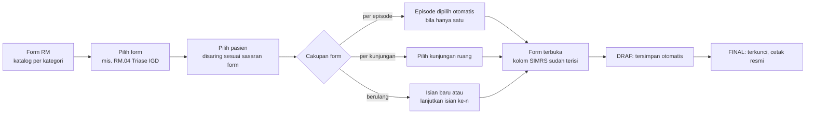
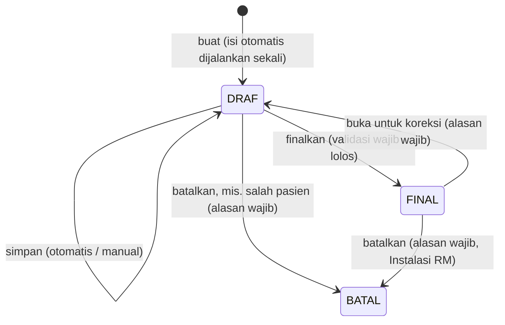

# PRD & Rencana Bertahap — **Form RM Terpadu**

## Katalog formulir rekam medis lintas unit: pilih form → pilih pasien → terisi otomatis dari SIMRS

**Project:** ReportHub (`reporthubrsb`) · Modul **Form RM** (`form-rm`)
**Organisasi:** UPTD RSUD Bolaang Mongondow Timur
**Versi:** 0.3 — K1, K5, K7 diputuskan; K4 ditunda (§15)
**Tanggal:** 6 Oktober 2026 · **Status:** F0 selesai (Langkah 1 fondasi backend + Langkah 2 cutover UI) — lihat §16
**Sifat data SIMGOS:** **FULL READ-ONLY.** Hanya `SELECT` / `information_schema`. Tidak ada DDL/DML, tidak menambah atau mengubah tabel maupun stored procedure apa pun di SIMGOS. Semua isian form, tanda tangan, dan riwayat disimpan di DB aplikasi `reporthub`.

---

## 1. Latar Belakang & Tujuan

Form RM saat ini dibangun untuk admisi IGD. Empat formulir (RM.04 Triase, RM.21 Edukasi, RM.01 Ringkasan Masuk & Keluar, RM.03 General Consent) diisi dari daftar pasien IGD. Ke depan modul ini harus menampung **banyak formulir RM dari semua unit** (rawat jalan, IGD, rawat inap, kamar operasi, kebidanan), tetap rapi dengan pengelompokan per kategori.

Alur yang diminta:

1. **Form RM** → katalog formulir per kategori.
2. **Pilih form** yang akan diisi.
3. **Pilih pasien.** Bila sebagian data pasien sudah ada di SIMRS, form **terisi otomatis**.

Permintaan tambahan: kemungkinan klien desktop berbasis WebView dengan **Tauri** versi terbaru, dan syarat mutlak **aman (diuji celah keamanannya), teroptimasi, best practices, clean code**.

Tujuan terukur:

- Menambah satu formulir baru cukup dengan **satu berkas definisi** (ditambah tata letak cetak bila khusus), tanpa menyalin rute, API, atau halaman.
- **≥ 80 % kolom yang datanya tersedia di SIMRS terisi otomatis** pada form yang memakai sumber tersebut, diukur per form pada data 30 hari.
- Setiap perubahan isian **terlacak** (siapa, kapan, apa). Isian FINAL **tidak bisa diubah diam-diam**, dan manipulasi langsung di DB **terdeteksi**.
- **Nol temuan kritis/tinggi** pada suite uji keamanan (§10.3) sebelum setiap rilis.

---

## 2. Kondisi Sekarang (penelusuran kode, 6 Okt 2026)

| Aspek | Kondisi | Dampak |
| --- | --- | --- |
| Sasaran pasien | Daftar disaring `kategori === "IGD"` (`form-rm.service.ts`); badge "IGD" ditulis tetap; modul RBAC bernama "Form RM (Admisi)" | Unit lain tidak bisa memakai |
| Cara menambah form | ±8 berkas per form (konstanta, tipe, skema, service, API, halaman, view, dokumen cetak, halaman cetak); daftar kartu & kelengkapan ditulis tetap | Tidak terkelola untuk puluhan form |
| Penyimpanan | Tabel `form_rm`, unik `(nopen, jenis)`, isi di kolom JSON `data` | Form berulang (informed consent per tindakan, transfer) tidak bisa disimpan |
| Simpan | `upsert` menimpa tanpa versi | Dua petugas menyunting bersamaan → satu hilang tanpa peringatan |
| Jejak | Modul tidak memanggil `writeAudit`; tidak ada riwayat isi | Tidak memenuhi prinsip keutuhan rekam medis elektronik |
| Status | Tidak ada DRAF/FINAL | Form bisa diubah kapan pun, termasuk setelah dicetak dan ditandatangani |
| Identitas pasien | `norm`, `nama`, `ruang` yang disimpan **dikirim browser** (field `header` di skema simpan) | Bisa dipalsukan; seharusnya ditentukan server |
| Tanda tangan | PNG data-URL **di dalam JSON** isian (consent rata-rata 39 KB, maks 118 KB) | JSON membengkak; riwayat akan menggandakan gambar TTD |
| IP audit (lintas aplikasi) | `clientIp()` memakai X-Forwarded-For **paling kiri** | IP di audit bisa dipalsukan klien |
| Pengujian | Hanya `eslint` dan skrip E2E ad-hoc; tidak ada runner unit test | Logika murni (skor, pemetaan) tidak teruji otomatis |

Yang sudah baik dan dipertahankan:
- isi otomatis SIMRS untuk RM.01, RM.03 (NIK), dan RM.04 — hanya saat form baru, bertanda "SIMRS", tetap bisa disunting;
- `SignaturePad` dan alur TTD via HP;
- cetak 1:1 per kertas (A4/F4);
- penghitungan kelengkapan dengan satu query batch.

Isi `reporthub.form_rm` saat ini: **10 baris** (consent 6, edukasi 2, ringkasan 2, triase 0). Migrasinya kecil.

---

## 3. Temuan SIMGOS (6 Okt 2026, read-only)

### 3.1. Volume (30 hari terakhir)

| Jenis kunjungan | Ruangan aktif | NOPEN 30 hari | Sedang dirawat |
| --- | --- | ---: | ---: |
| Rawat jalan | 12 klinik | 145 | 1 |
| IGD | 4 (Bedah, IRDA, IRDO, Non Bedah) | 232 | 6 |
| Rawat inap | 12 (termasuk ICU, ICCU, NICU, Obgyn) | 192 | 21 |

Ruangan lain: Ruang OK, Laboratorium Sentral, Unit Radiologi, Farmasi. Total pasien 4.914; 4.889 di antaranya punya NIK.

Artinya: daftar di pemilih pasien **kecil** (puluhan per hari). Penyaringan di server dengan paginasi sederhana sudah cukup; beban utama ada pada query isi otomatis per pasien.

### 3.2. Sumber isi otomatis yang tersedia

Tabel `medicalrecord` di bawah berkunci `KUNJUNGAN` dan **terindeks** pada kolom itu. Cakupan = persentase NOPEN 30 hari yang punya minimal satu baris.

| Sumber | Tabel | RJ | IGD | RI | Dipakai untuk |
| --- | --- | ---: | ---: | ---: | --- |
| Keluhan utama | `keluhan_utama` | 37 % | 94 % | 82 % | asesmen awal, triase |
| Tanda vital | `tanda_vital` | 44 % | 92 % | 91 % | triase, asesmen, transfer |
| Edukasi pasien & keluarga (hambatan, bahasa, kebutuhan) | `edukasi_pasien_keluarga` | 25 % | 78 % | 3 % | **RM.21** (belum dipakai) |
| Nyeri | `penilaian_nyeri` | 6 % | 69 % | 3 % | asesmen |
| Risiko jatuh (Morse) | `penilaian_skala_morse` | 5 % | 68 % | 3 % | asesmen keperawatan |
| Alergi | `riwayat_alergi` | 0 % | 56 % | 17 % | asesmen, pra-anestesi, SSC |

Sumber lain yang juga tersedia:
- identitas, alamat, data sosial, dan NIK (`master.pasien`, `referensi`, `kartu_identitas_pasien`);
- episode: masuk/keluar, ruang, DPJP, penjamin (`pendaftaran.*`);
- diagnosa ICD-10 (`diagnosa`, berkunci NOPEN);
- triase (`triage`, berkunci NOPEN, ±97 % IGD);
- anamnesis, status fungsional, kondisi sosial, permasalahan gizi, RPP, rencana terapi, pemeriksaan fisik, Barthel Index.

**Temuan penting:** cakupan asesmen di episode rawat inap rendah (edukasi, nyeri, Morse 3 %), sedangkan di IGD tinggi. Sebagian besar pasien RI masuk lewat IGD dengan NOPEN berbeda yang tertaut lewat SPRI (`perencanaan_rawat_inap`). Datanya tercatat di episode IGD asal. Pustaka isi otomatis untuk form rawat inap karena itu harus bisa **mengambil dari episode IGD asal** bila episode RI kosong.

### 3.3. Formulir yang tabel SIMGOS-nya kosong

SIMGOS menyediakan tabel untuk formulir berikut, tetapi isinya **0 baris** (dihitung `COUNT(*)`). Formulir ini kemungkinan besar masih diisi di kertas, sehingga menjadi kandidat prioritas. Perlu konfirmasi Instalasi RM (keputusan K1).

| Formulir | Tabel SIMGOS (acuan struktur) |
| --- | --- |
| Persetujuan tindakan kedokteran | `persetujuan_tindakan_dokter*` |
| Persetujuan transfusi darah | `persetujuan_pemberian_transfusi_darah` |
| Surgical Safety Checklist (sign in, time out, sign out) | `surgical_safety_checklist_*` |
| Asesmen pra-anestesi/sedasi, persiapan anestesi | `pra_anastesi_sedasi`, `persiapan_anastesi` |
| Lembar transfer pasien antar-ruang | `lembar_transfer_pasien` |
| Riwayat obstetri & ginekologi | `obstetri`, `riwayat_obstetri`, `riwayat_gynekologi` |
| Risiko jatuh anak (Humpty Dumpty) | `penilaian_skala_humpty_dumpty` |

Hampir kosong: rekonsiliasi obat saat transfer (2) dan pulang (5), skrining perencanaan pulang (45), edukasi end of life (6).

Struktur kolom tabel-tabel ini boleh dipakai sebagai acuan isi formulir. **Aplikasi tidak menulis ke tabel tersebut.**

---

## 4. Pengguna & Peran

| Peran | Kebutuhan utama |
| --- | --- |
| Admisi / pendaftaran | General consent, identitas, ringkasan masuk |
| Perawat / bidan | Triase, asesmen keperawatan, edukasi, transfer, Surgical Safety Checklist |
| Dokter (DPJP, anestesi, bedah) | Asesmen medis, informed consent, pra-anestesi |
| Petugas Instalasi RM | Memantau kelengkapan, membuka isian FINAL untuk koreksi, membatalkan isian salah-pasien |
| Admin | Hak akses per kategori |
| Pasien / wali | Bukan pengguna aplikasi; hanya menandatangani (di layar atau via HP) |

---

## 5. Ruang Lingkup

**Termasuk:**
- katalog per kategori;
- alur form lebih dulu dan pasien lebih dulu;
- pemilih pasien per sasaran form;
- pustaka isi otomatis SIMRS;
- siklus DRAF → FINAL → koreksi, dengan riwayat dan rantai hash;
- tanda tangan disimpan terpisah;
- cetak sesuai versi form;
- kelengkapan per episode yang dapat diatur;
- migrasi 4 form lama;
- pengerasan keamanan;
- klien desktop Tauri atau PWA (opsional, §12).

**Tidak termasuk:**
- Menulis ke SIMGOS dalam bentuk apa pun.
- Tanda tangan elektronik tersertifikasi (BSrE/PSrE). TTD gambar dengan jejak audit tetap dipakai; TTE tersertifikasi menjadi fase terpisah bila diwajibkan.
- Form builder di database (pengguna menyusun form sendiri).
- Mode offline.
- Aplikasi mobile Tauri (Android/iOS). Tablet memakai browser.

---

## 6. Alur Pengguna

### 6.1. Alur utama (form lebih dulu)



- **Katalog.** Kartu per kategori; pencarian form berdasarkan kode atau judul. Hanya form yang boleh diakses pengguna yang tampil. Tiap form menunjukkan jumlah draf milik pengguna.
- **Pemilih pasien.** Secara bawaan menampilkan pasien **aktif** yang cocok dengan sasaran form, misalnya:
  - Triase → kunjungan IGD 24 jam terakhir;
  - transfer → pasien rawat inap yang sedang dirawat.

  Untuk pasien di luar daftar itu tersedia pencarian No.RM, nama, atau NIK (minimal 3 karakter). Setiap baris menunjukkan status isian form tersebut: belum ada, DRAF, atau FINAL.
- **Isian yang sudah ada.** Untuk form tidak berulang, memilih pasien yang sudah punya isian **membuka isian itu**, bukan membuat isian ganda.

### 6.2. Alur pasien lebih dulu (dipertahankan)

Daftar pasien → profil episode → semua form yang relevan untuk episode itu, dikelompokkan per kategori beserta statusnya. Kedua alur membuka halaman isian yang sama.

### 6.3. Siklus hidup isian



- **Tidak ada penghapusan permanen.** Pembatalan menyimpan alasan dan tetap terlihat di riwayat.
- **Revisi (snapshot lengkap)** dibuat setiap kali isian difinalkan atau dibatalkan. Perbandingan antar-revisi FINAL memperlihatkan koreksi apa yang dilakukan.
- **Simpan selama DRAF** (otomatis maupun manual) memperbarui draf dan tercatat di audit, tanpa snapshot, supaya riwayat tidak dibanjiri.
- **Cetak:**
  - Cetak resmi hanya untuk isian FINAL. Isian DRAF tercetak dengan tanda air "DRAF".
  - Kaki halaman memuat ID isian, nomor revisi, 8 karakter awal hash, dan waktu cetak.
  - Setiap cetak diaudit.

### 6.4. Aturan isi otomatis

1. **Dijalankan sekali** saat isian dibuat. Nilai disalin ke isian, dan perubahan di SIMRS sesudahnya tidak mengubah isian diam-diam.
2. **Tanda asal kolom.** Kolom hasil SIMRS bertanda **"SIMRS"**. Bila disunting petugas, tanda berubah menjadi "diubah"; asal-usul tiap kolom disimpan di metadata isian.
3. **"Muat ulang dari SIMRS"** tersedia per bagian, hanya saat DRAF. Tombol ini menampilkan **perbandingan** nilai lama dan baru; petugas memilih kolom mana yang diganti.
4. **Episode IGD asal.** Bila sumber kosong di episode ini dan pasien rawat inap berasal dari IGD, pustaka mengambil dari episode IGD asal (tautan SPRI) dan menandai asalnya.
5. **Kegagalan sumber tidak menggagalkan form.** Kolomnya dibiarkan kosong dan bagian itu diberi catatan "data SIMRS tidak tersedia".
6. **Identitas dari server.** Kepala form (No.RM, nama, tanggal lahir, jenis kelamin, ruang) selalu diambil server dari SIMGOS saat isian dibuat, lalu disimpan sebagai snapshot. Klien tidak pernah mengirim identitas.

---

## 7. Katalog & Kategori Formulir

**Keputusan K1 (6 Okt 2026):** katalog awal = **4 formulir yang sudah ada** (RM.04, RM.21, RM.01, RM.03). Formulir lain ditambahkan setelah tersedia. Tabel di bawah adalah usulan pengelompokan jangka panjang, disusun dari formulir yang sudah ada, ruangan aktif, dan tabel SIMGOS (§3.3):

| Kategori | Contoh formulir | Cakupan | Status |
| --- | --- | --- | --- |
| Administrasi & Persetujuan | RM.03 General Consent; persetujuan/penolakan tindakan kedokteran; persetujuan transfusi; pulang atas permintaan sendiri | episode / **berulang** (per tindakan) | RM.03 ada |
| Gawat Darurat | RM.04 Triase IGD; asesmen awal IGD | kunjungan IGD | RM.04 ada |
| Rawat Jalan | asesmen awal rawat jalan | kunjungan klinik | baru |
| Rawat Inap | asesmen awal medis & keperawatan; lembar transfer; perencanaan pulang; rekonsiliasi obat | episode / **berulang** (transfer) | baru |
| Kamar Operasi & Anestesi | Surgical Safety Checklist; asesmen pra-anestesi/sedasi | kunjungan OK / berulang | baru |
| Kebidanan & Neonatus | asesmen obstetri; riwayat kehamilan | episode | baru |
| Edukasi | RM.21 Edukasi Pasien & Keluarga Terintegrasi | episode | RM.21 ada |
| Ringkasan & Pemulangan | RM.01 Ringkasan Masuk & Keluar | episode | RM.01 ada |

Atribut setiap definisi form:

| Atribut | Contoh | Fungsi |
| --- | --- | --- |
| `kode`, `judul`, `kategori` | `RM.04`, Triase IGD, Gawat Darurat | katalog & cetak |
| `versi` | `1` | isian lama tetap dicetak dengan tata letak versinya |
| `cakupan` | `EPISODE` / `KUNJUNGAN` | kunci subjek isian |
| `berulang` | `false` | boleh lebih dari satu isian per subjek |
| `sasaran` | jenis kunjungan 2 (IGD), atau ruangan tertentu | penyaring pemilih pasien |
| `izin` | kunci RBAC kategori | siapa boleh melihat, mengisi, memfinalkan |
| `wajibUntuk` | episode IGD | hitungan kelengkapan |
| `skema` | Zod `.strict()` | validasi simpan & finalkan |
| `isiOtomatis` | daftar sumber + pemetaan kolom | pustaka §8.3 |
| `kertas` | A4 / F4, potret / lanskap | cetak |

---

## 8. Arsitektur Teknis

### 8.1. Registri form

Satu berkas definisi per form di `src/features/form-rm/forms/<kode>/`, didaftarkan di satu registri (pola sama dengan katalog modul RBAC).
- **Bagian murni** (metadata, skema, tata letak) aman dipakai di klien.
- **Bagian server** (pemetaan isi otomatis) berada di `src/server/modules/form-rm/` dan hanya diimpor server.

```ts
// Sketsa — bukan kode final.
type DefinisiForm<T> = {
  kode: string;               // "RM.04"
  versi: number;
  judul: string;
  kategori: KategoriForm;
  cakupan: "EPISODE" | "KUNJUNGAN";
  berulang: boolean;
  sasaran: SasaranPasien;     // jenis kunjungan / ruangan
  wajibUntuk?: SasaranPasien;
  skema: z.ZodType<T>;        // .strict(); tipe isian = z.infer
  kosong: () => T;
  kertas: Kertas;
  tampilan: () => Promise<KomponenForm<T>>;  // dimuat dinamis (code splitting)
  cetak: () => Promise<KomponenCetak<T>>;
};

// Server-only, terpisah dari definisi di atas.
type IsiOtomatisForm<T> = {
  sumber: SumberId[];
  petakan: (hasil: HasilSumber) => Partial<T>;  // murni, diuji unit
};
```

Registri divalidasi oleh unit test:
- kode unik;
- kategori dikenal;
- sumber isi otomatis terdaftar;
- skema bisa mem-parse `kosong()`.

### 8.2. Dua jenis form

- **Khusus.** Tampilan dan cetak ditulis tangan, misalnya matriks triase RM.04 dan teks legal RM.03. Keempat form lama masuk kelompok ini tanpa mengubah tampilannya.
- **Deklaratif.** Definisi bagian dan kolom: teks, angka, tanggal/jam, pilihan tunggal/ganda, centang, skor terhitung (mis. Morse), tabel berulang, dan tanda tangan. Renderer form dan renderer cetak generik membangun UI serta dokumen dari definisi itu. Targetnya, mayoritas form baru cukup deklaratif.

### 8.3. Pustaka isi otomatis (SIMGOS, read-only)

- **Sumber.** Satu sumber = satu fungsi DAL berisi satu query berparameter, berkunci NOPEN/KUNJUNGAN yang terindeks dan dibatasi `MAX_EXECUTION_TIME`. Hasilnya bertipe dan boleh `null`.
- **Sumber awal:** `identitas`, `sosial`, `episode`, `diagnosa`, `tandaVital`, `keluhan`, `alergi`, `nyeri`, `risikoJatuh`, `edukasi`, `triase`, `statusFungsional`, `anamnesis`, `episodeIgdAsal`.
- **Pemakaian oleh form.** Form hanya *menyebut* sumber yang dipakainya. Service mengambil setiap sumber unik sekali, paralel terbatas (maks 4 sekaligus), lewat client SIMGOS singleton yang sudah ada.
- **Penormal bersama.** Penormal nilai referensi SIMGOS ke opsi form (mis. `matchAgama`, `matchPekerjaan`) dipindah ke pustaka bersama.
- **Uji silang.** Setiap pemetaan diuji silang dengan SQL independen pada data nyata (pola Verifikasi Klaim).

### 8.4. Rute & API

| Rute | Fungsi |
| --- | --- |
| `/form-rm` | katalog per kategori |
| `/form-rm/f/[kode]` | pemilih pasien untuk form itu |
| `/form-rm/isian/[id]` | halaman isian (satu URL per isian) |
| `/form-rm/pasien/[nopen]` | alur pasien lebih dulu |
| `/print/form-rm/isian/[id]` | cetak, dengan tata letak sesuai versi isian |

| API | Izin | Keterangan |
| --- | --- | --- |
| `GET /api/form-rm/katalog` | view | form yang boleh diakses + hitungan draf |
| `GET /api/form-rm/f/[kode]/pasien?q=&halaman=` | view kategori | daftar pasien sasaran + status isian |
| `POST /api/form-rm/isian` `{kode, nopen, kunjungan?}` | create kategori | buat-atau-buka; isi otomatis dijalankan di server |
| `GET /api/form-rm/isian/[id]` | view kategori | isian + asal kolom |
| `PATCH /api/form-rm/isian/[id]` `{rev, data}` | update kategori | simpan draf; `rev` usang → 409 |
| `POST /api/form-rm/isian/[id]/aksi` `{aksi, rev, alasan?}` | update kategori / kelola | `FINALKAN`, `BUKA_KOREKSI`, `BATALKAN` |
| `GET /api/form-rm/isian/[id]/riwayat` | view kategori | revisi + hasil pemeriksaan integritas |
| `GET /api/form-rm/ttd/[id]` | view kategori | gambar TTD; `no-store`, `nosniff`, CSP `sandbox` |

**TTD tanpa endpoint unggah terpisah** (diputuskan saat implementasi): klien tetap mengirim TTD baru sebagai PNG data-URL di dalam `data` saat simpan. Server menormalkan PNG, menyimpannya di `form_rm_ttd`, lalu menggantinya dengan referensi `ttd:<id>`. Referensi yang dikirim balik wajib milik isian yang sama; referensi ke isian lain → 422.

- **RBAC.** Satu modul per kategori (`form-rm.<kategori>`) dengan aksi yang sudah ada (`view`, `create`, `update`, `print`). Membuka atau membatalkan isian FINAL memakai modul terpisah `form-rm.kelola` (Instalasi RM). Tipe `ModuleAction` tidak perlu ditambah.
- **Rute lama** (`/form-rm/[nopen]/edukasi`, dst.) dialihkan ke rute baru agar tautan lama tetap jalan.

### 8.5. Model data (DB `reporthub` saja)

DDL ditulis manual seperti modul lain (`prisma db push` tidak dipakai karena drift), lalu `npm run db:app:generate` dan restart server.

```sql
-- Sketsa — bukan DDL final. Panjang kolom NOPEN/KUNJUNGAN mengikuti SIMGOS.
CREATE TABLE form_rm_isian (
  id               CHAR(25)     NOT NULL PRIMARY KEY,   -- cuid
  form_kode        VARCHAR(20)  NOT NULL,
  form_versi       SMALLINT     NOT NULL,
  subjek           VARCHAR(30)  NOT NULL,   -- NOPEN atau nomor KUNJUNGAN sesuai cakupan
  nopen            VARCHAR(20)  NOT NULL,
  kunjungan        VARCHAR(30)  NULL,
  urutan           SMALLINT     NOT NULL DEFAULT 1,     -- isian ke-n (form berulang)
  norm             VARCHAR(20)  NOT NULL,   -- snapshot dari SIMGOS
  nama_pasien      VARCHAR(191) NOT NULL,
  ruang            VARCHAR(191) NULL,
  status           VARCHAR(10)  NOT NULL,   -- DRAF | FINAL | BATAL
  rev              INT          NOT NULL DEFAULT 1,     -- konkurensi optimistis
  data             JSON         NOT NULL,
  asal             JSON         NULL,       -- asal-usul kolom (SIMRS / diubah)
  dibuat_oleh      VARCHAR(191) NULL,
  diubah_oleh      VARCHAR(191) NULL,
  difinalkan_oleh  VARCHAR(191) NULL,
  difinalkan_pada  DATETIME(3)  NULL,
  created_at       DATETIME(3)  NOT NULL DEFAULT CURRENT_TIMESTAMP(3),
  updated_at       DATETIME(3)  NOT NULL DEFAULT CURRENT_TIMESTAMP(3) ON UPDATE CURRENT_TIMESTAMP(3),
  UNIQUE KEY uq_form_rm_isian (form_kode, subjek, urutan),
  KEY ix_form_rm_isian_nopen (nopen),
  KEY ix_form_rm_isian_norm (norm),
  KEY ix_form_rm_isian_kode_status (form_kode, status, updated_at)
);

-- Append-only: tidak pernah di-UPDATE/DELETE oleh aplikasi.
CREATE TABLE form_rm_revisi (
  id            CHAR(25)     NOT NULL PRIMARY KEY,
  isian_id      CHAR(25)     NOT NULL,      -- FK → form_rm_isian
  rev           INT          NOT NULL,
  status        VARCHAR(10)  NOT NULL,
  data          JSON         NOT NULL,
  hash          CHAR(64)     NOT NULL,
  hash_sebelum  CHAR(64)     NULL,
  oleh          VARCHAR(191) NULL,
  alasan        VARCHAR(500) NULL,
  created_at    DATETIME(3)  NOT NULL DEFAULT CURRENT_TIMESTAMP(3)
);

-- Gambar TTD: sekali tulis, tidak pernah diubah.
CREATE TABLE form_rm_ttd (
  id           CHAR(25)     NOT NULL PRIMARY KEY,
  isian_id     CHAR(25)     NOT NULL,       -- FK → form_rm_isian
  peran        VARCHAR(20)  NOT NULL,       -- pasien | wali | petugas | dokter
  nama         VARCHAR(191) NULL,
  png          MEDIUMBLOB   NOT NULL,
  sha256       CHAR(64)     NOT NULL,
  bytes        INT          NOT NULL,
  dibuat_oleh  VARCHAR(191) NULL,
  created_at   DATETIME(3)  NOT NULL DEFAULT CURRENT_TIMESTAMP(3)
);
```

- **Satu kunci unik untuk semua cakupan.** `subjek` berisi NOPEN atau KUNJUNGAN sesuai cakupan form. Form tidak berulang selalu `urutan = 1`, sehingga isian ganda ditolak oleh DB, bukan hanya oleh kode.
- **Rantai hash ber-kunci.** `hash = HMAC-SHA256(kunci, hash_sebelum ‖ JSON kanonik revisi)`, dengan kunci rahasia `FORM_RM_KUNCI_INTEGRITAS` (≥ 32 karakter, wajib di env; tanpa kunci → 503). Isi revisi memuat data, aksi, status, alasan, pelaku, waktu, dan sha256 setiap gambar TTD yang dirujuk. Karena memakai kunci server, orang yang hanya punya akses DB tidak bisa membuat ulang segel. Riwayat isian menghitung ulang rantai ini, sehingga manipulasi langsung di DB terdeteksi.
- **DDL final** ada di `scripts/db/form-rm.sql` (perbedaan dari sketsa: revisi menyimpan `aksi`; TTD menyimpan `slot`, tanpa nama penanda tangan; kolom pelaku `*_oleh_id`; revisi dibuat di **setiap transisi**, termasuk BUKA_KOREKSI).
- **TTD terpisah.** JSON isian hanya menyimpan id TTD. Revisi tidak menggandakan gambar, dan setiap gambar punya sha256 sendiri.
- **Migrasi dari tabel lama:**
  - 10 baris `form_rm` dipindah ke `form_rm_isian`, dengan status awal sesuai K5.
  - TTD yang ada di JSON diekstrak ke `form_rm_ttd`.
  - `form_rm` lama dipertahankan read-only satu rilis, lalu dihapus setelah dicadangkan.
  - Skrip migrasi idempoten dan aman diulang (pelajaran dari migrasi checklist).

### 8.6. Batas lapisan

- **Arah panggilan:** API (validasi Zod + `authorize`) → service (state machine, audit, transaksi) → DAL (SIMGOS read-only / Prisma `reporthub`).
- Tidak ada SQL di service/API, dan tidak ada impor balik.
- Registri murni tidak mengimpor `server-only`.

---

## 9. Kinerja & Optimasi

| Operasi | Target p95 | Cara |
| --- | --- | --- |
| Buka katalog | < 300 ms | registri di memori + 1 query hitungan draf |
| Daftar pasien sasaran | < 500 ms | query rentang terindeks + 1 query batch status isian |
| Buat isian + isi otomatis | < 1,5 s | sumber unik, paralel ≤ 4, query terindeks, `MAX_EXECUTION_TIME` |
| Simpan draf | < 300 ms | satu update bersyarat |
| Cetak | < 2 s | data dari `reporthub`; TTD dengan ETag |

Tambahan:
- **Code splitting.** Komponen form dan cetak dimuat dinamis per kode, sehingga halaman katalog tidak membawa JavaScript puluhan form.
- **Simpan otomatis yang hemat.** Debounce 3 detik setelah berhenti mengetik, hanya bila ada perubahan, dan hanya satu permintaan berjalan sekaligus.
- **Batas ukuran.** JSON isian ≤ 256 KB. TTD ≤ 300 KB dan ≤ 1500 × 600 px setelah diproses.
- **Tanpa cache lintas pengguna untuk data pasien.**
  - Respons API dan halaman yang berisi data pasien memakai `Cache-Control: no-store`.
  - Gambar TTD juga `no-store` (isi rekam medis, PC bersama), dengan ETag sha256.
- **Koneksi SIMGOS.** Tetap memakai client singleton dengan batas koneksi, tanpa pool baru (pelajaran insiden err 1040).
- **Daftar dan kelengkapan.** Satu query batch per halaman, bukan per pasien.

---

## 10. Keamanan

### 10.1. Prinsip

Data yang ditangani adalah rekam medis, yang termasuk **data pribadi spesifik** menurut UU 27/2022 tentang Pelindungan Data Pribadi. Permenkes 24/2022 tentang Rekam Medis juga mewajibkan kerahasiaan, keutuhan, dan ketersediaannya dijaga. Prinsip di [06-security-konvensi.md](./06-security-konvensi.md) berlaku penuh; bagian ini menambahkan kontrol khusus modul.

### 10.2. Ancaman & kontrol

| Ancaman | Kontrol |
| --- | --- |
| Akses isian tanpa hak (IDOR) | Izin dicek per **kategori form** di service untuk setiap baca/tulis isian, TTD, dan riwayat berdasarkan ID; isian dari kategori yang tidak diberikan → 404 seragam |
| Pemalsuan identitas pasien | Identitas diambil server dari SIMGOS; skema simpan tidak menerima field identitas |
| Mass assignment / data liar | Skema Zod `strictObject` di semua tingkat; kunci tak dikenal → 422; `__proto__` dibuang Zod (tak pernah tersimpan, prototype tak tercemar — dikunci unit test); batas panjang setiap kolom |
| XSS tersimpan | Semua teks dirender React (ter-escape); tanpa `dangerouslySetInnerHTML` di form, cetak, maupun riwayat |
| TTD berbahaya | Hanya PNG: tanda tangan berkas, CRC, IHDR & urutan chunk divalidasi; berkas **disusun ulang** hanya dari IHDR/PLTE/tRNS/IDAT/IEND (teks, metadata, data sesudah IEND dibuang); batas dimensi & ukuran; disajikan `image/png` + `nosniff` + CSP `sandbox` |
| Lost update | `rev` + update bersyarat → 409 dengan pesan jelas |
| Mengubah isian FINAL | Update bersyarat `status = 'DRAF'`; transisi eksplisit; rantai hash mendeteksi manipulasi di DB |
| CSRF | Cookie `SameSite=Lax` (sudah) ditambah **cek `Origin` / `Sec-Fetch-Site`** untuk semua metode yang mengubah data |
| Pemalsuan IP audit | `clientIp()` diganti: X-Real-IP dari nginx, lalu X-Forwarded-For paling kanan (pola QR publik) |
| Banjir permintaan | Batas laju simpan per pengguna (mis. 60/menit) dan pencarian pasien; batas ukuran body |
| Kebocoran lewat error / log | `fail()` seragam; log tanpa isi form, nama, atau diagnosa; metadata audit hanya id isian, kode form, NOPEN, status |
| PC bersama di loket/bangsal | `no-store`; token akses 15 menit (sudah); keluar otomatis saat idle (K6) |
| Injeksi SQL ke SIMGOS | Query berparameter; tanpa identifier dinamis; sumber isi otomatis berupa whitelist di registri; user DB hanya SELECT |

### 10.3. Pengujian keamanan (wajib lulus di setiap fase)

Suite otomatis dijalankan pada **build produksi** (`next build && next start`), bukan hanya di dev:

1. **Matriks otorisasi.** Setiap endpoint diuji dengan lima kondisi pengguna: tanpa login, tanpa izin, izin kategori lain, hanya lihat, izin penuh. Hasilnya harus 401/403/404/200 sesuai harapan.
2. **IDOR.** Isian, TTD, dan riwayat milik kategori lain diakses lewat ID → ditolak dengan respons seragam.
3. **Fuzz input.** Kunci tak dikenal, tipe salah, string sangat panjang, nesting dalam, `__proto__`, NUL, unicode, dan payload SQL di pencarian → 422 atau aman, tanpa 500.
4. **XSS.** Payload di setiap jenis kolom teks → tampil ter-escape di form, cetak, riwayat, dan daftar.
5. **TTD.** Non-PNG, polyglot PNG+HTML, SVG, chunk tak dikenal, dimensi raksasa, dan ukuran berlebih → ditolak.
6. **Konkurensi.** Dua simpan paralel dengan `rev` sama → tepat satu 200 dan satu 409. Finalkan dan simpan yang berbarengan juga diuji.
7. **Imutabilitas FINAL.**
   - PATCH ke isian FINAL → 409; transisi ilegal → 409.
   - Rantai hash utuh.
   - Manipulasi baris di DB uji → terdeteksi.
8. **CSRF.** POST/PATCH dengan Origin asing atau tanpa Origin → 403.
9. **Batas laju & ukuran.** Banjir simpan → 429; body berlebih → 413.
10. **Header.** `no-store`, `nosniff`, CSP, dan `X-Frame-Options` hadir di halaman isian, cetak, dan API.
11. **Read-only SIMGOS.** Pemeriksaan statis memastikan DAL modul hanya berisi `SELECT`, ditambah uji bahwa user DB menolak INSERT.
12. **Tanpa PHI di audit & log.** Metadata audit hasil uji dipindai: tidak boleh ada nama, diagnosa, atau isi form.
13. **Dependensi.** `npm audit --omit=dev` tanpa temuan tinggi/kritis.
14. **Tinjauan kode keamanan.** Diff setiap fase ditinjau dengan `/security-review` sebelum diserahkan untuk di-commit.

Uji memakai DB nyata `reporthub` dengan **pembersihan terarah** dan snapshot sebelum/sesudah, serta tidak pernah menyentuh SIMGOS selain SELECT.

---

## 11. Kualitas Kode & Definition of Done

- **Satu sumber kebenaran.** Tipe isian = `z.infer` dari skema; tidak ada tipe ganda.
- **Tanpa duplikasi per form.** Rute, API, simpan, cetak, dan kelengkapan dibuat generik; sebuah form hanya berupa definisi.
- **Fungsi murni dipisah dari I/O.** Pemetaan isi otomatis, skor (Morse, GCS), state machine, dan hash kanonik diuji unit dengan **Vitest** (K7).
- **State machine eksplisit.** Transisi bertipe; error domain memakai kelas yang sudah ada (`BusinessRuleError`, `ConflictError`, `NotFoundError`).
- **Penamaan** Bahasa Indonesia, konsisten dengan kode yang ada. Komentar menjelaskan *mengapa*, bukan *apa*.
- **Aksesibilitas:**
  - label terlihat;
  - navigasi keyboard dan fokus terlihat;
  - target sentuh ≥ 44 px untuk tablet di bangsal;
  - status tidak hanya dibedakan dengan warna.
- **DoD setiap fase** — semua butir berikut wajib terpenuhi:
  - `tsc` dan `eslint` tanpa error;
  - unit test dan E2E fungsional lulus;
  - suite keamanan §10.3 lulus pada build produksi;
  - isi otomatis cocok dengan SQL independen;
  - dokumentasi diperbarui;
  - commit dilakukan oleh pemilik repo.

---

## 12. Klien Desktop (Opsional): Tauri

### 12.1. Status Tauri

Versi terbaru adalah **Tauri 2.12**, rilis 26 September 2026. Perubahan yang relevan:
- dukungan **Windows 7 dihentikan**, karena installer WebView2 terbaru tidak lagi berjalan di Windows 7;
- ada penangan izin webview baru (`on_permission_request`) untuk mengatur izin seperti kamera dan notifikasi secara terprogram.

### 12.2. Arsitektur yang layak

ReportHub bergantung pada server: render di server, API, koneksi SIMGOS, dan secret JWT. Karena itu Tauri hanya dipakai sebagai **jendela aplikasi yang membuka origin produksi ReportHub (HTTPS)**.

- **Server Next.js tidak dibundel ke PC.** Membundelnya akan menyebarkan kredensial SIMGOS ke setiap PC, dan setiap PC membuka koneksi sendiri ke SIMGOS (risiko err 1040 terulang).
- **Aplikasi web tetap satu.** Browser, tablet, dan Tauri memakai server yang sama.

### 12.3. Syarat keamanan bila dibangun

- **Origin dikunci** ke domain produksi; navigasi ke domain lain dibuka di browser sistem.
- **Tanpa IPC untuk konten remote** secara bawaan. Perintah native hanya ditambahkan bila ada kebutuhan nyata, masing-masing dengan capability yang dibatasi ke origin itu.
- **Pengerasan build rilis:**
  - DevTools dimatikan;
  - satu instance saja;
  - pembaruan otomatis bertanda tangan (`tauri-plugin-updater`);
  - installer ditandatangani sertifikat code signing.
- **Kamera** (TTD foto) diizinkan lewat penangan izin Tauri 2.12, hanya untuk origin ReportHub.

### 12.4. Kapan layak

| Kebutuhan | Tanpa Tauri | Dengan Tauri |
| --- | --- | --- |
| Jendela aplikasi sendiri, ikon di taskbar | PWA (butuh HTTPS) | ya |
| Cetak langsung ke printer tertentu tanpa dialog | tidak bisa | bisa, perlu kode Rust untuk API cetak WebView2 |
| Pad tanda tangan USB, pembaca e-KTP, sidik jari | terbatas (WebHID/WebUSB) | bisa lewat SDK native |
| Mode kiosk di loket | sebagian (kebijakan Edge) | ya |
| Kamera saat server masih http LAN | gagal (butuh HTTPS) | tetap gagal tanpa HTTPS |

**Rekomendasi:** pasang HTTPS dulu, dengan PWA sebagai bawaan. Tauri dibangun di Fase F5 hanya bila K3 menyebut kebutuhan perangkat yang nyata.

---

## 13. Rencana Bertahap

| Fase | Isi | Kriteria selesai |
| --- | --- | --- |
| **F0 Langkah 1 — Fondasi backend** ✅ | Registri 4 form; skema strict bersama; DDL `form_rm_isian`/`ttd`/`revisi`; API generik (buat-atau-buka, simpan ber-`rev`, transisi, riwayat + segel HMAC, TTD terpisah, audit); isi otomatis di server; perbaikan `clientIp`; cek Origin/`Sec-Fetch-Site`; batas laju & ukuran; Vitest; suite keamanan. UI lama tetap memakai tabel lama | Suite keamanan & E2E lulus di build produksi; UI lama tetap jalan |
| **F0 Langkah 2 — Cutover** ✅ | Migrasi baris `form_rm` + ekstraksi TTD (status awal DRAF, K5) lewat aplikasi; 4 view memakai API isian (status DRAF/FINAL/BATAL, finalkan, koreksi, batal, riwayat); cetak per isian; rute lama dialihkan; API simpan lama dihapus (`form_rm` hanya dibaca untuk migrasi) | 4 form lama berjalan di rute baru dengan data utuh |
| **F1 — Katalog & pemilih pasien** | Katalog per kategori; pemilih pasien per sasaran; alur pasien lebih dulu; kelengkapan dari `wajibUntuk`; RBAC per kategori | Alur form → pasien → isian berjalan untuk 4 form; hitungan kelengkapan cocok dengan SQL independen |
| **F2 — Pustaka isi otomatis** | Sumber §8.3 + episode IGD asal; tanda asal kolom; "Muat ulang dari SIMRS" dengan perbandingan; RM.21 terisi dari `edukasi_pasien_keluarga` | Pemetaan cocok 100 % dengan SQL independen pada sampel 30 hari; ≥ 80 % kolom yang datanya tersedia terisi |
| **F3 — Mesin form deklaratif** | Renderer form & cetak generik; skor terhitung; tabel berulang; batch pertama form baru (sesuai K1) | Form baru cukup ditambah dengan satu berkas definisi; cetak sesuai kertas |
| **F4 — Perluasan per kategori** | Batch form berikutnya | Setiap batch: E2E dan suite keamanan lulus |
| **F5 — Opsional: PWA / Tauri** | Manifest PWA (HTTPS) atau shell Tauri 2.12 sesuai K3 | Installer bertanda tangan, pembaruan otomatis, uji capability |

---

## 14. Risiko & Mitigasi

| Risiko | Mitigasi |
| --- | --- |
| Daftar form resmi belum ada → katalog salah susun | Putuskan K1 sebelum F1; kategori di registri mudah diubah |
| Tata letak cetak tiap form berbeda → mesin deklaratif tidak cukup | Jalur form khusus tetap tersedia |
| Skema SIMGOS berubah saat pembaruan vendor → sumber isi otomatis rusak | Satu tempat per sumber; kegagalan sumber tidak menggagalkan form; uji silang berkala |
| Data asesmen RI kosong karena tercatat di episode IGD | Sumber `episodeIgdAsal` |
| Petugas menerima isi otomatis tanpa memeriksa | Tanda "SIMRS" jelas; finalkan wajib lolos validasi |
| Migrasi merusak data lama | Tabel lama hanya dibaca; migrasi idempoten (dilewati bila isian sudah ada); diuji dengan baris sintetis + snapshot sebelum/sesudah; data lama nyata dicek read-only (11/11 lolos skema, 7/7 TTD lolos normalisasi) |

---

## 15. Keputusan Terbuka

| # | Pertanyaan | Rekomendasi |
| --- | --- | --- |
| K1 | Daftar Formulir RM resmi RS (nomor, judul, kategori) dan urutan prioritas | ✅ **Diputuskan:** mulai dengan 4 form yang ada; form lain menyusul setelah tersedia |
| K2 | Peran pengisi per kategori, dan siapa yang boleh membuka isian FINAL | Pengisi = peran kategori; membuka FINAL = Instalasi RM (sementara: modul `form-rm.kelola`) |
| K3 | Kebutuhan perangkat untuk Tauri (cetak langsung, pad TTD, e-KTP, kiosk) | Bila tidak ada → PWA |
| K4 | Apakah server produksi sudah HTTPS | ⏸ **Ditunda** (6 Okt 2026): dimitigasi kemudian. Rekomendasi: sertifikat Let's Encrypt via DNS-01 untuk nama host LAN di reverse proxy; wajib sebelum PWA/Tauri/kamera |
| K5 | Status awal 10 isian lama setelah migrasi | ✅ Mengikuti rekomendasi: DRAF (diterapkan di Langkah 2) |
| K6 | Keluar otomatis saat idle di PC bersama | 15 menit |
| K7 | Menambah Vitest sebagai runner unit test | ✅ Mengikuti rekomendasi: Vitest 3 (v5 butuh `@types/node` ≥ 22; proyek masih ^20) |

---

## 16. Status Implementasi

### F0 Langkah 1 — Fondasi backend (6 Okt 2026)

**Yang dibangun:**
- **Registri form:** `src/features/form-rm/registry.ts` (4 definisi: metadata, skema, isian kosong, peta slot TTD, syarat FINAL).
- **Skema strict bersama:** `src/features/form-rm/skema.ts`.
- **Mesin status:** `src/features/form-rm/isian.status.ts`.
- **Layanan isian:** `src/server/modules/form-rm/isian.*`, yaitu service, isi otomatis, segel HMAC, skema API, penjaga HTTP, dan tipe.
- **API:** `src/app/api/form-rm/isian/**` dan `src/app/api/form-rm/ttd/[id]`.
- **Pustaka umum baru:** `src/server/lib/png.ts` dan `src/server/lib/asal-sama.ts`.
- **DDL:** `scripts/db/form-rm.sql` dengan runner `scripts/db/migrate-form-rm.mjs`.
- **Modul RBAC** `form-rm.kelola`.

**Syarat FINAL awal (dapat diubah per form di registri):**
- **RM.04:** kategori triase, waktu triase, nama petugas, dan TTD petugas.
- **RM.21:** minimal satu edukasi aktif; tiap entri aktif berisi edukator, tanggal/jam, dan TTD sasaran.
- **RM.01:** nama dan TTD dokter yang merawat; bila ada sebab kematian, juga I.a serta nama dan TTD dokter pemberi keterangan.
- **RM.03:** nama dan TTD pasien/penanggung jawab, nama dan TTD petugas, serta tanggal.

**Hasil uji:**
- **Unit test:** 78/78 (Vitest).
- **E2E + keamanan API isian:** 83/83 di dev dan 83/83 di build produksi. Cakupannya mengikuti §10.3:
  - matriks izin, IDOR TTD, dan fuzz strict;
  - XSS tersimpan, serta TTD polyglot, SVG, JPEG, dan CRC rusak;
  - konkurensi buat, simpan, dan finalkan;
  - imutabilitas FINAL, serta manipulasi data, revisi, hash, dan gambar TTD langsung di DB yang semuanya terdeteksi;
  - CSRF, batas laju, dan batas ukuran;
  - header respons;
  - audit tanpa PHI dan IP audit yang tidak bisa dipalsukan;
  - isi otomatis yang dicek silang dengan SQL independen.
- **Data lama:** tabel `form_rm` identik sebelum dan sesudah uji. Kesepuluh rekaman lama lolos skema strict setelah dibersihkan dari kunci usang, dan halaman lama (daftar, detail, form, cetak) lulus 31/31.

**Temuan keamanan di luar modul:** Next.js 16.2.10 memiliki advisory **kritis**, yaitu bypass proxy/middleware (GHSA-6gpp-xcg3-4w24) dan RCE pada Image Optimization (GHSA-2xp9-vwfh-vxw4). Aplikasi ini memakai keduanya.
- **Penanganan:** upgrade ke **Next 16.3.8**. Regresi QR publik lulus 74/74 (API, produksi) dan 23/23 (UI, tanpa pelanggaran CSP).
- **Sisa advisory high:** rantai CLI Prisma, `mariadb` 3.4 di dalam adapter Prisma, exceljs/brace-expansion, dan postcss saat build. Semuanya tidak terjangkau dari input pengguna saat runtime; ditindaklanjuti terpisah.

### F0 Langkah 2 — Cutover UI (6 Okt 2026)

**Rute:**
- `/form-rm/isian/[id]` — halaman isian (satu URL per isian; pembukaan diaudit). Tampilan dipilih di server sesuai kode form.
- `/print/form-rm/isian/[id]` — cetak per isian (izin `form-rm` print, diaudit). Kertas dari registri; tanda air **DRAF** / **DIBATALKAN** untuk isian non-FINAL; kaki halaman (margin `@page`) memuat ID isian, status + rev, 8 karakter segel revisi terakhir, dan waktu cetak WITA. TTD disisipkan server sebagai data-URL.
- `/form-rm/[nopen]` — profil pasien: status tiap form (Belum ada / Draf / Final). Tombol **Isi Form** = POST buat-atau-buka (isian hanya dibuat oleh aksi eksplisit, tidak pernah oleh GET).
- **Rute lama** `/form-rm/<nopen>/<jenis>` dan `/print/form-rm/<jenis>/<nopen>` dialihkan (307) ke isian aktif; tanpa isian → profil pasien / pesan "belum diisi". `loading.tsx` profil dipindah ke route group `(profil)` agar pengalihan & 404 rute lama berupa status HTTP asli (bukan meta-tag hasil streaming).
- API simpan lama `/api/form-rm/<jenis>/<nopen>` beserta servis/amplopnya **dihapus**.

**UI bersama** (`src/features/form-rm/isian/`):
- `useIsian` — state form, simpan ber-`rev` (Ctrl+S), transisi, penanda perubahan + peringatan `beforeunload`, penggantian TTD data-URL → referensi server tanpa menimpa suntingan yang terjadi selama menyimpan (`petaTtd.ts`, murni & diuji).
- `IsianFrame` — pemberitahuan status (FINAL terkunci, BATAL + "Buat isian baru", baca-saja, konflik rev + "Muat ulang"), bilah aksi (Riwayat, Cetak, Batalkan, Simpan, Finalkan, Buka koreksi — sesuai izin), dialog finalisasi (syarat FINAL dicek di klien, diulang di server) dan dialog alasan (≥ 5 karakter), panel riwayat + hasil pemeriksaan segel.
- **Kunci kolom:** `<BidangIsian>` = `<fieldset disabled>` saat FINAL/BATAL/tanpa izin ubah; kontrol tetap terbaca penuh. Tab kategori triase sengaja di luar kunci (tetap bisa dipilih saat FINAL). `setForm` juga menolak perubahan saat terkunci (pengaman kedua). SignaturePad menampilkan gambar saja saat terkunci.
- Daftar pasien: chip status per form (Final ✓ / Draf ✎ / belum); **Lengkap = semua form FINAL** (`kelengkapan.ts`, murni & diuji).

**Migrasi data lama (K5 → DRAF), lewat aplikasi** — bukan skrip `.mjs`, agar memakai kode yang sama dengan simpan biasa (skema strict, normalisasi PNG, pemisahan TTD):
- `pindahkanBarisLama`: kunci usang dibuang, TTD diekstrak ke `form_rm_ttd`, identitas dari SIMGOS (cadangan: kolom lama), `created_at`/`updated_at` lama dipertahankan, username lama → id pengguna, audit `form-rm.isian.pindah-lama`. Dilewati bila form itu sudah punya isian (status apa pun) → aman diulang.
- **Otomatis saat dibuka:** buat-atau-buka yang belum pernah punya isian memakai data lama (bukan isi otomatis) → data lama tak pernah tertutup isian baru. Data lama tak sah → 409 yang jelas, isian tidak dibuat.
- **Sekaligus:** banner di `/form-rm` khusus pengelola RM (`form-rm.kelola`) + `POST /api/form-rm/data-lama` (CSRF + laju). Jumlah tertunda dihitung dari baris lama tanpa isian.
- Tabel `form_rm` hanya dibaca. Hapus setelah semua dipindah + dicadangkan (satu rilis kemudian).

**Perbaikan race buat-isian:** urutan isian baru kini diambil dari snapshot **awal** (sebelum isi otomatis yang lambat), sehingga permintaan bersamaan pasti bentrok di kunci unik; sebelumnya ada celah dua isian aktif untuk form tidak berulang bila satu permintaan selesai di tengah isi otomatis permintaan lain.

**Hasil uji (dev & build produksi):**
- **Unit test:** 88/88 (baru: pemetaan TTD pasca-simpan, kelengkapan, `srcTtd`).
- **E2E Langkah 1 (regresi):** 83/83 — skrip kini mengecualikan NOPEN yang punya data lama/isian nyata; API lama terverifikasi 404.
- **E2E Langkah 2:** 56/56 — halaman & izin, rute lama (307/404, GET tanpa efek), cetak (tanda air, segel, TTD tersisip, XSS ter-escape, audit, izin print), migrasi baris **sintetis** (kunci usang, TTD, identitas, waktu lama, idempoten, 6 paralel → 1 migrasi, data tak sah → 409, batal tidak memicu migrasi ulang), pindah massal (403 tanpa kelola / CSRF; sukses **tidak** diuji karena akan memindahkan data nyata), race (8 & 6 paralel → satu isian aktif), log tanpa 500/PHI, data lama nyata identik.
- **UI (Chrome headless):** 29/29 — Isi Form → sunting → Ctrl+S → syarat FINAL → TTD gambar → finalkan → terkunci → riwayat segel utuh → buka koreksi (alasan) → konflik rev → `beforeunload` → batal → buat isian baru; triase FINAL di tablet; cetak; tanpa error JS.
- **Regresi QR publik (produksi):** 74/74.

## 17. Sumber

- Kode: `src/server/modules/form-rm/*`, `src/features/form-rm/*` (termasuk `isian/`), `src/app/(dashboard)/form-rm/*`, `src/app/print/form-rm/*`, `src/app/api/form-rm/*`, `prisma/app/schema.prisma` (model `FormRm*`), `src/server/lib/request.ts`.
- Penelusuran read-only SIMGOS dan `reporthub`, 6 Oktober 2026.
- [Announcing Tauri 2.12](https://v2.tauri.app/blog/tauri-2.12/) · [Tauri releases](https://v2.tauri.app/release/tauri/)
