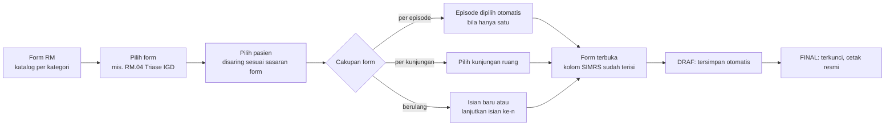
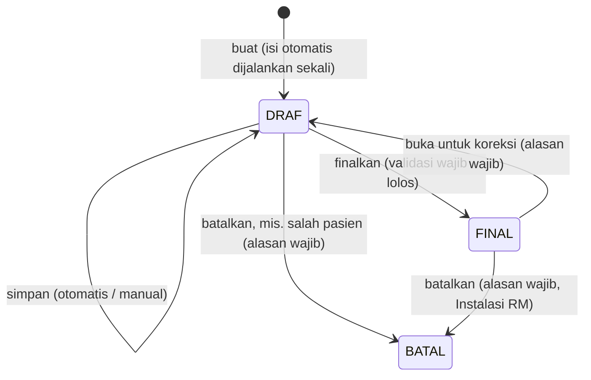
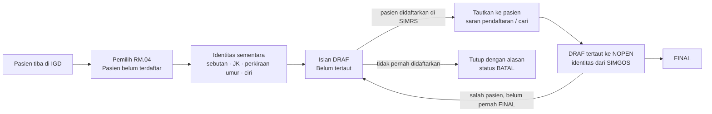

# PRD & Rencana Bertahap — **Form RM Terpadu**

## Katalog formulir rekam medis lintas unit: pilih form → pilih pasien → terisi otomatis dari SIMRS

**Project:** ReportHub (`reporthubrsb`) · Modul **Form RM** (`form-rm`)
**Organisasi:** UPTD RSUD Bolaang Mongondow Timur
**Versi:** 0.8 — K1, K3, K5, K6, K7 diputuskan; K4 ditunda; K8–K10 terbuka (§15)
**Tanggal:** 12 Oktober 2026 · **Status:** F0–F3 selesai (pilot Morse menunggu templat resmi RS, K10); F4 berjalan per formulir resmi yang dikirim RS (1:1) — RM.22 Persetujuan/Penolakan Tindakan (§16 F4.1), RM.33 Persetujuan/Penundaan-Penolakan Rujukan (§16 F4.2), RM.41 Pulang Atas Permintaan Sendiri (§16 F4.3) & RM.50 Monitoring Transfusi Darah (§16 F4.4) selesai; F5 selesai — PWA, simpan otomatis, keluar otomatis saat idle, pengerasan sesi; F5b selesai — aplikasi desktop Tauri (WebView2); F6 selesai — Triase IGD sebelum pasien terdaftar ("Belum tertaut", lalu ditautkan ke NOPEN) — lihat §6.5 & §16
**Sifat data SIMGOS:** **FULL READ-ONLY.** Hanya `SELECT` / `information_schema`. Tidak ada DDL/DML, tidak menambah atau mengubah tabel maupun stored procedure apa pun di SIMGOS. Semua isian form, tanda tangan, dan riwayat disimpan di DB aplikasi `reporthub`.

---

## 1. Latar Belakang & Tujuan

Form RM saat ini dibangun untuk admisi IGD. Empat formulir (RM.04 Triase, RM.21 Edukasi, RM.01 Ringkasan Masuk & Keluar, RM.03 General Consent) diisi dari daftar pasien IGD. Ke depan modul ini harus menampung **banyak formulir RM dari semua unit** (rawat jalan, IGD, rawat inap, kamar operasi, kebidanan), tetap rapi dengan pengelompokan per kategori.

Alur yang diminta:

1. **Form RM** → katalog formulir per kategori.
2. **Pilih form** yang akan diisi.
3. **Pilih pasien.** Bila sebagian data pasien sudah ada di SIMRS, form **terisi otomatis**.

Permintaan tambahan: kemungkinan klien desktop berbasis WebView dengan **Tauri** versi terbaru, dan syarat mutlak **aman (diuji celah keamanannya), teroptimasi, best practices, clean code**.

Tujuan terukur:

- Menambah satu formulir baru cukup dengan **satu berkas definisi** (ditambah tata letak cetak bila khusus), tanpa menyalin rute, API, atau halaman.
- **≥ 80 % kolom yang datanya tersedia di SIMRS terisi otomatis** pada form yang memakai sumber tersebut, diukur per form pada data 30 hari.
- Setiap perubahan isian **terlacak** (siapa, kapan, apa). Isian FINAL **tidak bisa diubah diam-diam**, dan manipulasi langsung di DB **terdeteksi**.
- **Nol temuan kritis/tinggi** pada suite uji keamanan (§10.3) sebelum setiap rilis.

---

## 2. Kondisi Sekarang (penelusuran kode, 6 Okt 2026)

| Aspek                      | Kondisi                                                                                                                                          | Dampak                                                                      |
| -------------------------- | ------------------------------------------------------------------------------------------------------------------------------------------------ | --------------------------------------------------------------------------- |
| Sasaran pasien             | Daftar disaring `kategori === "IGD"` (`form-rm.service.ts`); badge "IGD" ditulis tetap; modul RBAC bernama "Form RM (Admisi)"                    | Unit lain tidak bisa memakai                                                |
| Cara menambah form         | ±8 berkas per form (konstanta, tipe, skema, service, API, halaman, view, dokumen cetak, halaman cetak); daftar kartu & kelengkapan ditulis tetap | Tidak terkelola untuk puluhan form                                          |
| Penyimpanan                | Tabel `form_rm`, unik `(nopen, jenis)`, isi di kolom JSON `data`                                                                                 | Form berulang (informed consent per tindakan, transfer) tidak bisa disimpan |
| Simpan                     | `upsert` menimpa tanpa versi                                                                                                                     | Dua petugas menyunting bersamaan → satu hilang tanpa peringatan             |
| Jejak                      | Modul tidak memanggil `writeAudit`; tidak ada riwayat isi                                                                                        | Tidak memenuhi prinsip keutuhan rekam medis elektronik                      |
| Status                     | Tidak ada DRAF/FINAL                                                                                                                             | Form bisa diubah kapan pun, termasuk setelah dicetak dan ditandatangani     |
| Identitas pasien           | `norm`, `nama`, `ruang` yang disimpan **dikirim browser** (field `header` di skema simpan)                                                       | Bisa dipalsukan; seharusnya ditentukan server                               |
| Tanda tangan               | PNG data-URL **di dalam JSON** isian (consent rata-rata 39 KB, maks 118 KB)                                                                      | JSON membengkak; riwayat akan menggandakan gambar TTD                       |
| IP audit (lintas aplikasi) | `clientIp()` memakai X-Forwarded-For **paling kiri**                                                                                             | IP di audit bisa dipalsukan klien                                           |
| Pengujian                  | Hanya `eslint` dan skrip E2E ad-hoc; tidak ada runner unit test                                                                                  | Logika murni (skor, pemetaan) tidak teruji otomatis                         |

Yang sudah baik dan dipertahankan:

- isi otomatis SIMRS untuk RM.01, RM.03 (NIK), dan RM.04 — hanya saat form baru, bertanda "SIMRS", tetap bisa disunting;
- `SignaturePad` dan alur TTD via HP;
- cetak 1:1 per kertas (A4/F4);
- penghitungan kelengkapan dengan satu query batch.

Isi `reporthub.form_rm` saat ini: **10 baris** (consent 6, edukasi 2, ringkasan 2, triase 0). Migrasinya kecil.

---

## 3. Temuan SIMGOS (6 Okt 2026, read-only)

### 3.1. Volume (30 hari terakhir)

| Jenis kunjungan | Ruangan aktif                        | NOPEN 30 hari | Sedang dirawat |
| --------------- | ------------------------------------ | ------------: | -------------: |
| Rawat jalan     | 12 klinik                            |           145 |              1 |
| IGD             | 4 (Bedah, IRDA, IRDO, Non Bedah)     |           232 |              6 |
| Rawat inap      | 12 (termasuk ICU, ICCU, NICU, Obgyn) |           192 |             21 |

Ruangan lain: Ruang OK, Laboratorium Sentral, Unit Radiologi, Farmasi. Total pasien 4.914; 4.889 di antaranya punya NIK.

Artinya: daftar di pemilih pasien **kecil** (puluhan per hari). Penyaringan di server dengan paginasi sederhana sudah cukup; beban utama ada pada query isi otomatis per pasien.

### 3.2. Sumber isi otomatis yang tersedia

Tabel `medicalrecord` di bawah berkunci `KUNJUNGAN` dan **terindeks** pada kolom itu. Cakupan = persentase NOPEN 30 hari yang punya minimal satu baris.

| Sumber                                                  | Tabel                     |   RJ |  IGD |   RI | Dipakai untuk              |
| ------------------------------------------------------- | ------------------------- | ---: | ---: | ---: | -------------------------- |
| Keluhan utama                                           | `keluhan_utama`           | 37 % | 94 % | 82 % | asesmen awal, triase       |
| Tanda vital                                             | `tanda_vital`             | 44 % | 92 % | 91 % | triase, asesmen, transfer  |
| Edukasi pasien & keluarga (hambatan, bahasa, kebutuhan) | `edukasi_pasien_keluarga` | 25 % | 78 % |  3 % | **RM.21** (belum dipakai)  |
| Nyeri                                                   | `penilaian_nyeri`         |  6 % | 69 % |  3 % | asesmen                    |
| Risiko jatuh (Morse)                                    | `penilaian_skala_morse`   |  5 % | 68 % |  3 % | asesmen keperawatan        |
| Alergi                                                  | `riwayat_alergi`          |  0 % | 56 % | 17 % | asesmen, pra-anestesi, SSC |

Sumber lain yang juga tersedia:

- identitas, alamat, data sosial, dan NIK (`master.pasien`, `referensi`, `kartu_identitas_pasien`);
- episode: masuk/keluar, ruang, DPJP, penjamin (`pendaftaran.*`);
- diagnosa ICD-10 (`diagnosa`, berkunci NOPEN);
- triase (`triage`, berkunci NOPEN, ±97 % IGD);
- anamnesis, status fungsional, kondisi sosial, permasalahan gizi, RPP, rencana terapi, pemeriksaan fisik, Barthel Index.

**Temuan penting:** cakupan asesmen di episode rawat inap rendah (edukasi, nyeri, Morse 3 %), sedangkan di IGD tinggi. Sebagian besar pasien RI masuk lewat IGD dengan NOPEN berbeda yang tertaut lewat SPRI (`perencanaan_rawat_inap`). Datanya tercatat di episode IGD asal. Pustaka isi otomatis untuk form rawat inap karena itu harus bisa **mengambil dari episode IGD asal** bila episode RI kosong.

### 3.3. Formulir yang tabel SIMGOS-nya kosong

SIMGOS menyediakan tabel untuk formulir berikut, tetapi isinya **0 baris** (dihitung `COUNT(*)`). Formulir ini kemungkinan besar masih diisi di kertas, sehingga menjadi kandidat prioritas. Perlu konfirmasi Instalasi RM (keputusan K1).

| Formulir                                                | Tabel SIMGOS (acuan struktur)                        |
| ------------------------------------------------------- | ---------------------------------------------------- |
| Persetujuan tindakan kedokteran                         | `persetujuan_tindakan_dokter*`                       |
| Persetujuan transfusi darah                             | `persetujuan_pemberian_transfusi_darah`              |
| Surgical Safety Checklist (sign in, time out, sign out) | `surgical_safety_checklist_*`                        |
| Asesmen pra-anestesi/sedasi, persiapan anestesi         | `pra_anastesi_sedasi`, `persiapan_anastesi`          |
| Lembar transfer pasien antar-ruang                      | `lembar_transfer_pasien`                             |
| Riwayat obstetri & ginekologi                           | `obstetri`, `riwayat_obstetri`, `riwayat_gynekologi` |
| Risiko jatuh anak (Humpty Dumpty)                       | `penilaian_skala_humpty_dumpty`                      |

Hampir kosong: rekonsiliasi obat saat transfer (2) dan pulang (5), skrining perencanaan pulang (45), edukasi end of life (6).

Struktur kolom tabel-tabel ini boleh dipakai sebagai acuan isi formulir. **Aplikasi tidak menulis ke tabel tersebut.**

---

## 4. Pengguna & Peran

| Peran                          | Kebutuhan utama                                                                         |
| ------------------------------ | --------------------------------------------------------------------------------------- |
| Admisi / pendaftaran           | General consent, identitas, ringkasan masuk                                             |
| Perawat / bidan                | Triase, asesmen keperawatan, edukasi, transfer, Surgical Safety Checklist               |
| Dokter (DPJP, anestesi, bedah) | Asesmen medis, informed consent, pra-anestesi                                           |
| Petugas Instalasi RM           | Memantau kelengkapan, membuka isian FINAL untuk koreksi, membatalkan isian salah-pasien |
| Admin                          | Hak akses per kategori                                                                  |
| Pasien / wali                  | Bukan pengguna aplikasi; hanya menandatangani (di layar atau via HP)                    |

---

## 5. Ruang Lingkup

**Termasuk:**

- katalog per kategori;
- alur form lebih dulu dan pasien lebih dulu;
- pemilih pasien per sasaran form;
- pustaka isi otomatis SIMRS;
- siklus DRAF → FINAL → koreksi, dengan riwayat dan rantai hash;
- tanda tangan disimpan terpisah;
- cetak sesuai versi form;
- kelengkapan per episode yang dapat diatur;
- migrasi 4 form lama;
- pengerasan keamanan;
- klien desktop Tauri atau PWA (opsional, §12).

**Tidak termasuk:**

- Menulis ke SIMGOS dalam bentuk apa pun.
- Tanda tangan elektronik tersertifikasi (BSrE/PSrE). TTD gambar dengan jejak audit tetap dipakai; TTE tersertifikasi menjadi fase terpisah bila diwajibkan.
- Form builder di database (pengguna menyusun form sendiri).
- Mode offline.
- Aplikasi mobile Tauri (Android/iOS). Tablet memakai browser.

---

## 6. Alur Pengguna

### 6.1. Alur utama (form lebih dulu)



- **Katalog.** Kartu per kategori; pencarian form berdasarkan kode atau judul. Hanya form yang boleh diakses pengguna yang tampil. Tiap form menunjukkan jumlah draf milik pengguna.
- **Pemilih pasien.** Secara bawaan menampilkan pasien **aktif** yang cocok dengan sasaran form, misalnya:
  - Triase → kunjungan IGD 24 jam terakhir;
  - transfer → pasien rawat inap yang sedang dirawat.

  Untuk pasien di luar daftar itu tersedia pencarian No.RM, nama, atau NIK (minimal 3 karakter). Setiap baris menunjukkan status isian form tersebut: belum ada, DRAF, atau FINAL.

- **Isian yang sudah ada.** Untuk form tidak berulang, memilih pasien yang sudah punya isian **membuka isian itu**, bukan membuat isian ganda.

### 6.2. Alur pasien lebih dulu (dipertahankan)

Daftar pasien → profil episode → semua form yang relevan untuk episode itu, dikelompokkan per kategori beserta statusnya. Kartu form berwarna menurut status: kuning = draf belum final, hijau = final, putih = belum diisi (lihat §16 "Profil pasien"). Kedua alur membuka halaman isian yang sama.

### 6.3. Siklus hidup isian



- **Tidak ada penghapusan permanen.** Pembatalan menyimpan alasan dan tetap terlihat di riwayat.
- **Revisi (snapshot lengkap)** dibuat setiap kali isian difinalkan atau dibatalkan. Perbandingan antar-revisi FINAL memperlihatkan koreksi apa yang dilakukan.
- **Simpan selama DRAF** (otomatis maupun manual) memperbarui draf dan tercatat di audit, tanpa snapshot, supaya riwayat tidak dibanjiri.
- **Cetak:**
  - Cetak resmi hanya untuk isian FINAL. Isian DRAF tercetak dengan tanda air "DRAF".
  - Kaki halaman memuat ID isian, nomor revisi, 8 karakter awal hash, dan waktu cetak.
  - Setiap cetak diaudit.

### 6.4. Aturan isi otomatis

1. **Dijalankan sekali** saat isian dibuat. Nilai disalin ke isian, dan perubahan di SIMRS sesudahnya tidak mengubah isian diam-diam.
2. **Tanda asal kolom.** Kolom hasil SIMRS bertanda **"SIMRS"**. Bila disunting petugas, tanda berubah menjadi "diubah"; asal-usul tiap kolom disimpan di metadata isian.
3. **"Muat ulang dari SIMRS"** tersedia per bagian, hanya saat DRAF. Tombol ini menampilkan **perbandingan** nilai lama dan baru; petugas memilih kolom mana yang diganti.
4. **Episode IGD asal.** Bila sumber kosong di episode ini dan pasien rawat inap berasal dari IGD, pustaka mengambil dari episode IGD asal (tautan SPRI) dan menandai asalnya.
5. **Kegagalan sumber tidak menggagalkan form.** Kolomnya dibiarkan kosong dan bagian itu diberi catatan "data SIMRS tidak tersedia".
6. **Identitas dari server.** Kepala form (No.RM, nama, tanggal lahir, jenis kelamin, ruang) selalu diambil server dari SIMGOS saat isian dibuat, lalu disimpan sebagai snapshot. Klien tidak pernah mengirim identitas.

### 6.5. Isian sebelum pasien terdaftar (Triase IGD)

Pasien gawat darurat ditriase lebih dulu, sebelum didaftarkan di SIMRS. Form yang mengizinkannya (registri: `tanpaPendaftaran`, saat ini hanya **RM.04 Triase IGD**) bisa diisi tanpa NOPEN, lalu **ditautkan** ke pendaftaran setelah pasien terdaftar.



- **Identitas sementara** (nama/sebutan wajib, jenis kelamin, perkiraan umur, ciri/keterangan kedatangan) hanya untuk mengenali pasien. Isinya tidak menambah kolom formulir RM.04, dan tetap disimpan sebagai jejak setelah ditautkan.
- **Belum tertaut:** isi form diisi manual (tanpa isi otomatis SIMRS), TTD petugas boleh, cetak bertanda air DRAF dengan No. RM kosong. **FINAL menunggu tautan**, karena dokumen RM final wajib beridentitas pasien.
- **Tautkan:** saran = pendaftaran IGD yang masuk antara 2 jam sebelum s.d. 48 jam sesudah waktu kedatangan/triase di form (atau waktu isian dibuat), yang belum punya isian RM.04 lebih dulu, lalu yang waktunya terdekat; atau cari No. RM/NIK/NOPEN/nama. Petugas memilih dan mengonfirmasi. Identitas isian diganti snapshot SIMGOS; isi form tidak berubah. Pendaftaran yang sudah punya isian RM.04 aktif ditolak (salah satunya dibatalkan dulu). Data SIMRS bisa diterapkan sesudahnya lewat "Muat ulang dari SIMRS".
- **Lepas tautan** (salah pasien) hanya untuk draf yang belum pernah difinalkan dan belum memakai data SIMRS pasien itu; selain itu: batalkan lalu buat isian baru.
- **Tutup tanpa pendaftaran:** pasien pulang, menolak, dirujuk, atau meninggal sebelum terdaftar, atau isian ganda → dibatalkan dengan alasan (pilihan baku atau bebas); tetap tersimpan di riwayat. Isian yang belum tertaut **≥ 6 jam** diberi tanda peringatan di daftar.

---

## 7. Katalog & Kategori Formulir

**Keputusan K1 (6 Okt 2026):** katalog awal = **4 formulir yang sudah ada** (RM.04, RM.21, RM.01, RM.03). Formulir lain ditambahkan setelah tersedia. Tabel di bawah adalah usulan pengelompokan jangka panjang, disusun dari formulir yang sudah ada, ruangan aktif, dan tabel SIMGOS (§3.3):

| Kategori                   | Contoh formulir                                                                                                         | Cakupan                               | Status    |
| -------------------------- | ----------------------------------------------------------------------------------------------------------------------- | ------------------------------------- | --------- |
| Administrasi & Persetujuan | RM.03 General Consent; persetujuan/penolakan tindakan kedokteran; persetujuan transfusi; pulang atas permintaan sendiri | episode / **berulang** (per tindakan) | RM.03 ada |
| Gawat Darurat              | RM.04 Triase IGD; asesmen awal IGD                                                                                      | kunjungan IGD                         | RM.04 ada |
| Asesmen Keperawatan        | Pengkajian risiko jatuh dewasa (Morse); risiko jatuh anak (Humpty Dumpty); asesmen nyeri                                | episode (pengkajian ulang dalam tabel) | Morse pilot (F3) |
| Rawat Jalan                | asesmen awal rawat jalan                                                                                                | kunjungan klinik                      | baru      |
| Rawat Inap                 | asesmen awal medis & keperawatan; lembar transfer; perencanaan pulang; rekonsiliasi obat                                | episode / **berulang** (transfer)     | baru      |
| Kamar Operasi & Anestesi   | Surgical Safety Checklist; asesmen pra-anestesi/sedasi                                                                  | kunjungan OK / berulang               | baru      |
| Kebidanan & Neonatus       | asesmen obstetri; riwayat kehamilan                                                                                     | episode                               | baru      |
| Edukasi                    | RM.21 Edukasi Pasien & Keluarga Terintegrasi                                                                            | episode                               | RM.21 ada |
| Ringkasan & Pemulangan     | RM.01 Ringkasan Masuk & Keluar                                                                                          | episode                               | RM.01 ada |

Atribut setiap definisi form:

| Atribut                     | Contoh                                         | Fungsi                                              |
| --------------------------- | ---------------------------------------------- | --------------------------------------------------- |
| `kode`, `judul`, `kategori` | `RM.04`, Triase IGD, Gawat Darurat             | katalog & cetak                                     |
| `versi`                     | `1`                                            | isian lama tetap dicetak dengan tata letak versinya |
| `cakupan`                   | `EPISODE` / `KUNJUNGAN`                        | kunci subjek isian                                  |
| `berulang`                  | `false`                                        | boleh lebih dari satu isian per subjek              |
| `sasaran`                   | jenis kunjungan 2 (IGD), atau ruangan tertentu | penyaring pemilih pasien                            |
| `izin`                      | kunci RBAC kategori                            | siapa boleh melihat, mengisi, memfinalkan           |
| `wajibUntuk`                | episode IGD (daftar jenis kunjungan)           | hitungan kelengkapan                                |
| `skema`                     | Zod `.strict()`                                | validasi simpan & finalkan                          |
| `isiOtomatis`               | daftar sumber + pemetaan kolom                 | pustaka §8.3                                        |
| `kertas`                    | A4 / F4, potret / lanskap                      | cetak                                               |

---

## 8. Arsitektur Teknis

### 8.1. Registri form

Satu berkas definisi per form di `src/features/form-rm/forms/<kode>/`, didaftarkan di satu registri (pola sama dengan katalog modul RBAC).

- **Bagian murni** (metadata, skema, tata letak) aman dipakai di klien.
- **Bagian server** (pemetaan isi otomatis) berada di `src/server/modules/form-rm/` dan hanya diimpor server.

```ts
// Sketsa — bukan kode final.
type DefinisiForm<T> = {
  kode: string; // "RM.04"
  versi: number;
  judul: string;
  kategori: KategoriForm;
  cakupan: "EPISODE" | "KUNJUNGAN";
  berulang: boolean;
  sasaran: SasaranPasien; // jenis kunjungan / ruangan
  wajibUntuk?: SasaranPasien;
  skema: z.ZodType<T>; // .strict(); tipe isian = z.infer
  kosong: () => T;
  kertas: Kertas;
  tampilan: () => Promise<KomponenForm<T>>; // dimuat dinamis (code splitting)
  cetak: () => Promise<KomponenCetak<T>>;
};

// Server-only, terpisah dari definisi di atas.
type IsiOtomatisForm<T> = {
  sumber: SumberId[];
  petakan: (hasil: HasilSumber) => Partial<T>; // murni, diuji unit
};
```

Registri divalidasi oleh unit test:

- kode unik;
- kategori dikenal;
- sumber isi otomatis terdaftar;
- skema bisa mem-parse `kosong()`.

### 8.2. Dua jenis form

- **Khusus.** Tampilan dan cetak ditulis tangan, misalnya matriks triase RM.04 dan teks legal RM.03. Keempat form lama masuk kelompok ini tanpa mengubah tampilannya.
- **Deklaratif.** Definisi bagian dan kolom: teks, angka, tanggal/jam, pilihan tunggal/ganda, centang, skor terhitung (mis. Morse), tabel berulang, dan tanda tangan. Renderer form dan renderer cetak generik membangun UI serta dokumen dari definisi itu. Targetnya, mayoritas form baru cukup deklaratif.

### 8.3. Pustaka isi otomatis (SIMGOS, read-only)

- **Sumber.** Satu sumber = satu fungsi DAL berisi satu query berparameter, berkunci NOPEN/KUNJUNGAN yang terindeks dan dibatasi `MAX_EXECUTION_TIME`. Hasilnya bertipe dan boleh `null`.
- **Sumber awal:** `identitas`, `sosial`, `episode`, `diagnosa`, `tandaVital`, `keluhan`, `alergi`, `nyeri`, `risikoJatuh`, `edukasi`, `triase`, `statusFungsional`, `anamnesis`, `episodeIgdAsal`. Ditambah `rujukan` (rujukan keluar, RM.33 — F4.2) dan `alergi` (`medicalrecord.riwayat_alergi` seluruh kunjungan episode, cadangan episode IGD asal — RM.50, F4.4); sumber `pulang` kini juga memuat waktu pulang & petugas pencatat (RM.41 — F4.3).
- **Pemakaian oleh form.** Form hanya _menyebut_ sumber yang dipakainya. Service mengambil setiap sumber unik sekali, paralel terbatas (maks 4 sekaligus), lewat client SIMGOS singleton yang sudah ada.
- **Penormal bersama.** Penormal nilai referensi SIMGOS ke opsi form (mis. `matchAgama`, `matchPekerjaan`) dipindah ke pustaka bersama.
- **Uji silang.** Setiap pemetaan diuji silang dengan SQL independen pada data nyata (pola Verifikasi Klaim).

### 8.4. Rute & API

| Rute                                          | Fungsi                                           |
| --------------------------------------------- | ------------------------------------------------ |
| `/form-rm`                                    | katalog per kategori                             |
| `/form-rm/f/[kode]`                           | pemilih pasien untuk form itu                    |
| `/form-rm/isian/[id]`                         | halaman isian (satu URL per isian)               |
| `/form-rm/pasien` · `/form-rm/pasien/[nopen]` | alur pasien lebih dulu (daftar · profil episode) |
| `/print/form-rm/isian/[id]`                   | cetak, dengan tata letak sesuai versi isian      |

| API                                                        | Izin                     | Keterangan                                        |
| ---------------------------------------------------------- | ------------------------ | ------------------------------------------------- |
| `GET /api/form-rm/katalog`                                 | view                     | form yang boleh diakses + hitungan draf           |
| `GET /api/form-rm/f/[kode]/pasien?q=&halaman=`             | view kategori            | daftar pasien sasaran + status isian              |
| `POST /api/form-rm/isian` `{kode, nopen, kunjungan?}`      | create kategori          | buat-atau-buka; isi otomatis dijalankan di server |
| `GET /api/form-rm/isian/[id]`                              | view kategori            | isian + asal kolom                                |
| `PATCH /api/form-rm/isian/[id]` `{rev, data}`              | update kategori          | simpan draf; `rev` usang → 409                    |
| `POST /api/form-rm/isian/[id]/aksi` `{aksi, rev, alasan?}` | update kategori / kelola | `FINALKAN`, `BUKA_KOREKSI`, `BATALKAN`            |
| `GET /api/form-rm/isian/[id]/riwayat`                      | view kategori            | revisi + hasil pemeriksaan integritas             |
| `GET /api/form-rm/ttd/[id]`                                | view kategori            | gambar TTD; `no-store`, `nosniff`, CSP `sandbox`  |

**TTD tanpa endpoint unggah terpisah** (diputuskan saat implementasi): klien tetap mengirim TTD baru sebagai PNG data-URL di dalam `data` saat simpan. Server menormalkan PNG, menyimpannya di `form_rm_ttd`, lalu menggantinya dengan referensi `ttd:<id>`. Referensi yang dikirim balik wajib milik isian yang sama; referensi ke isian lain → 422.

- **RBAC.** Satu modul per kategori (`form-rm.<kategori>`) dengan aksi yang sudah ada (`view`, `create`, `update`, `print`). Membuka atau membatalkan isian FINAL memakai modul terpisah `form-rm.kelola` (Instalasi RM). Tipe `ModuleAction` tidak perlu ditambah.
  - _Diputuskan saat implementasi F1:_ modul lama `form-rm` dipertahankan sebagai **"Semua Kategori"** agar grant yang sudah ada di produksi tidak hilang (tanpa migrasi data peran). `view` adalah dasar: aksi lain pada sebuah kategori hanya berlaku bila `view` kategori itu juga dimiliki.
  - _Katalog dirender server_ (registri di memori + satu kelompok query hitungan draf), sehingga `GET /api/form-rm/katalog` tidak dibuat.
- **Rute lama** (`/form-rm/[nopen]/edukasi`, dst.) dialihkan ke rute baru agar tautan lama tetap jalan.

### 8.5. Model data (DB `reporthub` saja)

DDL ditulis manual seperti modul lain (`prisma db push` tidak dipakai karena drift), lalu `npm run db:app:generate` dan restart server.

```sql
-- Sketsa — bukan DDL final. Panjang kolom NOPEN/KUNJUNGAN mengikuti SIMGOS.
CREATE TABLE form_rm_isian (
  id               CHAR(25)     NOT NULL PRIMARY KEY,   -- cuid
  form_kode        VARCHAR(20)  NOT NULL,
  form_versi       SMALLINT     NOT NULL,
  subjek           VARCHAR(30)  NOT NULL,   -- NOPEN atau nomor KUNJUNGAN sesuai cakupan
  nopen            VARCHAR(20)  NOT NULL,
  kunjungan        VARCHAR(30)  NULL,
  urutan           SMALLINT     NOT NULL DEFAULT 1,     -- isian ke-n (form berulang)
  norm             VARCHAR(20)  NOT NULL,   -- snapshot dari SIMGOS
  nama_pasien      VARCHAR(191) NOT NULL,
  ruang            VARCHAR(191) NULL,
  status           VARCHAR(10)  NOT NULL,   -- DRAF | FINAL | BATAL
  rev              INT          NOT NULL DEFAULT 1,     -- konkurensi optimistis
  data             JSON         NOT NULL,
  asal             JSON         NULL,       -- asal-usul kolom (SIMRS / diubah)
  dibuat_oleh      VARCHAR(191) NULL,
  diubah_oleh      VARCHAR(191) NULL,
  difinalkan_oleh  VARCHAR(191) NULL,
  difinalkan_pada  DATETIME(3)  NULL,
  created_at       DATETIME(3)  NOT NULL DEFAULT CURRENT_TIMESTAMP(3),
  updated_at       DATETIME(3)  NOT NULL DEFAULT CURRENT_TIMESTAMP(3) ON UPDATE CURRENT_TIMESTAMP(3),
  UNIQUE KEY uq_form_rm_isian (form_kode, subjek, urutan),
  KEY ix_form_rm_isian_nopen (nopen),
  KEY ix_form_rm_isian_norm (norm),
  KEY ix_form_rm_isian_kode_status (form_kode, status, updated_at)
);

-- Append-only: tidak pernah di-UPDATE/DELETE oleh aplikasi.
CREATE TABLE form_rm_revisi (
  id            CHAR(25)     NOT NULL PRIMARY KEY,
  isian_id      CHAR(25)     NOT NULL,      -- FK → form_rm_isian
  rev           INT          NOT NULL,
  status        VARCHAR(10)  NOT NULL,
  data          JSON         NOT NULL,
  hash          CHAR(64)     NOT NULL,
  hash_sebelum  CHAR(64)     NULL,
  oleh          VARCHAR(191) NULL,
  alasan        VARCHAR(500) NULL,
  created_at    DATETIME(3)  NOT NULL DEFAULT CURRENT_TIMESTAMP(3)
);

-- Gambar TTD: sekali tulis, tidak pernah diubah.
CREATE TABLE form_rm_ttd (
  id           CHAR(25)     NOT NULL PRIMARY KEY,
  isian_id     CHAR(25)     NOT NULL,       -- FK → form_rm_isian
  peran        VARCHAR(20)  NOT NULL,       -- pasien | wali | petugas | dokter
  nama         VARCHAR(191) NULL,
  png          MEDIUMBLOB   NOT NULL,
  sha256       CHAR(64)     NOT NULL,
  bytes        INT          NOT NULL,
  dibuat_oleh  VARCHAR(191) NULL,
  created_at   DATETIME(3)  NOT NULL DEFAULT CURRENT_TIMESTAMP(3)
);
```

- **Satu kunci unik untuk semua cakupan.** `subjek` berisi NOPEN atau KUNJUNGAN sesuai cakupan form. Form tidak berulang selalu `urutan = 1`, sehingga isian ganda ditolak oleh DB, bukan hanya oleh kode.
- **Rantai hash ber-kunci.** `hash = HMAC-SHA256(kunci, hash_sebelum ‖ JSON kanonik revisi)`, dengan kunci rahasia `FORM_RM_KUNCI_INTEGRITAS` (≥ 32 karakter, wajib di env; tanpa kunci → 503). Isi revisi memuat data, aksi, status, alasan, pelaku, waktu, dan sha256 setiap gambar TTD yang dirujuk. Karena memakai kunci server, orang yang hanya punya akses DB tidak bisa membuat ulang segel. Riwayat isian menghitung ulang rantai ini, sehingga manipulasi langsung di DB terdeteksi.
- **DDL final** ada di `scripts/db/form-rm.sql` (perbedaan dari sketsa: revisi menyimpan `aksi`; TTD menyimpan `slot`, tanpa nama penanda tangan; kolom pelaku `*_oleh_id`; revisi dibuat di **setiap transisi**, termasuk BUKA_KOREKSI).
- **TTD terpisah.** JSON isian hanya menyimpan id TTD. Revisi tidak menggandakan gambar, dan setiap gambar punya sha256 sendiri.
- **Isian sebelum pasien terdaftar (F6, §6.5):** tabel `form_rm_identitas_sementara` (satu baris per isian: sebutan, jenis kelamin, perkiraan umur, ciri, jejak penautan). Selama belum tertaut, isian memakai `subjek = "~<16 karakter acak>"`, `nopen`/`norm` kosong. Tautan mengganti subjek ke NOPEN, sehingga kunci unik tetap menjamin satu isian aktif per NOPEN. Karena FINAL menunggu tautan dan tautan hanya untuk isian tanpa revisi, subjek tak pernah berubah setelah ada revisi bersegel.
- **Migrasi dari tabel lama:**
  - 10 baris `form_rm` dipindah ke `form_rm_isian`, dengan status awal sesuai K5.
  - TTD yang ada di JSON diekstrak ke `form_rm_ttd`.
  - `form_rm` lama dipertahankan read-only satu rilis, lalu dihapus setelah dicadangkan.
  - Skrip migrasi idempoten dan aman diulang (pelajaran dari migrasi checklist).

### 8.6. Batas lapisan

- **Arah panggilan:** API (validasi Zod + `authorize`) → service (state machine, audit, transaksi) → DAL (SIMGOS read-only / Prisma `reporthub`).
- Tidak ada SQL di service/API, dan tidak ada impor balik.
- Registri murni tidak mengimpor `server-only`.

---

## 9. Kinerja & Optimasi

| Operasi                   | Target p95 | Cara                                                            |
| ------------------------- | ---------- | --------------------------------------------------------------- |
| Buka katalog              | < 300 ms   | registri di memori + 1 query hitungan draf                      |
| Daftar pasien sasaran     | < 500 ms   | query rentang terindeks + 1 query batch status isian            |
| Buat isian + isi otomatis | < 1,5 s    | sumber unik, paralel ≤ 4, query terindeks, `MAX_EXECUTION_TIME` |
| Simpan draf               | < 300 ms   | satu update bersyarat                                           |
| Cetak                     | < 2 s      | data dari `reporthub`; TTD dengan ETag                          |

Tambahan:

- **Code splitting.** Komponen form dan cetak dimuat dinamis per kode, sehingga halaman katalog tidak membawa JavaScript puluhan form.
- **Simpan otomatis yang hemat.** Debounce 3 detik setelah berhenti mengetik, hanya bila ada perubahan, dan hanya satu permintaan berjalan sekaligus.
- **Batas ukuran.** JSON isian ≤ 256 KB. TTD ≤ 300 KB dan ≤ 1500 × 600 px setelah diproses.
- **Tanpa cache lintas pengguna untuk data pasien.**
  - Respons API dan halaman yang berisi data pasien memakai `Cache-Control: no-store`.
  - Gambar TTD juga `no-store` (isi rekam medis, PC bersama), dengan ETag sha256.
- **Koneksi SIMGOS.** Tetap memakai client singleton dengan batas koneksi, tanpa pool baru (pelajaran insiden err 1040).
- **Daftar dan kelengkapan.** Satu query batch per halaman, bukan per pasien.

---

## 10. Keamanan

### 10.1. Prinsip

Data yang ditangani adalah rekam medis, yang termasuk **data pribadi spesifik** menurut UU 27/2022 tentang Pelindungan Data Pribadi. Permenkes 24/2022 tentang Rekam Medis juga mewajibkan kerahasiaan, keutuhan, dan ketersediaannya dijaga. Prinsip di [06-security-konvensi.md](./06-security-konvensi.md) berlaku penuh; bagian ini menambahkan kontrol khusus modul.

### 10.2. Ancaman & kontrol

| Ancaman                      | Kontrol                                                                                                                                                                                                                                                  |
| ---------------------------- | -------------------------------------------------------------------------------------------------------------------------------------------------------------------------------------------------------------------------------------------------------- |
| Akses isian tanpa hak (IDOR) | Izin dicek per **kategori form** di service untuk setiap baca/tulis isian, TTD, dan riwayat berdasarkan ID; isian dari kategori yang tidak diberikan → 404 seragam                                                                                       |
| Pemalsuan identitas pasien   | Identitas diambil server dari SIMGOS; skema simpan tidak menerima field identitas                                                                                                                                                                        |
| Mass assignment / data liar  | Skema Zod `strictObject` di semua tingkat; kunci tak dikenal → 422; `__proto__` dibuang Zod (tak pernah tersimpan, prototype tak tercemar — dikunci unit test); batas panjang setiap kolom                                                               |
| XSS tersimpan                | Semua teks dirender React (ter-escape); tanpa `dangerouslySetInnerHTML` di form, cetak, maupun riwayat                                                                                                                                                   |
| TTD berbahaya                | Hanya PNG: tanda tangan berkas, CRC, IHDR & urutan chunk divalidasi; berkas **disusun ulang** hanya dari IHDR/PLTE/tRNS/IDAT/IEND (teks, metadata, data sesudah IEND dibuang); batas dimensi & ukuran; disajikan `image/png` + `nosniff` + CSP `sandbox` |
| Lost update                  | `rev` + update bersyarat → 409 dengan pesan jelas                                                                                                                                                                                                        |
| Mengubah isian FINAL         | Update bersyarat `status = 'DRAF'`; transisi eksplisit; rantai hash mendeteksi manipulasi di DB                                                                                                                                                          |
| CSRF                         | Cookie `SameSite=Lax` (sudah) ditambah **cek `Origin` / `Sec-Fetch-Site`** untuk semua metode yang mengubah data                                                                                                                                         |
| Pemalsuan IP audit           | `clientIp()` diganti: X-Real-IP dari nginx, lalu X-Forwarded-For paling kanan (pola QR publik)                                                                                                                                                           |
| Banjir permintaan            | Batas laju simpan per pengguna (mis. 60/menit) dan pencarian pasien; batas ukuran body                                                                                                                                                                   |
| Kebocoran lewat error / log  | `fail()` seragam; log tanpa isi form, nama, atau diagnosa; metadata audit hanya id isian, kode form, NOPEN, status                                                                                                                                       |
| PC bersama di loket/bangsal  | `no-store`; token akses 15 menit; keluar otomatis saat idle (K6, F5) dua lapis — klien (semua tab, peringatan 1 menit, draf disimpan dulu) dan server (refresh token tanpa permintaan > masa access + batas idle ditolak); service worker tanpa cache        |
| Open redirect                | `callbackUrl` login & refresh hanya path internal (`jalurInternal`): backslash & karakter kontrol ditolak, hasil parse wajib tetap di origin sendiri (F5)                                                                                                  |
| Sesi habis saat menulis      | Proxy memulihkan sesi untuk semua metode (307 → refresh → 307, metode & body diulang); API tanpa sesi → 401 JSON, tak pernah halaman login (F5)                                                                                                           |
| Injeksi SQL ke SIMGOS        | Query berparameter; tanpa identifier dinamis; sumber isi otomatis berupa whitelist di registri; user DB hanya SELECT                                                                                                                                     |

### 10.3. Pengujian keamanan (wajib lulus di setiap fase)

Suite otomatis dijalankan pada **build produksi** (`next build && next start`), bukan hanya di dev:

1. **Matriks otorisasi.** Setiap endpoint diuji dengan lima kondisi pengguna: tanpa login, tanpa izin, izin kategori lain, hanya lihat, izin penuh. Hasilnya harus 401/403/404/200 sesuai harapan.
2. **IDOR.** Isian, TTD, dan riwayat milik kategori lain diakses lewat ID → ditolak dengan respons seragam.
3. **Fuzz input.** Kunci tak dikenal, tipe salah, string sangat panjang, nesting dalam, `__proto__`, NUL, unicode, dan payload SQL di pencarian → 422 atau aman, tanpa 500.
4. **XSS.** Payload di setiap jenis kolom teks → tampil ter-escape di form, cetak, riwayat, dan daftar.
5. **TTD.** Non-PNG, polyglot PNG+HTML, SVG, chunk tak dikenal, dimensi raksasa, dan ukuran berlebih → ditolak.
6. **Konkurensi.** Dua simpan paralel dengan `rev` sama → tepat satu 200 dan satu 409. Finalkan dan simpan yang berbarengan juga diuji.
7. **Imutabilitas FINAL.**
   - PATCH ke isian FINAL → 409; transisi ilegal → 409.
   - Rantai hash utuh.
   - Manipulasi baris di DB uji → terdeteksi.
8. **CSRF.** POST/PATCH dengan Origin asing atau tanpa Origin → 403.
9. **Batas laju & ukuran.** Banjir simpan → 429; body berlebih → 413.
10. **Header.** `no-store`, `nosniff`, CSP, dan `X-Frame-Options` hadir di halaman isian, cetak, dan API.
11. **Read-only SIMGOS.** Pemeriksaan statis memastikan DAL modul hanya berisi `SELECT`, ditambah uji bahwa user DB menolak INSERT.
12. **Tanpa PHI di audit & log.** Metadata audit hasil uji dipindai: tidak boleh ada nama, diagnosa, atau isi form.
13. **Dependensi.** `npm audit --omit=dev` tanpa temuan tinggi/kritis.
14. **Tinjauan kode keamanan.** Diff setiap fase ditinjau dengan `/security-review` sebelum diserahkan untuk di-commit.

Uji memakai DB nyata `reporthub` dengan **pembersihan terarah** dan snapshot sebelum/sesudah, serta tidak pernah menyentuh SIMGOS selain SELECT.

---

## 11. Kualitas Kode & Definition of Done

- **Satu sumber kebenaran.** Tipe isian = `z.infer` dari skema; tidak ada tipe ganda.
- **Tanpa duplikasi per form.** Rute, API, simpan, cetak, dan kelengkapan dibuat generik; sebuah form hanya berupa definisi.
- **Fungsi murni dipisah dari I/O.** Pemetaan isi otomatis, skor (Morse, GCS), state machine, dan hash kanonik diuji unit dengan **Vitest** (K7).
- **State machine eksplisit.** Transisi bertipe; error domain memakai kelas yang sudah ada (`BusinessRuleError`, `ConflictError`, `NotFoundError`).
- **Penamaan** Bahasa Indonesia, konsisten dengan kode yang ada. Komentar menjelaskan _mengapa_, bukan _apa_.
- **Aksesibilitas:**
  - label terlihat;
  - navigasi keyboard dan fokus terlihat;
  - target sentuh ≥ 44 px untuk tablet di bangsal;
  - status tidak hanya dibedakan dengan warna.
- **DoD setiap fase** — semua butir berikut wajib terpenuhi:
  - `tsc` dan `eslint` tanpa error;
  - unit test dan E2E fungsional lulus;
  - suite keamanan §10.3 lulus pada build produksi;
  - isi otomatis cocok dengan SQL independen;
  - dokumentasi diperbarui;
  - commit dilakukan oleh pemilik repo.

---

## 12. Klien Desktop (Opsional): Tauri

### 12.1. Status Tauri

Versi terbaru adalah **Tauri 2.12**, rilis 26 September 2026. Perubahan yang relevan:

- dukungan **Windows 7 dihentikan**, karena installer WebView2 terbaru tidak lagi berjalan di Windows 7;
- ada penangan izin webview baru (`on_permission_request`) untuk mengatur izin seperti kamera dan notifikasi secara terprogram.

### 12.2. Arsitektur yang layak

ReportHub bergantung pada server: render di server, API, koneksi SIMGOS, dan secret JWT. Karena itu Tauri hanya dipakai sebagai **jendela aplikasi yang membuka origin produksi ReportHub (HTTPS)**.

- **Server Next.js tidak dibundel ke PC.** Membundelnya akan menyebarkan kredensial SIMGOS ke setiap PC, dan setiap PC membuka koneksi sendiri ke SIMGOS (risiko err 1040 terulang).
- **Aplikasi web tetap satu.** Browser, tablet, dan Tauri memakai server yang sama.

### 12.3. Syarat keamanan bila dibangun

- **Origin dikunci** ke domain produksi; navigasi ke domain lain dibuka di browser sistem.
- **Tanpa IPC untuk konten remote** secara bawaan. Perintah native hanya ditambahkan bila ada kebutuhan nyata, masing-masing dengan capability yang dibatasi ke origin itu.
- **Pengerasan build rilis:**
  - DevTools dimatikan;
  - satu instance saja;
  - pembaruan otomatis bertanda tangan (`tauri-plugin-updater`);
  - installer ditandatangani sertifikat code signing.
- **Kamera** (TTD foto) diizinkan lewat penangan izin Tauri 2.12, hanya untuk origin ReportHub.

### 12.4. Kapan layak

| Kebutuhan                                       | Tanpa Tauri               | Dengan Tauri                                   |
| ----------------------------------------------- | ------------------------- | ---------------------------------------------- |
| Jendela aplikasi sendiri, ikon di taskbar       | PWA (butuh HTTPS)         | ya                                             |
| Cetak langsung ke printer tertentu tanpa dialog | tidak bisa                | bisa, perlu kode Rust untuk API cetak WebView2 |
| Pad tanda tangan USB, pembaca e-KTP, sidik jari | terbatas (WebHID/WebUSB)  | bisa lewat SDK native                          |
| Mode kiosk di loket                             | sebagian (kebijakan Edge) | ya                                             |
| Kamera saat server masih http LAN               | gagal (butuh HTTPS)       | bisa: origin ReportHub diperlakukan sebagai konteks aman (risiko diterima, lihat F5b) |

**Rekomendasi:** pasang HTTPS dulu, dengan PWA sebagai bawaan. Tauri dibangun di Fase F5 hanya bila K3 menyebut kebutuhan perangkat yang nyata.

_Diputuskan 8 Okt 2026:_ pemilik meminta jendela desktop Tauri sekarang (F5b, §16) — hanya jendela WebView2 ke server; perintah native (cetak langsung, pad TTD, e-KTP, kiosk) tetap menunggu kebutuhan nyata.

---

## 13. Rencana Bertahap

| Fase                                  | Isi                                                                                                                                                                                                                                                                                                                                      | Kriteria selesai                                                                                          |
| ------------------------------------- | ---------------------------------------------------------------------------------------------------------------------------------------------------------------------------------------------------------------------------------------------------------------------------------------------------------------------------------------- | --------------------------------------------------------------------------------------------------------- |
| **F0 Langkah 1 — Fondasi backend** ✅ | Registri 4 form; skema strict bersama; DDL `form_rm_isian`/`ttd`/`revisi`; API generik (buat-atau-buka, simpan ber-`rev`, transisi, riwayat + segel HMAC, TTD terpisah, audit); isi otomatis di server; perbaikan `clientIp`; cek Origin/`Sec-Fetch-Site`; batas laju & ukuran; Vitest; suite keamanan. UI lama tetap memakai tabel lama | Suite keamanan & E2E lulus di build produksi; UI lama tetap jalan                                         |
| **F0 Langkah 2 — Cutover** ✅         | Migrasi baris `form_rm` + ekstraksi TTD (status awal DRAF, K5) lewat aplikasi; 4 view memakai API isian (status DRAF/FINAL/BATAL, finalkan, koreksi, batal, riwayat); cetak per isian; rute lama dialihkan; API simpan lama dihapus (`form_rm` hanya dibaca untuk migrasi)                                                               | 4 form lama berjalan di rute baru dengan data utuh                                                        |
| **F1 — Katalog & pemilih pasien** ✅  | Katalog per kategori; pemilih pasien per sasaran; alur pasien lebih dulu; kelengkapan dari `wajibUntuk`; RBAC per kategori                                                                                                                                                                                                               | Alur form → pasien → isian berjalan untuk 4 form; hitungan kelengkapan cocok dengan SQL independen        |
| **F2 — Pustaka isi otomatis** ✅      | Sumber §8.3 + episode IGD asal; tanda asal kolom; "Muat ulang dari SIMRS" dengan perbandingan; RM.21 terisi dari `edukasi_pasien_keluarga`                                                                                                                                                                                               | Pemetaan cocok 100 % dengan SQL independen pada sampel 30 hari; ≥ 80 % kolom yang datanya tersedia terisi |
| **F3 — Mesin form deklaratif** ✅     | Renderer form & cetak generik; skor terhitung; tabel berulang; batch pertama form baru (sesuai K1)                                                                                                                                                                                                                                       | Form baru cukup ditambah dengan satu berkas definisi; cetak sesuai kertas                                 |
| **F4 — Perluasan per kategori** 🔄     | Per formulir RM resmi yang dikirim RS, 1:1 dengan kertasnya (keputusan 7 Okt 2026) — RM.22 Persetujuan/Penolakan Tindakan ✅ 9 Okt; RM.33 Persetujuan/Penundaan-Penolakan Rujukan ✅ 9 Okt; RM.41 Pulang APS ✅ 9 Okt; RM.50 Monitoring Transfusi ✅ 12 Okt                                                                                                                                                       | Setiap batch: E2E dan suite keamanan lulus                                                                |
| **F5 — PWA + penyelesaian non-form** ✅ | Manifest PWA + service worker tanpa cache (K3 → PWA); simpan otomatis draf (§6.3/§9); keluar otomatis saat idle (K6); pengerasan sesi                                                                                                                                                                                                  | Suite F5 + regresi F0–F3 & QR publik lulus di build produksi                                              |
| **F5b — Aplikasi desktop Tauri** ✅    | Jendela WebView2 Tauri 2.12 ke satu origin server (§12.3): origin dikunci, tanpa IPC, izin minimal, satu instance, pembaruan bertanda tangan dari server ReportHub; installer NSIS per pengguna; panduan `docs/desktop-tauri.md`                                                                                                           | Uji unit Rust, uji jendela rilis via CDP, uji pembaruan (sah/rusak/versi palsu) & pasang→perbarui→copot  |
| **F6 — Triase sebelum pasien terdaftar** ✅ | Isian RM.04 dengan identitas sementara ("Belum tertaut"); tautkan ke NOPEN (saran + cari); FINAL menunggu tautan; lepas tautan (salah pasien); tutup tanpa pendaftaran beralasan; penanda di katalog & pemilih (§6.5)                                                                                                                    | E2E & UI di build produksi + regresi F0–F5 lulus; saran pendaftaran cocok dengan SQL independen            |

---

## 14. Risiko & Mitigasi

| Risiko                                                                 | Mitigasi                                                                                                                                                                                                           |
| ---------------------------------------------------------------------- | ------------------------------------------------------------------------------------------------------------------------------------------------------------------------------------------------------------------ |
| Daftar form resmi belum ada → katalog salah susun                      | Putuskan K1 sebelum F1; kategori di registri mudah diubah                                                                                                                                                          |
| Tata letak cetak tiap form berbeda → mesin deklaratif tidak cukup      | Jalur form khusus tetap tersedia                                                                                                                                                                                   |
| Skema SIMGOS berubah saat pembaruan vendor → sumber isi otomatis rusak | Satu tempat per sumber; kegagalan sumber tidak menggagalkan form; uji silang berkala                                                                                                                               |
| Data asesmen RI kosong karena tercatat di episode IGD                  | Sumber `episodeIgdAsal`                                                                                                                                                                                            |
| Petugas menerima isi otomatis tanpa memeriksa                          | Tanda "SIMRS" jelas; finalkan wajib lolos validasi                                                                                                                                                                 |
| Migrasi merusak data lama                                              | Tabel lama hanya dibaca; migrasi idempoten (dilewati bila isian sudah ada); diuji dengan baris sintetis + snapshot sebelum/sesudah; data lama nyata dicek read-only (11/11 lolos skema, 7/7 TTD lolos normalisasi) |

---

## 15. Keputusan Terbuka

| #   | Pertanyaan                                                                                                                                                                                                                                | Rekomendasi                                                                                                                                                                              |
| --- | ----------------------------------------------------------------------------------------------------------------------------------------------------------------------------------------------------------------------------------------- | ---------------------------------------------------------------------------------------------------------------------------------------------------------------------------------------- |
| K1  | Daftar Formulir RM resmi RS (nomor, judul, kategori) dan urutan prioritas                                                                                                                                                                 | ✅ **Diputuskan:** mulai dengan 4 form yang ada; form lain menyusul setelah tersedia                                                                                                     |
| K2  | Peran pengisi per kategori, dan siapa yang boleh membuka isian FINAL                                                                                                                                                                      | Pengisi = peran kategori; membuka FINAL = Instalasi RM (sementara: modul `form-rm.kelola`)                                                                                               |
| K3  | Kebutuhan perangkat untuk Tauri (cetak langsung, pad TTD, e-KTP, kiosk)                                                                                                                                                                   | ✅ **PWA** dibangun di F5 (7 Okt 2026); atas permintaan pemilik, **jendela desktop Tauri** dibangun di F5b (8 Okt 2026). Perintah native (cetak langsung, pad TTD, e-KTP, kiosk) tetap menunggu kebutuhan nyata |
| K4  | Apakah server produksi sudah HTTPS                                                                                                                                                                                                        | ⏸ **Ditunda** (6 Okt 2026): dimitigasi kemudian. Rekomendasi: sertifikat Let's Encrypt via DNS-01 untuk nama host LAN di reverse proxy. PWA (F5) sudah siap, tetapi pemasangan penuh & halaman "Tidak terhubung" baru aktif di HTTPS; kamera juga butuh HTTPS |
| K5  | Status awal 10 isian lama setelah migrasi                                                                                                                                                                                                 | ✅ Mengikuti rekomendasi: DRAF (diterapkan di Langkah 2)                                                                                                                                 |
| K6  | Keluar otomatis saat idle di PC bersama                                                                                                                                                                                                   | ✅ Mengikuti rekomendasi: **15 menit**, untuk seluruh aplikasi; dapat diubah lewat env `SESI_IDLE_MENIT` (5–480; `0` = nonaktif, mis. layar monitor di dinding)                             |
| K7  | Menambah Vitest sebagai runner unit test                                                                                                                                                                                                  | ✅ Mengikuti rekomendasi: Vitest 3 (v5 butuh `@types/node` ≥ 22; proyek masih ^20)                                                                                                       |
| K8  | Pasien IGD yang lanjut rawat inap mendapat **NOPEN baru** di SIMGOS (552 dari 566 episode RI dalam 90 hari; tak satu pun berbagi NOPEN dengan leg IGD). RM.21/RM.01/RM.03 diisi di episode mana — IGD (praktik sekarang) atau rawat inap? | Sementara: tetap di episode IGD (sasaran & wajib = IGD, sama dengan sebelum F1). Pindah ke episode RI = ubah `sasaran`/`wajibUntuk` di registri; sejak F2 sumber asesmen episode RI otomatis diambil dari episode IGD asal (SPRI / pendaftaran IGD ≤ 24 jam) |
| K9  | Apakah Risiko Jatuh Morse **wajib** (dihitung di kelengkapan) — untuk episode IGD, rawat inap, atau keduanya? | Sementara tidak wajib (`wajibUntuk: []`) agar hitungan kelengkapan tidak berubah; cukup ubah satu baris di berkas definisi |
| K10 | Templat resmi formulir Risiko Jatuh RS: nomor RM, ambang kategori, daftar intervensi, tata letak cetak | Pilot memakai kode sementara `RM.MORSE`, ambang 0–24 / 25–44 / ≥ 45, dan intervensi standar; disesuaikan 1:1 setelah templat diterima — **wajib sebelum dipakai di produksi** |

---

## 16. Status Implementasi

### F0 Langkah 1 — Fondasi backend (6 Okt 2026)

**Yang dibangun:**

- **Registri form:** `src/features/form-rm/registry.ts` (4 definisi: metadata, skema, isian kosong, peta slot TTD, syarat FINAL).
- **Skema strict bersama:** `src/features/form-rm/skema.ts`.
- **Mesin status:** `src/features/form-rm/isian.status.ts`.
- **Layanan isian:** `src/server/modules/form-rm/isian.*`, yaitu service, isi otomatis, segel HMAC, skema API, penjaga HTTP, dan tipe.
- **API:** `src/app/api/form-rm/isian/**` dan `src/app/api/form-rm/ttd/[id]`.
- **Pustaka umum baru:** `src/server/lib/png.ts` dan `src/server/lib/asal-sama.ts`.
- **DDL:** `scripts/db/form-rm.sql` dengan runner `scripts/db/migrate-form-rm.mjs`.
- **Modul RBAC** `form-rm.kelola`.

**Syarat FINAL awal (dapat diubah per form di registri):**

- **RM.04:** kategori triase, waktu triase, nama petugas, dan TTD petugas.
- **RM.21:** minimal satu edukasi aktif; tiap entri aktif berisi edukator, tanggal/jam, dan TTD sasaran.
- **RM.01:** nama dan TTD dokter yang merawat; bila ada sebab kematian, juga I.a serta nama dan TTD dokter pemberi keterangan.
- **RM.03:** nama dan TTD pasien/penanggung jawab, nama dan TTD petugas, serta tanggal.

**Hasil uji:**

- **Unit test:** 78/78 (Vitest).
- **E2E + keamanan API isian:** 83/83 di dev dan 83/83 di build produksi. Cakupannya mengikuti §10.3:
  - matriks izin, IDOR TTD, dan fuzz strict;
  - XSS tersimpan, serta TTD polyglot, SVG, JPEG, dan CRC rusak;
  - konkurensi buat, simpan, dan finalkan;
  - imutabilitas FINAL, serta manipulasi data, revisi, hash, dan gambar TTD langsung di DB yang semuanya terdeteksi;
  - CSRF, batas laju, dan batas ukuran;
  - header respons;
  - audit tanpa PHI dan IP audit yang tidak bisa dipalsukan;
  - isi otomatis yang dicek silang dengan SQL independen.
- **Data lama:** tabel `form_rm` identik sebelum dan sesudah uji. Kesepuluh rekaman lama lolos skema strict setelah dibersihkan dari kunci usang, dan halaman lama (daftar, detail, form, cetak) lulus 31/31.

**Temuan keamanan di luar modul:** Next.js 16.2.10 memiliki advisory **kritis**, yaitu bypass proxy/middleware (GHSA-6gpp-xcg3-4w24) dan RCE pada Image Optimization (GHSA-2xp9-vwfh-vxw4). Aplikasi ini memakai keduanya.

- **Penanganan:** upgrade ke **Next 16.3.8**. Regresi QR publik lulus 74/74 (API, produksi) dan 23/23 (UI, tanpa pelanggaran CSP).
- **Sisa advisory high:** rantai CLI Prisma, `mariadb` 3.4 di dalam adapter Prisma, exceljs/brace-expansion, dan postcss saat build. Semuanya tidak terjangkau dari input pengguna saat runtime; ditindaklanjuti terpisah.

### F0 Langkah 2 — Cutover UI (6 Okt 2026)

**Rute:**

- `/form-rm/isian/[id]` — halaman isian (satu URL per isian; pembukaan diaudit). Tampilan dipilih di server sesuai kode form.
- `/print/form-rm/isian/[id]` — cetak per isian (izin `form-rm` print, diaudit). Kertas dari registri; tanda air **DRAF** / **DIBATALKAN** untuk isian non-FINAL; kaki halaman (margin `@page`) memuat ID isian, status + rev, 8 karakter segel revisi terakhir, dan waktu cetak WITA. TTD disisipkan server sebagai data-URL.
- `/form-rm/[nopen]` — profil pasien: status tiap form (Belum ada / Draf / Final). Tombol **Isi Form** = POST buat-atau-buka (isian hanya dibuat oleh aksi eksplisit, tidak pernah oleh GET).
- **Rute lama** `/form-rm/<nopen>/<jenis>` dan `/print/form-rm/<jenis>/<nopen>` dialihkan (307) ke isian aktif; tanpa isian → profil pasien / pesan "belum diisi". `loading.tsx` profil dipindah ke route group `(profil)` agar pengalihan & 404 rute lama berupa status HTTP asli (bukan meta-tag hasil streaming).
- API simpan lama `/api/form-rm/<jenis>/<nopen>` beserta servis/amplopnya **dihapus**.

**UI bersama** (`src/features/form-rm/isian/`):

- `useIsian` — state form, simpan ber-`rev` (Ctrl+S), transisi, penanda perubahan + peringatan `beforeunload`, penggantian TTD data-URL → referensi server tanpa menimpa suntingan yang terjadi selama menyimpan (`petaTtd.ts`, murni & diuji).
- `IsianFrame` — pemberitahuan status (FINAL terkunci, BATAL + "Buat isian baru", baca-saja, konflik rev + "Muat ulang"), bilah aksi (Riwayat, Cetak, Batalkan, Simpan, Finalkan, Buka koreksi — sesuai izin), dialog finalisasi (syarat FINAL dicek di klien, diulang di server) dan dialog alasan (≥ 5 karakter), panel riwayat + hasil pemeriksaan segel.
- **Kunci kolom:** `<BidangIsian>` = `<fieldset disabled>` saat FINAL/BATAL/tanpa izin ubah; kontrol tetap terbaca penuh. Tab kategori triase sengaja di luar kunci (tetap bisa dipilih saat FINAL). `setForm` juga menolak perubahan saat terkunci (pengaman kedua). SignaturePad menampilkan gambar saja saat terkunci.
- Daftar pasien: chip status per form (Final ✓ / Draf ✎ / belum); **Lengkap = semua form FINAL** (`kelengkapan.ts`, murni & diuji).

**Migrasi data lama (K5 → DRAF), lewat aplikasi** — bukan skrip `.mjs`, agar memakai kode yang sama dengan simpan biasa (skema strict, normalisasi PNG, pemisahan TTD):

- `pindahkanBarisLama`: kunci usang dibuang, TTD diekstrak ke `form_rm_ttd`, identitas dari SIMGOS (cadangan: kolom lama), `created_at`/`updated_at` lama dipertahankan, username lama → id pengguna, audit `form-rm.isian.pindah-lama`. Dilewati bila form itu sudah punya isian (status apa pun) → aman diulang.
- **Otomatis saat dibuka:** buat-atau-buka yang belum pernah punya isian memakai data lama (bukan isi otomatis) → data lama tak pernah tertutup isian baru. Data lama tak sah → 409 yang jelas, isian tidak dibuat.
- **Sekaligus:** banner di `/form-rm` khusus pengelola RM (`form-rm.kelola`) + `POST /api/form-rm/data-lama` (CSRF + laju). Jumlah tertunda dihitung dari baris lama tanpa isian.
- Tabel `form_rm` hanya dibaca. Hapus setelah semua dipindah + dicadangkan (satu rilis kemudian).

**Perbaikan race buat-isian:** urutan isian baru kini diambil dari snapshot **awal** (sebelum isi otomatis yang lambat), sehingga permintaan bersamaan pasti bentrok di kunci unik; sebelumnya ada celah dua isian aktif untuk form tidak berulang bila satu permintaan selesai di tengah isi otomatis permintaan lain.

**Hasil uji (dev & build produksi):**

- **Unit test:** 88/88 (baru: pemetaan TTD pasca-simpan, kelengkapan, `srcTtd`).
- **E2E Langkah 1 (regresi):** 83/83 — skrip kini mengecualikan NOPEN yang punya data lama/isian nyata; API lama terverifikasi 404.
- **E2E Langkah 2:** 56/56 — halaman & izin, rute lama (307/404, GET tanpa efek), cetak (tanda air, segel, TTD tersisip, XSS ter-escape, audit, izin print), migrasi baris **sintetis** (kunci usang, TTD, identitas, waktu lama, idempoten, 6 paralel → 1 migrasi, data tak sah → 409, batal tidak memicu migrasi ulang), pindah massal (403 tanpa kelola / CSRF; sukses **tidak** diuji karena akan memindahkan data nyata), race (8 & 6 paralel → satu isian aktif), log tanpa 500/PHI, data lama nyata identik.
- **UI (Chrome headless):** 29/29 — Isi Form → sunting → Ctrl+S → syarat FINAL → TTD gambar → finalkan → terkunci → riwayat segel utuh → buka koreksi (alasan) → konflik rev → `beforeunload` → batal → buat isian baru; triase FINAL di tablet; cetak; tanpa error JS.
- **Regresi QR publik (produksi):** 74/74.

### F1 — Katalog, pemilih pasien, RBAC per kategori (7 Okt 2026)

**Rute:**

- `/form-rm` — katalog per kategori (hanya form yang boleh dilihat), pencarian kode/judul, hitungan draf (milik pengguna & seluruhnya). Banner pindah data lama tetap khusus `form-rm.kelola`.
- `/form-rm/f/[kode]` — pemilih pasien satu form + strip **Draf Anda**. Bawaan: pasien aktif sesuai `sasaran`; kata kunci ≥ 3 karakter mencari No.RM / NIK / NOPEN (angka, persis) atau nama (huruf) di semua episode sasaran. Saring status isian (Belum diisi / Draf / Final, bercacah) dan ruangan. Baris berisian membuka isian itu (tak pernah isian ganda).
- `/form-rm/pasien` — daftar per pasien (rentang tanggal, saring jenis kunjungan bila sasaran > 1 jenis, ruangan, cari). `/form-rm/pasien/[nopen]` — profil episode: form per kategori + tanda wajib + ringkasan kelengkapan.
- **Rute lama:** `/form-rm/<nopen>` → 307 `/form-rm/pasien/<nopen>`; `/form-rm/<nopen>/<jenis>` hanya mengungkap ID isian bila kategori boleh dilihat (selain itu → profil).
- **API baru:** `GET /api/form-rm/f/[kode]/pasien` (strict; kunci tak dikenal → 422; batas laju 60 pencarian/menit/pengguna). `GET /api/form-rm/list` kini per episode + `jenis`.

**Registri:** `kategori.ts` (kategori + modul RBAC, tanpa skema → aman diimpor katalog modul & nav), `sasaran` `{ jenis, jendelaJam }` dan `wajibUntuk` (jenis kunjungan) per form. Konfigurasi awal (lihat K8): RM.04 → IGD 24 jam; RM.21/RM.01/RM.03 → IGD 7 hari; keempatnya wajib untuk episode IGD — identik dengan perilaku sebelum F1F.

**Kelengkapan:** dihitung atas form yang boleh dilihat pengguna; hanya form **wajib** (jenis kunjungan episode cocok `wajibUntuk`, diambil dari SEMUA leg episode) yang dihitung; "Lengkap" = ada form wajib dan semuanya FINAL.

**Keamanan:** hak per kategori dicek di service untuk setiap baca/tulis isian, TTD (lewat isian pemiliknya), riwayat, dan cetak; kategori tak terlihat → 404 seragam (identik dengan ID tak ada). DAL SIMGOS baru (leg aktif / rentang / pasien / jenis episode / cari NORM) hanya SELECT berparameter + `MAX_EXECUTION_TIME(5000)`; pencarian angka lewat indeks NORM / NIK / NOPEN, nama lewat indeks NAMA (4–7 ms pada data nyata).

**Perbaikan ikut:** umur di kepala form dihitung pada tanggal masuk episode (sebelumnya terpaku 23 Jul 2026 karena nilai bawaan `hitungUmur`); jam masuk di profil pasien tak lagi bergeser +8 jam; sidebar hanya menandai satu item aktif (prefix terpanjang).

**Hasil uji (dev & build produksi):**

- Unit 115/115 (baru: hak per kategori, tafsir kata kunci, pengelompokan episode, kelengkapan `wajibUntuk`, katalog modul RBAC).
- E2E F1 103/103: matriks izin 8 peran (semua / satu kategori / hanya lihat / create tanpa view / kelola saja / modul lain / tanpa login); IDOR lintas kategori (isian, simpan, aksi, riwayat, TTD, halaman, cetak, rute lama) = 404 seragam; daftar aktif RM.04 & RM.01, saring ruangan, dan pencarian No.RM / NOPEN / NIK / nama **cocok SQL independen**; daftar per pasien 44/44 episode dan hitungan Lengkap/Belum lengkap (1/43, termasuk kasus keempat form FINAL) **cocok SQL independen**; fuzz 18 kasus → 422 tanpa 500; header no-store; banjir pencarian → 429; DAL statis hanya SELECT; audit tanpa PHI; data nyata identik sebelum/sesudah.
- UI (Chrome headless) 29/29: katalog → pemilih → cari → Isi Form → isian → kembali (Draf Anda) → saring status; tablet 820 px & ponsel 390 px tanpa luapan horizontal, target sentuh ≥ 40 px; alur per pasien → profil; tanpa galat JS.
- Regresi: E2E L1 83/83, L2 56/56, UI L2 29/29.
- `/security-review` atas diff F1: tanpa temuan.

### F2 — Pustaka isi otomatis (7 Okt 2026)

**Pustaka sumber** (`src/server/modules/form-rm/isian.sumber*.ts`): 9 sumber — `identitas`, `sosial`, `keluarga`, `episode`, `diagnosa`, `pulang`, `triase`, `edukasi` (+ `morse` di F3). Satu sumber = satu query SELECT berparameter, berkunci NORM/NOPEN/KUNJUNGAN terindeks, `MAX_EXECUTION_TIME(3000)`; diambil sekali per pengisian, paralel ≤ 4; sumber gagal → status "gagal", kolomnya kosong, isian tetap dibuat.

**Pemetaan murni** (`isian.petakan.ts`, diuji unit): kode referensi SIMGOS dipetakan **per ID** (agama, pendidikan, pekerjaan, status kawin, bahasa, kelas, cara/keadaan keluar), bukan pencocokan teks. Ini memperbaiki bug lama RM.01: pencocokan teks `includes("ma")` membuat "Tamat SD", "Diploma", dan "Strata I" terbaca **SLTA**. Keputusan pemetaan:

- RM.21 `KESEDIAAN = 0` dibiarkan kosong (525 dari 535 baris bernilai 0 tetap berisi kebutuhan edukasi → kemungkinan nilai bawaan, bukan penolakan).
- RM.01 "keluarga terdekat" diambil dari pasangan/kepala keluarga/anak, bukan dari orang tua (orang tua → kolom "nama orang tua"); cara masuk tidak diisi untuk episode rawat inap saja (rujukannya milik pendaftaran RI).
- Jenis pelayanan dari nama ruang (IRDA = anak, IRDO = kebidanan — mohon dikonfirmasi).

**Episode IGD asal:** untuk episode rawat inap tanpa leg IGD, sumber asesmen (triase, edukasi, Morse) yang kosong diambil dari episode IGD asal — lewat SPRI (`perencanaan_rawat_inap.PENDAFTARAN_RI_NOMOR`, NORM sama) atau pendaftaran IGD pasien yang sama ≤ 24 jam sebelumnya (pola fungsi SIMGOS `getNopenIRD`). 424/566 episode RI 90 hari tertaut lewat SPRI.

**Tanda asal kolom:** kolom `asal` (JSON, tanpa DDL) kini menyimpan per path `{ sumber, nilai, nopen? }`. Penanda **SIMRS** / **Diubah** per kolom dihitung di klien dengan membandingkan nilai sekarang dengan nilai SIMRS; isian lama (daftar path) tetap terbaca. Klien tidak pernah bisa menulis `asal`.

**Muat ulang dari SIMRS** (`GET/POST /api/form-rm/isian/[id]/simrs`): perbandingan per bagian (nilai isian ↔ SIMRS terkini, status tersedia/tidak/gagal); petugas memilih kolom; server mengambil ulang nilai SIMRS (klien hanya mengirim path yang terdaftar di registri), rev naik, audit `banding-simrs` & `muat-ulang-simrs`. Hanya isian DRAF; update pada kategori form; CSRF + batas laju (20 banding/menit).

**RM.21:** persiapan edukasi (bahasa, penerjemah, pendidikan, hambatan, kesediaan) terisi dari `edukasi_pasien_keluarga` + data pasien; kategori edukator diberi tanda **Dibutuhkan** sesuai asesmen kebutuhan edukasi SIMRS (rujukan baca-saja, tidak mengaktifkan entri).

**Hasil uji (dev & build produksi):**

- Unit 147/147 (baru: asal kolom, pemetaan per ID, konsistensi registri ↔ pemetaan).
- E2E F2 46/46: **2.320 kolom pada 160 isian** (40 episode IGD 30 hari × 4 form) dan **530 kolom isian rawat inap** (episode IGD asal lewat SPRI, dicek silang dengan `getNopenIRD` SIMGOS) **cocok 100 % SQL independen**; cakupan kolom berdata SIMRS yang punya padanan opsi **100 %** (93,8 % atas semua data mentah — sisanya nilai tanpa opsi formulir, mis. pekerjaan "Mengurus Rumah Tangga", cara keluar "lanjut rawat inap"); p95 buat isian + isi otomatis 151 ms (dev) / 40 ms (produksi); banding/terapkan, rev usang 409, 9 fuzz → 422, IDOR 404 seragam, hanya lihat 403, CSRF 403, body 413, FINAL 409, banjir 429, audit tanpa PHI, data nyata identik.
- UI 23/23 (penanda SIMRS → Diubah, dialog banding & terapkan, ponsel 390 px, tanpa galat JS); regresi L1 83, L2 56, F1 103, UI L2 29, UI F1 29.
- `/security-review` atas diff F2: tanpa temuan.

### F3 — Mesin form deklaratif + pilot Risiko Jatuh Morse (7 Okt 2026)

**Mesin** (`src/features/form-rm/deklaratif.ts`, murni): struktur bagian & kolom — teks, angka (rentang), tanggal, tanggal-jam, pilihan (berskor), pilihan ganda, centang, TTD, info, **skor terhitung** (jumlah skor opsi + pita kategori; tidak disimpan, selalu dihitung dari data), dan **tabel berulang** (baris awal tetap, batas baris, minimal baris sebelum FINAL). Dari struktur diturunkan: skema strict (kunci asing di tingkat mana pun → 422), isian kosong, slot TTD (`tabel.i.kolom`), dan syarat FINAL per baris. Struktur divalidasi saat modul dimuat (id aman sebagai path, opsi unik, skor hanya dari pilihan berskor di lingkupnya).

**Renderer & cetak generik:** `FormDeklaratifView` (bagian, chip pilihan + skor, skor & kategori langsung, baris tabel ringkas/terbuka, tambah/hapus baris, penanda asal, kunci FINAL) dan `DokumenDeklaratif` (kop RS + identitas, pilihan dicetak ☑/☐ lengkap; tabel per baris, atau **per lajur** — entri sebagai kolom dengan legenda skor, baris total skor + kategori, centang intervensi, dan lajur kosong untuk pengisian tangan; ukuran kertas dari registri). Halaman isian & cetak memilihnya otomatis untuk form ber-`struktur`.

**Menambah form deklaratif** = satu berkas `src/features/form-rm/forms/<form>.ts` + mendaftarkan kodenya (`KODE_FORM`, `DEFINISI_FORM`, `tampilan.ts` — TypeScript menolak bila terlewat) + pemetaan SIMRS opsional (`PETA_FORM`). Metadata tampilan sengaja terpisah dari registri agar katalog tidak memuat skema semua form.

**Pilot `RM.MORSE` — Pengkajian Risiko Jatuh Dewasa (Skala Morse)** (kategori baru **Asesmen Keperawatan** → modul RBAC `form-rm.asesmen-keperawatan`): tabel pengkajian (maks 20, baris 1 = pengkajian awal), 6 faktor berskor (= `master.referensi` SCORING JENIS 186–191 SIMGOS), total skor & kategori (0–24 rendah / 25–44 sedang / ≥ 45 tinggi), intervensi, nama & paraf perawat; sasaran IGD + rawat inap (72 jam / masih dirawat); belum wajib (K9). Baris awal terisi dari `penilaian_skala_morse` pertama episode (atau episode IGD asal); gaya berjalan berkode 0 dengan faktor lain terisi = "normal" (SIMGOS tak punya kode normal; 429 baris). **Isi & cetak masih draf sampai templat resmi diterima (K10).**

**Hasil uji (dev & build produksi):**

- Unit 192/192 (baru: validasi struktur, skema & isian kosong turunan, 14 kasus tolak, slot TTD per baris, syarat FINAL per baris, skor & ambang Morse 24/25 dan 44/45, pemetaan Morse).
- E2E F3 42/42: katalog & RBAC kategori baru (grant lama "semua kategori" ikut mencakup; modul lain tak melihat); pemilih Morse (IGD + RI) = SQL independen; **280 kolom baris pengkajian awal pada 35 episode cocok SQL independen** (termasuk 3 dari episode IGD asal); 10 kasus skema tabel → 422; syarat FINAL per baris; FINAL terkunci; cetak lajur — skor & kategori per pengkajian = hitungan independen, intervensi ✓, XSS ter-escape, paraf PNG; IDOR 404 seragam; muat ulang SIMRS di baris tabel; profil pasien "Tidak wajib"; audit tanpa PHI; data nyata identik.
- UI 14/14 (baris awal bertanda SIMRS, skor 90 · Risiko tinggi langsung di baris & bilah aksi, tambah/hapus baris, baris awal tak bisa dihapus, simpan, finalisasi, ponsel 390 px, cetak lajur, tanpa galat JS).
- Regresi: F2 46/46 (p95 isi otomatis 42 ms di produksi), F1 103/103 (daftar per pasien kini juga memuat episode rawat inap karena sasaran Morse), L1 83/83, L2 56/56; UI F2 23/23, UI F1 29/29 (5 kategori, saring IGD/RI), UI L2 29/29. Log produksi tanpa 500 (hanya P2002 yang diharapkan dari uji balapan).
- `/security-review` atas diff F3: tanpa temuan.

### F4 — formulir resmi per kiriman RS (mulai 9 Okt 2026)

Keputusan pemilik: formulir baru dikerjakan **setelah formulir RM resmi dikirim**, 1:1 dengan kertasnya (nomor RM, isi, tata letak). Mesin F3 sudah siap; satu form = satu berkas definisi.

#### F4.1 — RM.22 Informasi dan Persetujuan / Penolakan Tindakan Kedokteran (9 Okt 2026)

Formulir resmi `RM. 22 OK (Informasi dan persetujuan-penolakan tindakan kedokteran).pdf` (berkas form IGD & rawat inap), **F4 potret, 2 lembar**: lembar persetujuan (berkop) dan lembar penolakan. Form KHUSUS (tampilan & cetak ditulis tangan), kategori Administrasi & Persetujuan, **berulang** — satu isian per tindakan; sasaran pasien IGD & rawat inap (72 jam / masih dilayani); tidak wajib per episode.

- **Data** (`rm22.constants.ts`, `rm22FormSchema` strict): pihak (dokter pelaksana, pemberi informasi/DPJP, pasien/keluarga penerima), 11 baris jenis informasi 1–10 + Lain-lain (`isi`, `tanda` V; id baris tersimpan — jangan diubah), 2 TTD pemberian informasi, `lembar` (persetujuan/penolakan), pernyataan (identitas yang menyatakan, tindakan, terhadap diri sendiri/keluarga + hubungan + identitas pasien, tanggal "Modayag"), TTD yang menyatakan + 2 saksi.
- **Isi otomatis**: pemberi informasi = DPJP episode; diagnosis (WD & DD) = diagnosa episode "Nama (KODE)" utama dulu, cadangan diagnosa masuk; identitas pasien (nama, umur tahun, JK, alamat + RT/RW); tanggal = hari ini.
- **Alur 6 langkah** (satu sumber dengan syarat FINAL, `kekuranganRm22`): pemberian informasi → isi informasi → TTD informasi → keputusan (lembar) → pernyataan → TTD & saksi. Navigasi lengket berstatus (kosong / belum lengkap / lengkap), langkah berikutnya disorot & digeser otomatis di ponsel, daftar kekurangan per langkah, pratinjau kalimat pernyataan, chip saran (DPJP, pasien sendiri, penerima, tindakan dari informasi no. 3 — tersinkron otomatis), "Tandai (V) semua yang terisi".
- **TTD terikat lembar & slot** (`cekTtdPernyataan`, hook registri baru `cekPerubahan` dijalankan server saat simpan): TTD pernyataan/saksi terkunci sampai lembar dipilih; ganti lembar mengosongkan TTD pernyataan & saksi (konfirmasi UI); server menolak (409) TTD lama yang terbawa, ditukar antar-slot, dipasang ulang dari lembar lain, atau "dicuci" lewat slot penerima. Pengecualian sah: yang menyatakan memakai ulang TTD penerima informasi yang tersimpan (orang sama).
- **Cetak 1:1** (`Rm22Document`): lembar terpilih satu halaman F4. Lembar penolakan (di kertas halaman belakang tanpa kop) diberi kop identitas pasien karena dicetak sendiri. Draf tanpa lembar = dua halaman persis kertas. Pilihan "laki-laki / perempuan*" & "saya / … saya*" dicoret yang tidak berlaku. Isi informasi panjang → kolom Isi diperlebar (`kolomIsiLebar`) agar tetap satu lembar; isi singkat memakai proporsi kolom kertas.
- **Form berulang di UI** (berlaku untuk semua form `berulang`): profil pasien menampilkan semua isian aktif (pembeda dari `ringkasIsian`: tindakan + lencana keputusan) dan tombol "Tambah isian (tindakan lain)"; pemilih pasien menampilkan jumlah isian + tombol "Baru"; "Draf Anda" memuat pembeda. Pembuatan bersamaan form berulang mengambil urutan berikutnya (maks. 3 kali) alih-alih 409.
- **Uji:** unit 306 (baru: `rm22.test.ts`, registri, pemetaan); E2E `rm22-e2e.mjs` 66/66 (isi otomatis = SQL SIMGOS independen, berulang + paralel, 7 kasus 422, RBAC/IDOR, aturan TTD termasuk 4 kasus serangan, syarat FINAL, cetak & escape HTML, profil/pemilih, muat ulang SIMRS, koreksi, audit tanpa PHI, data nyata identik); UI `rm22-ui.mjs` 41/41 (alur lengkap, TTD digambar, ganti lembar, finalkan, cetak 312 mm, isi panjang 307 mm, ponsel 390 px, tanpa galat JS). Regresi F1 103/103, F2 56/56, F6 113/113, UI F1 29/29, UI F6 29/29.
- `/security-review`: 1 temuan Medium di kode baru (pengecualian TTD penerima memakai nilai kiriman, bukan tersimpan) → diperbaiki & diuji.

#### F4.2 — RM.33 Informasi dan Persetujuan / Penundaan & Penolakan Rujukan (9 Okt 2026)

Formulir resmi `RM. 33 OK (INFORMASI DAN PERSETUJUAN - PENUNDAAN PENOLAKAN RUJUKAN).pdf`, **F4 potret, 2 lembar**: lembar 1 "INFORMASI DAN PERSETUJUAN RUJUKAN" (berkop), lembar 2 "INFORMASI PENUNDAAN DAN PENOLAKAN RUJUKAN" (tanpa kop, pita kosong, judul bagian bergeser ke kanan, "MENUNDA/MENOLAK" dicoret salah satu). Form KHUSUS, kategori Administrasi & Persetujuan, **berulang** — satu isian per rujukan (pasien bisa menunda lalu menyetujui, atau dirujuk lebih dari sekali); **sasaran rawat jalan, IGD & rawat inap** (rujukan keluar SIMGOS dibuat dari ketiganya: 99/52/106 dari 257 rujukan 2026), 72 jam / masih dilayani; tidak wajib per episode.

- **Bagian bersama RM.22 & RM.33** (`features/form-rm/persetujuan/`): `informasi.ts` (kop, 11 jenis informasi, teks pernyataan pemberi/penerima, kekurangan per bagian, pembuat aturan TTD `aturanTtd`, bantu cetak), `alur.tsx` (navigasi lengket, kartu langkah, ringkasan kekurangan), `bidang.tsx` (tabel informasi, pihak, TTD, yang menyatakan/terhadap, saksi, pratinjau), `cetak.tsx` (lembar berbingkai, kop, tabel pemberian informasi, CSS F4 berawalan `ip-`). RM.22 ditulis ulang di atasnya tanpa perubahan perilaku (E2E 66/66 & UI 41/41 ulang, ukuran cetak sama).
- **Data** (`rm33.constants.ts`, `rm33FormSchema` strict): rencana rujukan (`tujuanRujukan` faskes + poli, `tanggalRujuk`), bagian pemberian informasi (sama RM.22), `keputusan` setuju / menunda / menolak (setuju → lembar persetujuan; menunda/menolak → lembar penundaan & penolakan), yang menyatakan + terhadap diri/keluarga, tanggal "Sumber Rejo", TTD yang menyatakan, **Dokter** (nama + TTD, "dokter yang menindak"), 2 saksi.
- **Isi otomatis** — sumber baru `rujukan` (`pendaftaran.rujukan_keluar` terbaru episode, SELECT berparameter): tujuan = `master.ppk.NAMA` + poli (referensi JENIS 70), tanggal rujuk = rencana kunjungan (cadangan tanggal surat; tanggal nol dibuang), dokter perujuk (`DOKTER`, cadangan DPJP kunjungan tempat rujukan dibuat) → dokter pelaksana & kolom Dokter, informasi no. 3 "Rujukan ke …", no. 6 Tujuan = keterangan rujukan. Ditambah bagian bersama RM.22 (DPJP, diagnosis, identitas pasien, tanggal hari ini).
- **Alur 7 langkah** (`kekuranganRm33` = syarat FINAL): rujukan → pemberian informasi → isi informasi → TTD informasi → keputusan → pernyataan → TTD & saksi. Kartu keputusan tiga warna (setuju hijau / menunda kuning / menolak merah) dengan lembar tujuannya & pratinjau coretan "MENUNDA/~~MENOLAK~~"; chip saran "Isi: Rujukan ke …", "Rujuk hari ini", dokter = pelaksana / pemberi; judul langkah ringkas (TTD) agar 7 langkah muat satu baris di 1440 px.
- **TTD terikat keputusan & slot** (`cekTtdRm33` = `aturanTtd`): yang menyatakan, dokter, saksi terikat keputusan (menunda ↔ menolak pun — kalimatnya berbeda); pakai ulang hanya yang menyatakan ← TTD penerima TERSIMPAN dan dokter ← TTD pemberi TERSIMPAN.
- **Cetak 1:1** (`Rm33Document`): keputusan dipilih → satu halaman lembarnya (lembar 2 dicetak sendiri diberi kop); draf tanpa keputusan → dua halaman persis kertas. "ke" ditambahkan otomatis di depan tujuan (tanpa ganda). Baris TTD empat kolom + catatan kaki "Dokter yang menindak, istri / suami / ayah / ibu / mertua / perawat". Jarak baris pernyataan mengikuti kerapatan kertas RM.33 (paragrafnya lebih panjang dari RM.22) agar tetap satu lembar: normal 307 mm, isi panjang 310 mm, draf 307/292 mm (batas 312).
- **Form berulang generik**: satuan isian dari `TAMPILAN_FORM[kode].berulang` ("Satu isian per rujukan · Diisi bila pasien dirujuk", "Tambah isian (rujukan lain)"); `labelSasaran` "Pasien Rawat Jalan, IGD & Rawat Inap". Akibat sasaran RJ, daftar **Per Pasien** (gabungan sasaran form yang terlihat) kini juga memuat episode rawat jalan bagi pengguna yang boleh melihat RM.33.
- **Uji:** unit 339 (baru: `rm33.test.ts`, `persetujuan/informasi.test.ts`, registri, pemetaan rujukan); E2E `rm33-e2e.mjs` 72/72 (rujukan & isi otomatis = SQL SIMGOS independen, RJ tanpa rujukan, berulang + paralel, 7 kasus 422, RBAC/IDOR, 11 kasus aturan TTD termasuk serangan, syarat FINAL, cetak 1/2 halaman & coretan & escape HTML, profil/pemilih/Draf Anda, muat ulang SIMRS, koreksi, audit tanpa PHI, data nyata identik); UI `rm33-ui.mjs` 44/44 (alur lengkap, saran, TTD digambar/dipakai ulang, ganti keputusan + konfirmasi, finalkan, ukuran cetak, ponsel 390 px, tanpa galat JS). Regresi RM.22 66/66 + 41/41, F1 83/83, F2 56/56 + UI 29/29, F3 103/103, F6 113/113 + UI 29/29.
- `/security-review`: tanpa temuan.

#### F4.3 — RM.41 Surat Pernyataan Pulang Atas Permintaan Sendiri (9 Okt 2026)

Formulir resmi `RM. 41 OK (Surat pernyataan pulang atas permintaan sendiri) curve.pdf`, **F4 potret, 1 lembar**. Form KHUSUS, kategori **Ringkasan & Pemulangan**, satu isian per episode (tidak berulang); sasaran IGD & rawat inap (SIMGOS 2026: cara keluar "Pulang Paksa" 149 RI, 26 IGD), 72 jam / masih dilayani; tidak wajib per episode.

- **Data** (`rm41.constants.ts`, `rm41FormSchema` strict): yang bertanda tangan (nama, umur, alamat), **selaku** diri sendiri / suami / istri / ayah / ibu / anak / saudara (urutan kertas), pasien (nama, L/P, tanggal lahir, No. RM), alasan, waktu "Modayag, …, Jam : … WITA", petugas RS, saksi, yang menyatakan.
- **Isi otomatis:** identitas pasien; alamat pasien sebagai alamat yang menyatakan (bertanda SIMRS); bila `layanan.pasien_pulang.CARA = 2` (pulang paksa) → waktu pulang & petugas pencatat (`OLEH` → pengguna → pegawai + gelar). Alasan tidak tersimpan di SIMGOS.
- **Alur 4 langkah:** yang menyatakan (pilihan selaku + pratinjau coretan; diri sendiri menyalin nama & umur pasien, berpindah ke keluarga mengosongkan salinan itu) → data pasien → alasan & pernyataan (pratinjau 4 butir) → waktu & tanda tangan (Petugas RS · Saksi · Saya yang menyatakan).
- **TTD:** petugas & saksi terikat slot; yang menyatakan juga terikat **selaku** (`cekTtdRm41`) — mengganti selaku meminta konfirmasi dan mengosongkannya.
- **Cetak 1:1** (`Rm41Document`): huruf isi sans, garis titik-titik, pilihan selaku & L/P dicoret yang tak berlaku, kotak tanda tangan 71 mm di dasar bingkai; nilai panjang membungkus (tak pernah terpotong).
- **Uji:** unit 364; E2E `rm41-e2e.mjs` 60/60, UI `rm41-ui.mjs` 31/31 (prod). `/security-review`: tanpa temuan.

#### F4.4 — RM.50 Monitoring Pemberian Transfusi Darah / Produk Darah (12 Okt 2026)

Formulir resmi `RM. 50 (Monitoring Pemberian Transfusi Darah - Produk Darah).pdf`, **F4 lanskap, 2 halaman** (halaman 1: kop, data transfusi, riwayat & penerimaan kantong, tabel 10 baris; halaman 2: tabel 13 baris + catatan). Form KHUSUS, kategori **Asesmen Keperawatan**, **berulang** — satu isian per pemberian transfusi, baris = kantong darah (maks. 23 = kapasitas kertas); sasaran IGD & rawat inap, 72 jam; tidak wajib per episode.

- **SIMGOS:** tabel transfusi bawaan (`pemeriksaan_transfusi_darah`, observasi, persetujuan, `permintaan_darah_detail`) kosong — monitoring belum pernah dicatat di SIMRS. Isi otomatis: ruang rawat, dokter (DPJP), golongan darah (`master.pasien`, referensi JENIS 6; "Tidak Tahu" dibuang), dan **riwayat alergi** (sumber baru `alergi`: jenis 1–3 bertekst spesifik → "Ya" + sebutan; jenis 4 / penyangkalan → "Tidak"; teks umum seperti "Drug" tidak diisi).
- **Data** (`rm50.constants.ts`, `rm50FormSchema` strict): tanggal & jam, ruang rawat, dokter, alergi (tidak/ya + sebutkan), pernah transfusi (tidak/ya + tahun), golongan darah (A/B/AB/O ± Rh), keadaan kantong (utuh / tidak utuh + keterangan), tanggal & jam darah diterima, kantong[]: tanggal/jam mulai, jenis, no. seri, kadaluarsa, isi (ml), TTV TD/N/R/S pada 4 waktu (30 mnt sebelum, 15 mnt pertama, 60 mnt saat, 60 mnt setelah; "-" = tidak diukur), reaksi (≤ 80 karakter, muat sel kertas), nama petugas + paraf.
- **Alur 4 langkah:** data transfusi (+ catatan 1–4 sebagai pengingat) → riwayat & golongan darah → penerimaan kantong → monitoring per kantong. Kartu per kantong: jam sasaran tiap pengukuran dari jam mulai, saringan masukan TTV, lencana **Kedaluwarsa** (kadaluarsa < tanggal transfusi), **Suhu naik ≥ 1 °C**, **Ada reaksi / Tanpa reaksi**; kartu lengkap dapat ditutup menjadi ringkasan TTV; tambah kantong menyalin jenis & nama petugas.
- **Paraf** (`cekParafRm50`): referensi paraf tersimpan hanya sah bila ada baris tersimpan dengan paraf & nama petugas yang sama — pakai ulang paraf petugas yang sama antar-kantong boleh; memindah paraf ke petugas lain atau mengganti nama ditolak (409).
- **Cetak 1:1** (`Rm50Document`): selalu 2 halaman seperti kertas, kop lanskap (alamat 2 baris), kotak pilihan dicentang, 23 baris (kosong tetap tercetak); lebar cetak = area cetak F4 lanskap (314 mm) agar dicetak 100%; isi penuh (23 kantong, teks panjang) tetap muat bingkai 198 mm.
- **Uji:** unit 402 (baru `rm50.test.ts`, pemetaan alergi & RM.50, registri); E2E `rm50-e2e.mjs` 58/58, UI `rm50-ui.mjs` 40/40 (build produksi); regresi E2E RM.41 60/60, RM.33 72/72, RM.22 66/66, F1 83/83, F2 56/56, F3 103/103, F6 113/113; regresi UI RM.41 31/31, RM.33 44/44, RM.22 41/41, F2 29/29, F6 29/29; `tsc` & ESLint bersih; /security-review tanpa temuan.

### F5 — PWA + penyelesaian non-form (7 Okt 2026)

**Simpan otomatis** (§6.3/§9, `useIsian`): 3 detik setelah perubahan terakhir, hanya bila ada perubahan, satu permintaan sekaligus (simpan manual/otomatis/finalkan/terapkan SIMRS saling menunggu, bukan saling menolak). Isi form dan nomor versinya disimpan berpasangan, sehingga versi yang ditandai tersimpan selalu sama dengan data yang terkirim. Perubahan terakhir juga disimpan saat tab disembunyikan, saat pindah halaman di dalam aplikasi, dan sebelum keluar. Simpan yang gagal (mis. 422) tidak diulang sampai ada perubahan baru; konflik `rev` menghentikan simpan otomatis. Ctrl+S tanpa perubahan tidak mengirim apa pun (rev & audit tidak bertambah). Bilah aksi: "Perubahan akan disimpan otomatis…" → "Tersimpan".

**Keluar otomatis saat idle (K6)**, dua lapis:

- _Klien_ (`PenjagaSesi`, dasbor & halaman cetak): aktivitas (klik, ketik, sentuh, gulir) dibagi antar-tab lewat localStorage. Peringatan "Sesi akan berakhir" dengan hitung mundur muncul 1 menit sebelum batas; gerak mouse saja tidak menutupnya. Saat batas tercapai, layar langsung ditutup, draf semua tab disimpan, sesi dicabut di server, lalu halaman masuk dimuat ulang penuh (cache router berisi data pasien ikut dibuang). Login berikutnya kembali ke halaman semula dengan pemberitahuan. Tombol **Keluar** di satu tab juga mengeluarkan tab lain (BroadcastChannel).
- _Server_ (rotasi refresh token): token yang `iat`-nya lebih tua dari masa access + batas idle ditolak dan dicabut. Ini menutup kasus browser ditutup lalu dibuka lagi, atau JS dimatikan.
- Batas diatur lewat env `SESI_IDLE_MENIT` (bawaan 15; `0` = nonaktif).

**PWA (K3 → PWA):**

- `app/manifest.ts` (nama, ikon any + maskable dari lambang daerah, warna tema, `start_url` `/beranda` — sejak 13 Okt 2026 modul pertama yang diizinkan peran, dulu `/dashboard`) dan ikon Apple; manifest & `sw.js` dikecualikan dari proxy auth karena browser mengambilnya tanpa cookie.
- `public/sw.js` **tanpa Cache Storage sama sekali**: hanya navigasi yang disentuh; bila server tak terjangkau, tampil halaman "Tidak terhubung" (503, CSP ketat, tanpa data). API, aset, dan RSC tidak disentuh.
- SW didaftarkan hanya di build produksi dan konteks aman. Di HTTP LAN browser menolaknya, jadi pemasangan penuh menunggu HTTPS (K4). Menu pengguna menampilkan **Pasang aplikasi** bila browser (Chromium) menawarkannya.

**Pengerasan sesi** (cacat lama yang ditemukan saat menguji simpan otomatis, semuanya terbukti dulu dengan permintaan nyata):

1. Setelah access token (15 menit) habis, proxy mengalihkan PATCH/DELETE ke `/api/auth/refresh` yang hanya punya GET/POST → **405**. POST jatuh ke silent refresh → **200 berisi data pengguna**, sehingga aksi tampak berhasil padahal tidak dijalankan. Kini route refresh menangani semua metode: rotasi, lalu 307 kembali ke tujuan dengan metode & body yang sama.
2. API tanpa sesi dialihkan ke halaman login → fetch menerima **HTML 200** dan klien mengira simpan berhasil. Kini proxy menjawab **401 JSON** untuk semua `/api/*` tanpa sesi (halaman tetap dialihkan ke login).
3. **Open redirect:** `callbackUrl=/\evil.com` lolos `safePath` (`/` di depan, bukan `//`), lalu `new URL()` membacanya sebagai `http://evil.com/`. Pengguna yang masih login bisa diarahkan ke situs asing lewat tautan `/api/auth/refresh?callbackUrl=…`. Kini divalidasi `jalurInternal` (route refresh & halaman login).
4. Dua permintaan paralel saat access habis (mis. simpan otomatis + lonceng notifikasi) membuat yang kalah dianggap pencurian token → **semua sesi pengguna di semua perangkat dicabut**. Kini ada jendela 30 detik untuk token yang baru dirotasi (pola _reuse interval_); di luar jendela, deteksi pencurian tetap mencabut semua. Token yang baru di-logout ditolak tanpa mencabut sesi lain.
5. `refresh_tokens.replaced_by` (VARCHAR(30)) diisi hash 64 karakter yang dipotong diam-diam oleh DB (sql_mode tidak strict). Kini diisi id token pengganti, tanpa DDL.
6. _UI (sisa F3):_ di ponsel 390 px, chip skor & status di bilah aksi menindih tombol Riwayat/Cetak/Batalkan. Kini status berada di baris sendiri di ponsel, dan di layar lebar terpotong rapi.

**Hasil uji (dev & build produksi):**

- Unit 217/217 (baru: `jalurInternal` termasuk bypass backslash/tab/segmen titik; keputusan rotasi — rotasi/cabang/ditolak/idle/reuse dan salah zona waktu gagal tertutup; syarat rantai pengganti aktif untuk cabang; batas idle env; hitung mundur & pesan antar-tab).
- E2E sesi & PWA 47/47:
  - API tanpa sesi → 401 JSON (GET/POST/PATCH/DELETE); refresh palsu → 401 + cookie dihapus;
  - rantai pemulihan GET/POST/PATCH/POST-aksi/DELETE sampai handler asli (rev naik & status BATAL di DB); token lama dicabut dan `replaced_by` = id pengganti;
  - dua permintaan paralel → keduanya 200 tanpa mencabut sesi lain; pakai ulang dalam jendela → cabang; logout lalu pakai ulang → 401; "cabut semua sesi" sesudah rotasi → token lama dalam jendela ditolak tanpa sesi baru; di luar jendela → semua sesi dicabut;
  - idle server → halaman masuk `alasan=idle` / API 401, sesi dalam batas tetap pulih;
  - 9 varian open redirect (backslash, tab, absolut, segmen titik `/.//`, `/..//`, `%2e`) + login;
  - manifest, 4 ikon (ukuran sesuai), `sw.js` (no-cache, CSP, nosniff, tanpa Cache Storage); data nyata identik.
- UI 27/27 (Chrome headless, 2 tab, jam halaman digeser):
  - simpan otomatis: satu PATCH setelah jeda, tak ada PATCH tanpa perubahan atau Ctrl+S kosong; pindah halaman, tab tersembunyi, dan access habis di tengah isian tetap tersimpan;
  - penjaga idle: peringatan & hitung mundur, gerak mouse tidak menutup, aktivitas lintas tab, idle → semua tab ke halaman masuk tanpa terpantul ke dasbor, draf tab lain tersimpan sebelum sesi dicabut, token dicabut di DB, Keluar manual diikuti tab lain;
  - PWA: SW aktif di produksi dan tidak terdaftar di dev; luring → "Tidak terhubung"; tanpa Cache Storage;
  - ponsel 390 px tanpa tumpang-tindih; tanpa galat JS dan tanpa dialog "tinggalkan situs" saat keluar.
- Regresi produksi: L1 83/83, L2 56/56, F1 103/103, F2 46/46, F3 42/42; UI L2 29/29 (teks status disesuaikan dengan simpan otomatis), UI F1 29/29, UI F2 23/23, UI F3 14/14; QR publik 74/74. Log produksi tanpa 500 (hanya 22 P2002 yang diharapkan dari uji balapan).
- Skrip regresi modul lain yang mengharapkan "API tanpa login → 307" (pendapatan unit, verifikasi klaim V0, F1) disesuaikan ke 401.
- `/security-review` atas diff F5 menemukan **2 temuan Medium pada kode F5 sendiri**, keduanya sudah diperbaiki dan diuji (unit + E2E di atas):
  1. Open redirect lewat normalisasi segmen titik: `/.//evil.com` lolos pemeriksaan input dan dinormalkan menjadi `//evil.com`. Kini hasil normalisasi diperiksa ulang, dan route refresh juga memastikan tujuan akhir tetap di origin sendiri.
  2. Jendela cabang 30 detik bisa melewati "cabut semua sesi": token yang sudah dirotasi tidak tersentuh pencabutan massal. Kini cabang hanya sah bila rantai penggantinya masih berujung pada token aktif milik pengguna yang sama.

### F5b — Aplikasi desktop Tauri / WebView2 (8 Okt 2026)

**Keputusan pemilik (8 Okt 2026):**

- toolchain dipasang di PC pengembang (Rust 1.99 stable-msvc + VS Build Tools 2022);
- alamat server diatur lewat berkas konfigurasi;
- kamera diaktifkan walau server masih HTTP, dengan izin tetap ditanyakan;
- pembaruan disajikan oleh server ReportHub sendiri.

**Yang dibangun** (`desktop/`, panduan IT & pengembang di `docs/desktop-tauri.md`):

- **Satu origin:**
  - alamat dari `reporthub.json` di folder aplikasi (wajib origin murni; kunci liar atau path ditolak dengan dialog galat), selain itu alamat bawaan build `REPORTHUB_URL`;
  - navigasi ke origin lain dibatalkan dan http/https/mailto/tel dibuka di browser sistem; skema lain ditolak;
  - `target="_blank"` / `window.open` same-origin (mis. Cetak) → jendela aplikasi baru dengan sesi dan penguncian yang sama.
- **Tanpa IPC:**
  - `capabilities: []`, sehingga semua perintah Tauri dari halaman ditolak ACL;
  - plugin opener **sengaja tidak didaftarkan**. Skrip suntikannya mencegat klik tautan `_blank`, lalu memanggil IPC yang (benar) ditolak, sehingga tombol Cetak mati. Cacat ini ditemukan lewat uji klik sungguhan.
- **Izin:**
  - hanya kamera dan unduhan beruntun yang boleh diminta halaman server; pengguna tetap ditanya;
  - lokasi, notifikasi, mikrofon, clipboard baca, berkas, MIDI, dan sensor ditolak tanpa dialog.
- **Server HTTP (K4):**
  - hanya origin ReportHub yang diberi `--unsafely-treat-insecure-origin-as-secure`, sehingga kamera dan service worker jalan di aplikasi;
  - otomatis tidak dipakai lagi setelah alamat diganti ke `https://`. Risikonya tercatat di panduan.
- **Rilis:** DevTools mati, satu instance, penanda tampilan `window.__AUDITTRAIL_DESKTOP__` (bukan kapabilitas), installer NSIS **per pengguna** (tanpa admin, sehingga pembaruan juga tanpa admin), ±1,9 MB.
- **Pembaruan:**
  - diperiksa saat dibuka, dari `GET /api/desktop/pembaruan/windows/{arch}/{versi}`;
  - paket diverifikasi minisign dengan kunci publik tertanam + `requireSignedVersion`;
  - dialog Pasang sekarang / Nanti; draf formulir diminta disimpan sebelum pemasang berjalan;
  - kunci privat di `%USERPROFILE%\.tauri\` (akses dibatasi ke akun pembuatnya, tidak pernah masuk repo).
  - Diagnosis `--cek-pembaruan`: periksa, unduh, verifikasi tanpa memasang.
- **Server:**
  - endpoint publik `/api/desktop/pembaruan/...` dan `/api/desktop/unduh/{berkas}` (proxy `PUBLIC_PREFIXES`);
  - manifest `STORAGE_DIR/desktop/rilis.json` divalidasi strict; hanya installer yang tercantum di manifest yang bisa diunduh;
  - URL unduhan dari `PUBLIC_APP_ORIGIN`/`SIGN_PUBLIC_ORIGIN` (bukan header Host);
  - batas laju 30/10 per menit per IP.
  - Menu pengguna **Unduh aplikasi desktop** muncul di browser Windows bila rilis ada, dan tidak muncul di dalam aplikasi.
- **Skrip rilis** `npm run rilis` (di `desktop/`): build bertanda tangan → `desktop/rilis/<versi>/{installer, rilis.json}`; `--pasang-ke <STORAGE_DIR>` menyalin installer dulu, lalu manifest secara atomik.

**Hasil uji:**

- Rust: `cargo test` 11/11 (validasi alamat, pencocokan origin termasuk port/skema/`blob:`/`about:blank`, keputusan navigasi/jendela baru/izin, argumen browser, endpoint pembaruan); `cargo clippy -D warnings` bersih. Web: vitest 222/222 (baru: skema rilis), tsc & eslint bersih.
- Endpoint 28/28 (dev & produksi):
  - 204 tanpa rilis atau versi tidak lebih baru; 200 format updater Tauri;
  - parameter, path traversal, berkas di luar manifest → 404;
  - manifest rusak / menunjuk path liar → diabaikan;
  - prefiks mirip `/api/desktopx` tetap 401; banjir → 429; storage dipulihkan.
- Jendela aplikasi **build rilis** via CDP WebView2, 17/17:
  - `reporthub.json` tidak sah → dialog galat tanpa halaman; `reporthub.json` mengalahkan alamat bawaan;
  - origin HTTP LAN = konteks aman (kamera & SW tersedia); 5 perintah IPC ditolak ACL;
  - `file:` & origin lain dibatalkan; Cetak `_blank` → jendela baru berbagi sesi & ikut terkunci; `window.open` luar tidak masuk aplikasi;
  - lokasi/notifikasi/mikrofon ditolak; menu unduh tersembunyi; instance kedua langsung keluar.
- Pembaruan dengan paket nyata 1.0.0 → 1.0.1: sah → `TERSEDIA … TANDA_TANGAN_SAH`; tanda tangan dirusak 1 karakter → ditolak; server mengumumkan 1.0.2 untuk paket 1.0.1 → ditolak (`requireSignedVersion`); versi sama → terbaru.
- Ujung-ke-ujung 6/6:
  - installer 1.0.0 senyap per pengguna tanpa UAC;
  - dialog pembaruan berisi versi & catatan;
  - klik otomatis Pasang sekarang → 1.0.1 terpasang 11 detik kemudian (sesudah jeda simpan draf);
  - aplikasi terbuka kembali; `reporthub.json` bertahan; pencopotan bersih.
- Menu unduh di Chrome Windows 3/3 (muncul bila rilis ada, installer byte-identik, hilang bila tidak ada).
- Regresi produksi: sesi 47/47, F1 103/103, UI sesi 27/27.
- Data uji (pengguna/peran/token sementara, rilis uji di storage, data WebView2, pemasangan uji) dibersihkan.
- `/security-review` atas diff F5b: tanpa temuan.

**Belum:** sertifikat code signing installer (SmartScreen memperingatkan), dan alamat server produksi untuk build rilis resmi (`REPORTHUB_URL`, atau `reporthub.json` di tiap PC).

### F6 — Triase IGD sebelum pasien terdaftar (8 Okt 2026)

**Kebutuhan pemilik:** pasien IGD ditriase sebelum didaftarkan di SIMRS. Triase perlu form kosong sendiri yang diisi manual, berstatus belum tertaut, lalu ditautkan ke data pasien setelah pasien terdaftar.

**Keputusan pemilik (8 Okt 2026):**

- identitas sementara = sebutan + jenis kelamin + perkiraan umur + ciri;
- FINAL baru setelah tertaut;
- penautan dengan saran otomatis + pencarian, dikonfirmasi petugas;
- pasien yang tak pernah didaftarkan ditutup dengan alasan; belum tertaut ≥ 6 jam diberi peringatan.

**Yang dibangun:**

- **Data:** tabel `form_rm_identitas_sementara` (DDL idempoten di `scripts/db/form-rm.sql`, runner `migrate-form-rm.mjs`; tabel lama tidak diubah). Registri: `tanpaPendaftaran.waktuAcuan` pada RM.04 (kedatangan, lalu waktu triase).
- **API** (semua berizin kategori form, 404 seragam untuk kategori tak terlihat, CSRF + batas laju tulis, skema strict):
  - `POST /api/form-rm/isian/sementara` — buat isian belum tertaut (create);
  - `PATCH /api/form-rm/isian/[id]/sementara` — perbaiki identitas sementara sebelum ditautkan (update);
  - `GET /api/form-rm/isian/[id]/tautan?q=` — saran/cari pendaftaran (update; batas laju cari);
  - `POST /api/form-rm/isian/[id]/tautan` `{ rev, nopen }` — tautkan; `DELETE …/tautan?rev=` — lepas tautan.
- **Aturan server:** FINAL ditolak dengan syarat "Tautkan ke pasien yang sudah terdaftar di SIMRS"; banding/terapkan SIMRS ditolak sebelum tertaut; tautan menolak pendaftaran tanpa kunjungan IGD, pendaftaran yang sudah punya isian RM.04 aktif (mengembalikan id isian itu), pendaftaran dengan isian versi lama yang belum dipindahkan, dan isian yang punya revisi; tautan bersamaan ke NOPEN yang sama → satu menang (kunci unik), sisanya 409. Lepas tautan hanya untuk isian sementara, draf, tanpa revisi, tanpa data SIMRS.
- **UI:**
  - pemilih RM.04: panel **Belum tertaut** (identitas, umur isian, peringatan ≥ 6 jam, penanda "Anda") + tombol **Pasien belum terdaftar**;
  - halaman isian: pita **Belum tertaut** dengan **Tautkan ke pasien** / **Ubah identitas**; dialog tautan (saran, cari, penanda "sudah punya isian", peringatan jenis kelamin berbeda); setelah tertaut: catatan asal-usul + **Lepas tautan**;
  - tombol Batalkan menjadi **Tutup** dengan alasan baku; katalog menampilkan "n belum tertaut"; "Draf Anda" dan hitungan draf hanya memuat isian tertaut.
- **Audit:** `form-rm.isian.buat-sementara`, `ubah-identitas-sementara`, `tautkan`, `lepas-tautan` (+ `nopenSebelum`); tanpa identitas sementara atau nama pasien.

**Hasil uji:**

- Unit 237/237 (baru: skema identitas sementara, waktu acuan/jendela/urutan saran); tsc & eslint bersih.
- E2E build produksi 113/113:
  - buat, validasi & fuzz (422), RBAC (403/401), CSRF, XSS sebutan ter-escape;
  - FINAL & SIMRS ditolak sebelum tertaut; cetak draf;
  - saran = SQL independen jendela −2/+48 jam; urutan & penanda isian lain = SQL;
  - tautkan (identitas SIMGOS, isi form utuh, jejak), tolak ganda/versi lama/tanpa IGD/NOPEN tak ada, buka ulang tanpa ganda;
  - lepas & tautkan ulang (termasuk NOPEN dengan isian BATAL → urutan 2), tolak lepas setelah data SIMRS/FINAL, segel riwayat utuh;
  - tutup beralasan; balapan dua tautan → satu menang; IDOR 404 seragam; audit tanpa PHI; snapshot data nyata identik setelah pembersihan.
- UI Chrome 29/29 (desktop & ponsel, tanpa luapan, tanpa galat JS).
- Regresi build produksi: F0 Langkah 1 83/83, F0 Langkah 2 56/56, F1 103/103, F2 46/46, F3 41/41.
- Tinjauan keamanan atas diff F6: tanpa temuan; satu catatan integritas data (isian versi lama terlewati saat menautkan) diperbaiki.

**Catatan penerapan:** jalankan `migrate-form-rm.mjs` di produksi sebelum memakai versi ini; server dev yang sedang berjalan perlu di-restart setelah `db:app:generate` (klien Prisma lama tersimpan di proses).

### Profil pasien — tata letak & warna status (14 Okt 2026)

**Permintaan:** halaman `/form-rm/pasien/[nopen]` dirapikan (rapi, solid, responsif). Kartu form kuning selama isian belum difinalkan, hijau setelah final.

**Tata letak:**
- **Sampul episode:** identitas pasien (No. RM, NOPEN, jenis kelamin & umur, ruang, waktu masuk) dan **pita kelengkapan form wajib** dalam satu kartu.
  - Pita berisi satu segmen per form wajib, berwarna menurut status, dengan kode form di bawahnya.
  - Segmen menaut ke kartunya (`#form-<kode>`); kartu tujuan diberi cincin `:target`.
  - Legenda mencantumkan jumlah Final / Draf / Belum diisi.
- **Kategori:** judul dengan ikon kategori, garis, dan jumlah form.
- **Grid seragam:** 1 / 2 / 3 kolom menurut lebar **konten** (container query `@xl` / `@5xl`), bukan lebar layar, sehingga sidebar tidak memengaruhi jumlah kolom.
  - Kartu form berulang ikut satu kolom (dulu selebar dua kolom).
  - Kartu tidak diregangkan setinggi tetangganya.
  - Di tampilan multi-kolom judul disediakan dua baris, sehingga kartu form tunggal sama tinggi dan tombolnya sejajar.
- **Ponsel:** judul boleh dua baris (tidak lagi terpotong) dan chip tidak pecah baris.

**Status kartu:**
- Kartu memakai `KOSONG` / `DRAF` / `FINAL` (`statusPasien`); form berulang memakai `statusBerulang`: ada draf → DRAF, ada isian dan semuanya final → FINAL, BATAL diabaikan.
- Warna tidak pernah berdiri sendiri: selalu ada chip ikon + teks ("Belum diisi" / "Draf, belum final" / "Final"; untuk form berulang "N draf, belum final" / "Semua final"), waktu "Diperbarui", dan teks status untuk pembaca layar di pita.

**Tombol mengikuti kebutuhan tindakan:**
- Tombol utama (biru) hanya untuk yang perlu dikerjakan: "Lanjutkan isian" (draf) dan "Isi form" (form **wajib** yang belum diisi).
- Tombol bergaris untuk sisanya: "Lihat isian" (final), "Isi form" untuk form tidak wajib, dan "Tambah isian (… lain)".
- Pengguna tanpa izin buat melihat "Anda hanya dapat melihat form ini." di kartu kosong.

**Kode:**
- `src/features/form-rm/KartuFormPasien.tsx` (kartu + `NADA_STATUS`), `PitaKelengkapan.tsx`, `profil.ts` (murni, teruji).
- `BukaIsianButton` mendapat prop `ikon`; bawaannya tidak berubah untuk pemakai lain.
- `loading.tsx` mengikuti tata letak baru.
- Tidak ada perubahan query, API, atau skema; SIMGOS tidak tersentuh.

**Hasil uji:**
- Unit 442/442 (baru: `profil.test.ts`); tsc & eslint bersih.
- UI Chrome 15/15 di dev dan build produksi (`scratchpad/profil-ui.mjs`):
  - warna dan chip semua kartu, aturan tombol per status/wajib (termasuk form wajib kosong), baris form berulang;
  - pita (warna segmen, hitungan, sr-only), lompat ke kartu `:target`, tinggi kartu sejajar;
  - desktop / tablet / ponsel tanpa luapan dan judul tidak terpotong;
  - peran lihat-saja;
  - alur nyata "Isi form" → kembali → kartu kuning;
  - tanpa galat JS;
  - data uji (isian, audit, peran) dibersihkan terarah sampai nol.

## 17. Sumber

- Kode: `src/server/modules/form-rm/*`, `src/features/form-rm/*` (termasuk `isian/`), `src/app/(dashboard)/form-rm/*`, `src/app/print/form-rm/*`, `src/app/api/form-rm/*`, `prisma/app/schema.prisma` (model `FormRm*`), `src/server/lib/request.ts`.
- Penelusuran read-only SIMGOS dan `reporthub`, 6 Oktober 2026.
- [Announcing Tauri 2.12](https://v2.tauri.app/blog/tauri-2.12/) · [Tauri releases](https://v2.tauri.app/release/tauri/)
