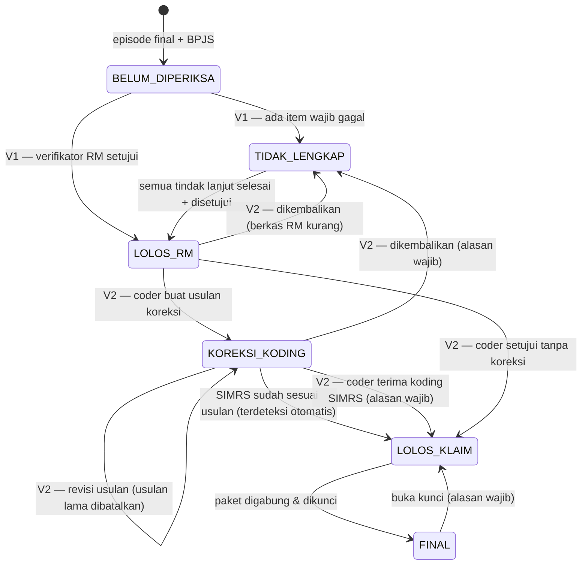

# PRD & Rencana Bertahap — **Verifikasi Klaim BPJS**

## Tab baru di modul Berkas & Klaim: Verifikasi RM → Verifikasi Klaim (Coder) → Paket Klaim Final

**Project:** ReportHub (`reporthubrsb`) · Workspace **Berkas & Klaim** (`berkas-klaim`)
**Organisasi:** UPTD RSUD Bolaang Mongondow Timur
**Versi:** 1.0 — keputusan §11 disetujui mengikuti rekomendasi (matriks §5.1 tetap menunggu pengesahan Casemix)
**Tanggal:** 29 September 2026 · **Status:** Stage V0–V3 selesai (§8) — 1 Oktober 2026
**Sifat data SIMGOS:** **FULL READ-ONLY.** Hanya `SELECT` / `information_schema`. Tidak ada DDL/DML, tidak menambah/mengubah tabel apa pun di SIMGOS. Semua status verifikasi, koreksi, lampiran, dan paket disimpan di DB aplikasi `reporthub`.

---

## 1. Latar Belakang & Tujuan

Berkas klaim BPJS saat ini dicek manual: petugas membuka detail berkas satu per satu, lalu menghubungi ruangan bila ada yang kurang. Tidak ada jejak siapa memeriksa apa, tidak ada antrean kerja per tahap, dan koreksi koding (mis. diagnosa primer tertukar dengan sekunder) tidak terlacak.

Alur yang diminta:

1. **Verifikasi Pertama — Kelengkapan Berkas RM.** Berkas diperiksa kelengkapannya dari rekam medis. Bila **tidak lengkap → kirim notifikasi** ke pihak yang harus melengkapi.
2. **Verifikasi Kedua — Verifikator Klaim BPJS / Coder.** Hanya berkas yang lolos tahap 1. Coder menyesuaikan koding (mis. diagnosa primer ↔ sekunder, kode ICD). Perubahan harus **tertaut ke Rekam Medis/SIMRS**.
3. **Tahap Final — Tarikan Data.** Berkas yang final dan lolos verifikasi bisa **langsung dicetak**, dengan opsi **menggabungkan (merge) seluruh dokumen klaim**, **menyisipkan dokumen tambahan**, lalu **menggabung ulang**.

Tujuan terukur:

- Satu **antrean kerja** per tahap dengan hitungan yang jelas (berapa belum diperiksa, menunggu ruangan, menunggu koreksi SIMRS, siap final).
- **Deteksi otomatis** kekurangan berkas dari data SIMGOS (bukan centang manual semata).
- **Tindak lanjut tertarget** ke DPJP / unit yang tepat, yang **tertutup otomatis** saat data di SIMRS sudah dilengkapi.
- **Jejak audit lengkap**: siapa memverifikasi, kapan, apa yang dikoreksi, versi paket mana yang dicetak.

---

## 2. Batasan Utama: SIMGOS Read-Only vs "koreksi diagnosa tersambung ke SIMRS"

Permintaan tahap 2 menyebut koreksi coder "akan connect ke SIMRS untuk perubahan diagnosa". Aplikasi ini **tidak boleh menulis ke SIMGOS** (kebijakan HIGH ALERT). Rancangan yang memenuhi keduanya:

| Langkah | Siapa | Di mana |
| --- | --- | --- |
| 1. Coder menyusun **usulan koreksi** (urutan primer/sekunder, ganti/tambah/hapus kode) | Coder | Aplikasi ini (disimpan di `reporthub`) |
| 2. Aplikasi membuat **tindak lanjut** ke petugas RM/DPJP berisi daftar perubahan yang persis | Otomatis | Aplikasi ini |
| 3. Petugas RM/DPJP **menerapkan perubahan di SIMRS** | Petugas RM/DPJP | SIMRS (aplikasi SIMGOS) |
| 4. Aplikasi **membandingkan ulang** diagnosa SIMGOS dengan usulan → status **"Sudah diterapkan di SIMRS"** otomatis, lengkap dengan **siapa & kapan** mengubah (dari log SIMGOS) | Otomatis (read-only) | Aplikasi ini |

Jadi "tersambung" = **tertaut dan terverifikasi otomatis**, bukan ditulis langsung. Bukti bahwa ini bisa dilacak: log SIMGOS mencatat perubahan diagnosa (`logs.pengguna_akses_log`, OBJEK 21003, 77 update dalam 30 hari terakhir).

> Bila kelak RS mengizinkan penulisan lewat **API resmi SIMGOS** (bukan akses DB langsung), langkah 3 bisa diotomatiskan. Itu di luar cakupan PRD ini.

---

## 3. Temuan Penelusuran SIMGOS (29 Sep 2026, read-only)

### 3.1. Fitur bawaan SIMGOS yang ada tetapi tidak dipakai

| Objek SIMGOS | Isi | Status pemakaian | Sikap kita |
| --- | --- | --- | --- |
| `berkas_klaim.kelengkapan` | 1 baris per NOPEN, `STATUS` 1=Belum Lengkap / 2=Lengkap, `DOKUMEN_VERIF` (JSON) | 3.999 baris, **semua STATUS=1, JSON null** (60 hari: 1.119/1.119 dibuat otomatis, 0 lengkap) | Tidak dipakai sebagai sumber; status verifikasi dikelola di `reporthub` |
| `berkas_klaim.kelengkapan_komentar` | Utas komentar per NOPEN | 0 baris | Tidak dipakai |
| `berkas_klaim.berkas` / `berkas_detil` | Paket berkas per penjamin per bulan | 2 / 4 baris (uji coba) | Tidak dipakai |
| `inacbg.hasil_grouping`, `grouping`, `klaim_status` | Hasil grouper INA-CBG | **0 baris** — grouping dilakukan di luar SIMRS (aplikasi E-Klaim) | Tidak ada tarif INA-CBG yang bisa dibaca; di luar cakupan |
| `laporan.request_report` | Log permintaan cetak | `REQUEST_DATA` **terenkripsi** | Nama report tak bisa dibaca dari log; tetap dipetakan manual (DevTools) |

### 3.2. Sumber data per pemeriksaan (semua terverifikasi ada & terindeks)

| Pemeriksaan | Tabel SIMGOS | Kunci | Catatan |
| --- | --- | --- | --- |
| Episode & jenis layanan | `pendaftaran.pendaftaran` + `kunjungan` + `master.ruangan` | `NOPEN`, `JENIS_KUNJUNGAN` 1=RJ 2=IGD 3=RI | Final = semua leg punya `KELUAR` |
| Penjamin | `pendaftaran.penjamin` | `NOPEN`, `JENIS` 2=BPJS | |
| SEP | `bpjs.kunjungan` via NIK → `bpjs.peserta` | noKartu + tglSEP | Sudah dipakai modul; ada versi batch |
| Diagnosa ICD-10 | `medicalrecord.diagnosa` | `NOPEN` | `UTAMA` 1=primer 2=sekunder; baris duplikat umum → hitung **kode berbeda** |
| Prosedur ICD-9-CM | `medicalrecord.prosedur` | `NOPEN` | 100% kode terpetakan ke ICD-9-CM 2010 IM |
| Resume medis | `medicalrecord.resume` | `NOPEN` | |
| CPPT | `medicalrecord.cppt` | `KUNJUNGAN` → NOPEN | |
| Verifikasi CPPT oleh DPJP | `medicalrecord.verifikasi_cppt` | `KUNJUNGAN` | |
| Triase (IGD) | `medicalrecord.triage` | `NOPEN` | ⚠️ `STATUS` 1=belum final, **2=final** (lihat §3.4) |
| SPRI (RI dari IGD) | `medicalrecord.perencanaan_rawat_inap` | `PENDAFTARAN_RI_NOMOR` (terindeks) | Juga penaut NOPEN IGD → NOPEN RI |
| Pasien pulang | `layanan.pasien_pulang` | `NOPEN` | `CARA` (REF 45), `KEADAAN` (REF 46) |
| Hasil lab/radiologi final | `layanan.status_hasil_pemeriksaan` → `tindakan_medis` → `kunjungan` | `STATUS_HASIL` 3=Final (REF 208); `JENIS` 8=Lab, 7=Rad (REF 74) | |
| Tagihan | `pembayaran.tagihan` | `ID` = NOPEN | |
| Master ICD (INA-CBG) | `master.mrconso` `SAB='ICD_10_2010_IM'` / `'ICD_9CM_2010_IM'` | `CODE` (terindeks) | Punya `VALIDCODE`, `ACCPDX` (boleh jadi diagnosa utama), `ASTERISK`; 331/332 kode yang dipakai tercakup |
| Dokumen PDF tersimpan SIMRS | `document-storage.document` | `REFERENCE_ID` = nomor kunjungan | Hasil Lab PK 7.530 PDF, Resep 7.894, Radiologi 177 |
| Akses ruangan petugas | `aplikasi.pengguna_akses_ruangan` | `PENGGUNA`, `RUANGAN` | 205 pengguna × 65 ruangan — dasar sasaran notifikasi unit |
| DPJP | `pendaftaran.kunjungan.DPJP` → `master.dokter.NIP` | NIP | 31/31 dokter punya NIP → cocokkan ke `users.nip` |

### 3.3. Baseline masalah nyata — episode **BPJS final**, 30 hari (30 Agu–29 Sep 2026)

Total **510 episode** (RI 177 · IGD 229 · RJ 104). Dari 229 IGD, **182 lanjut Rawat Inap** (NOPEN berbeda, tertaut SPRI) → klaimnya menyatu ke klaim RI.

| Temuan | Jumlah | Tahap |
| --- | ---: | --- |
| RI tanpa resume medis | **108 / 177** | V1 |
| RI dengan CPPT belum diverifikasi DPJP | **103 / 177** | V1 |
| Tanpa diagnosa ICD-10 sama sekali | **97** (RJ 69 · RI 28 · IGD 5) | V1 |
| Hasil laboratorium belum final | 45 | V1 |
| RI tanpa SPRI | 21 | V1 |
| Tanpa SEP terdeteksi | 14 | V1 |
| IGD tanpa triase | 6 | V1 |
| Hasil radiologi belum final | 3 | V1 |
| Tanpa tagihan | 1 | V1 |
| Kode sama tercatat primer **dan** sekunder | 3 | V2 |
| Diagnosa primer ganda (kode berbeda) | 2 | V2 |
| Kode diagnosa kosong | 2 | V2 |
| Kode "header" tak valid untuk klaim (mis. `R10`, 90 hari) | 3 baris | V2 |

Angka-angka ini adalah dasar uji penerimaan tiap stage: hasil aplikasi harus sama dengan hitungan SQL independen.

#### 3.3.1. Hasil Stage V0 — definisi final antrean (tervalidasi 29 Sep 2026)

Definisi baseline di atas masih kasar (per tanggal **daftar**, IGD dihitung sendiri, SEP tanpa cek jenis pelayanan). Antrean aplikasi memakai definisi final:
- **Tanggal pulang** (KELUAR leg klinis terakhir) dalam rentang, semua leg sudah KELUAR, penjamin terakhir BPJS.
- **IGD yang ber-SPRI ke pendaftaran RI yang sah digabung** ke episode RI.
- **SEP harus sesuai jenis pelayanan** (RI = 1, IGD/RJ = 2).
- **Hasil penunjang** dari leg yang dibatalkan diabaikan.

Periode 30 Agu–29 Sep 2026 (31 hari): **359 episode klaim** (RI 194 · IGD 54 · RJ 111), **180 episode IGD digabung** ke RI. **67 berkas lengkap otomatis.** Jumlah berkas yang gagal per aturan wajib:

| Aturan | Gagal | Catatan |
| --- | ---: | --- |
| `bukti` Bukti Pelayanan (RI wajib) | 191 | Baru 3 dari 194 RI mengisi Bukti Pelayanan di aplikasi → **perlu keputusan Casemix (W atau O)** |
| `resume` Resume medis (RI) | 120 | |
| `verif-cppt` CPPT belum pernah diverifikasi DPJP (RI) | 114 | Verifikasi sebagian = peringatan (lihat §5.1) |
| `diagnosa` Tanpa diagnosa / tanpa primer | 101 | |
| `sep` SEP (jenis sesuai) tidak ditemukan | 26 | |
| `spri` RI tanpa SPRI | 23 | |
| `penunjang` Hasil lab/rad belum final | 18 | |
| `triase` Triase kosong (IGD / IGD asal RI) | 6 | |
| `cppt` CPPT kosong | 1 | |
| `tagihan` Tanpa tagihan | 1 | |

Validasi: **359/359 episode identik per aturan** dengan SQL SIMGOS independen (formulasi berbeda: EXISTS/NOT EXISTS). Jumlah digabung, nomor SEP terpilih, dan hitungan "lengkap otomatis" juga identik. Komputasi 31 hari **256–432 ms**, dan permintaan berikutnya dilayani dari cache (35–50 ms).

### 3.4. Bug yang ditemukan di modul yang sudah ada

Detail berkas (`berkas-klaim.dal.ts` → `queryBerkasDetail`) menghitung triase dengan `t.STATUS = 1`. Padahal di SIMGOS `STATUS` 1 = belum final dan **2 = sudah final** (4.023 dari 4.028 baris). Akibatnya **223 episode IGD (30 hari) tampil "Triase belum diinput" padahal ada**. ✅ Diperbaiki di Stage V0 (`STATUS <> 0`).

### 3.5. Performa (uji nyata, koneksi tunggal)

| Query | Waktu |
| --- | ---: |
| Daftar episode 30 hari (620 NOPEN, agregat leg + penjamin) | 24 ms |
| **Seluruh cek kelengkapan 510 NOPEN** (10 query batch, `IN (…)` per 500 NOPEN, dijalankan berurutan) | **351 ms** |
| Cari ICD per prefiks kode (`CODE LIKE 'E11%'`) | 2 ms |
| Cari ICD per teks (LIKE / FULLTEXT) | 324–444 ms → **perlu cache di memori** (lihat §7) |

---

## 4. Alur Kerja & Status

Satuan kerja = **satu episode klaim (NOPEN)**. Episode IGD yang lanjut RI **digabung** ke episode RI (tidak muncul sebagai klaim sendiri; dokumennya ikut paket RI).



| Status | Arti | Pemilik |
| --- | --- | --- |
| `BELUM_DIPERIKSA` | Episode final masuk antrean | Verifikator RM |
| `TIDAK_LENGKAP` | Ada item wajib gagal; tindak lanjut terkirim | Unit/DPJP penerima tindak lanjut |
| `LOLOS_RM` | Kelengkapan disetujui | Verifikator Klaim / Coder |
| `KOREKSI_KODING` | Usulan koreksi menunggu diterapkan di SIMRS | Petugas RM/DPJP |
| `LOLOS_KLAIM` | Koding disetujui, siap paket | Petugas paket klaim |
| `FINAL` | Paket digabung, terkunci, siap cetak/kirim | — |

Aturan transisi:

- Hanya transisi di diagram yang diizinkan (divalidasi di server, bukan hanya UI).
- **Optimistic locking** (`versi`) mencegah dua verifikator menimpa keputusan satu sama lain.
- Setiap transisi tercatat di riwayat (siapa, kapan, dari→ke, catatan) + `writeAudit`.
- Hasil cek otomatis **selalu dihitung ulang dari SIMGOS** saat berkas dibuka / "Cek ulang"; snapshot terakhir disimpan untuk daftar & bukti.

---

## 5. Katalog Pemeriksaan (sumber tunggal di kode)

Pemeriksaan didefinisikan sebagai **katalog aturan** (pola sama dengan katalog RBAC): setiap aturan = `{ key, tahap, label, berlakuUntuk (RI/IGD/RJ), wajib, penanggungJawab, evaluasi(snapshot) }`. Menambah aturan = menambah satu entri, tanpa migrasi DB. Fungsi evaluasi murni (tanpa I/O) → mudah diuji.

### 5.1. Tahap 1 — Kelengkapan Berkas RM (otomatis dari SIMGOS)

| Kode | Pemeriksaan | RI | IGD | RJ | Penanggung jawab |
| --- | --- | :-: | :-: | :-: | --- |
| `sep` | SEP terbit & jenis pelayanan sesuai | W | W | W | Admisi / Pendaftaran |
| `diagnosa` | Minimal 1 diagnosa ICD-10 + ada diagnosa primer | W | W | W | DPJP |
| `resume` | Resume medis terisi | W | – | O | DPJP |
| `cppt` | CPPT ada | W | W | O | Perawat ruangan |
| `verif-cppt` | CPPT diverifikasi DPJP (sebagian → peringatan) | W | – | – | DPJP |
| `triase` | Triase terisi (STATUS 1/2) | W¹ | W | – | IGD |
| `spri` | SPRI (Surat Perintah Rawat Inap) ada | W | – | – | IGD / Admisi |
| `pulang` | Data pasien pulang (cara & keadaan) | W | O | – | Perawat ruangan |
| `penunjang` | Semua hasil lab/radiologi berstatus Final | W* | W* | W* | Laboratorium / Radiologi |
| `tagihan` | Tagihan ada | W | W | W | Kasir |
| `bukti` | Bukti Pelayanan (isian aplikasi) | W | O | O | Kepala ruangan |

W = wajib, O = opsional (ditampilkan, tak memblokir), – = tidak berlaku, * = hanya bila ada order penunjang.
¹ RI: hanya bila masuk lewat IGD — yang dicek triase **IGD asal** (ikut paket klaim RI).
`verif-cppt`: CPPT yang ditulis setelah `BATAS_TANGGAL` verifikasi terakhir dihitung "belum terverifikasi". Bila belum pernah diverifikasi sama sekali → **gagal**. Bila sebagian → **peringatan** (data 30 hari: 127 leg RI tanpa verifikasi, 66 sebagian, 16 penuh).
**Matriks ini perlu disahkan Casemix/Komite RM (keputusan §11-4).** Perubahan W/O cukup satu baris di `verifikasi.rules.ts`.

Ditambah **cek manual** oleh verifikator (daftar dapat dikonfigurasi), mis. "Tanda tangan DPJP di resume", "Identitas di semua lembar sesuai".

### 5.2. Tahap 2 — Koding & Klaim (otomatis + keputusan coder)

| Kode | Pemeriksaan | Dasar data |
| --- | --- | --- |
| `pdx-tunggal` | Tepat satu diagnosa primer (dihitung per **kode berbeda**) | `diagnosa.UTAMA` |
| `pdx-boleh` | Kode primer boleh jadi diagnosa utama (`ACCPDX='Y'`) | `mrconso ICD_10_2010_IM` |
| `kode-valid` | Semua kode valid untuk klaim (`VALIDCODE='1'`, bukan kode header) | `mrconso ICD_10_2010_IM` |
| `pdx-asterisk` | Kode asterisk (*) tidak dijadikan primer | `mrconso.ASTERISK` |
| `dx-konflik` | Kode yang sama tidak tercatat primer & sekunder sekaligus | `diagnosa` |
| `px-valid` | Prosedur ICD-9-CM valid | `mrconso ICD_9CM_2010_IM` |
| `px-operasi` | Ada tindakan bedah tapi prosedur ICD-9-CM kosong (peringatan) | `tindakan_medis` + `prosedur` |
| `sep-jenis` | Jenis pelayanan SEP (RI/RJ) sesuai episode | `bpjs.kunjungan.jenisPelayanan` |

Catatan penerapan (Stage V2, diverifikasi 1 Okt 2026):
- **Koding klaim** = baris aktif bertanda `INACBG = 1`, digabung **per kode**. SIMGOS sering mencatat diagnosa **kembar** (`INA_GROUPER` 0 dan 1; 188 NOPEN berisi keduanya, 183 identik). Kode yang tercatat utama di satu baris dan sekunder di baris lain ditangkap `dx-konflik`.
- **Prosedur** ber-`INACBG = 0` tidak ikut klaim. Set kodenya berbeda dari yang ber-`INACBG = 1`, jadi ditampilkan sebagai "tanpa tanda INA-CBG".
- Aturan tambahan `dx-kosong` (baris diagnosa tanpa kode, baseline §3.3). `px-operasi` memakai `master.tindakan.JENIS = 2` (Prosedur Bedah, REF 74), karena Ruang OK tidak dipakai dalam 31 hari.
- `sep-jenis` menjelaskan SEP berjenis lain bila SEP yang cocok tidak ada.
- **Usulan coder wajib lolos** `pdx-tunggal`, `dx-konflik`, `dx-kosong`, `kode-valid`, `pdx-asterisk`, `pdx-boleh`, `px-valid` (kode header / tak dikenal / utama terlarang ditolak server).
- **Diagnosa sekunder tidak punya urutan di SIMRS**, jadi yang bermakna hanya utama vs sekunder. Editor memakai pilihan Utama/Sekunder, bukan seret urutan.

---

## 6. Rancangan UI/UX

### 6.1. Navigasi

Workspace **Berkas & Klaim** mendapat item baru:

| Item | Rute | Untuk |
| --- | --- | --- |
| Berkas Klaim RM (sudah ada) | `/berkas-klaim/rm` | Lihat & cetak per dokumen |
| **Verifikasi Klaim** (baru) | `/berkas-klaim/verifikasi` | Verifikator RM, Coder, Petugas paket |
| **Tindak Lanjut Berkas** (baru) | `/berkas-klaim/tindak-lanjut` | DPJP & unit yang harus melengkapi |

Plus **lonceng notifikasi** di Topbar (global, jumlah belum dibaca).

### 6.2. Halaman Verifikasi Klaim — antrean kerja

- **Pita tahap (pipeline)** di atas, bisa diklik sebagai filter, masing-masing dengan jumlah:
  Belum Diperiksa · Tidak Lengkap · Lolos RM · Koreksi Koding · Siap Final · Final.
- **Filter satu baris:** rentang tanggal pulang (maks 31 hari), jenis layanan (RI/IGD/RJ), ruangan, pencarian nama/No.RM/SEP, penjamin (default **BPJS**).
- **Daftar** per episode: nama + No.RM, SEP, jenis layanan & ruang, tanggal pulang & lama rawat, **meter kelengkapan** (mis. 9/11, segmen berwarna + angka), chip masalah teratas, tahap saat ini, penanggung jawab & umur antrean.
- **Aksi massal (Tahap 1):** setujui sekaligus semua berkas yang **lengkap otomatis** (tetap tercatat per berkas).
- **Navigasi keyboard:** ↑/↓ pindah berkas, Enter buka, `L` loloskan, `K` kembalikan.

### 6.3. Ruang Kerja Berkas (panel samping di layar lebar, halaman penuh di HP)

Tab di dalam ruang kerja:

1. **Kelengkapan** — checklist otomatis (✓/✕ + alasan + tautan pratinjau dokumen) dan cek manual. Tombol **Cek ulang dari SIMRS**, **Loloskan**, **Tandai tidak lengkap** (memilih item → otomatis membuat tindak lanjut ke penanggung jawab).
2. **Koding** (Tahap 2) — dua kolom: *Di SIMRS sekarang* vs *Usulan coder*. Diagnosa bisa diseret untuk mengubah urutan, radio untuk menetapkan primer, cari ICD instan (kode/teks), peringatan aturan INA-CBG langsung di baris. Setelah disimpan: status **Menunggu SIMRS** → **Sudah diterapkan** otomatis, dengan bukti "diubah oleh X pada Y" dari log SIMGOS.
3. **Paket Klaim** (Tahap final) — daftar komponen berurut (SEP, Resume, SPRI, Triase, CPPT, Hasil Lab/Rad, Resume Pulang, Bukti Pelayanan, Rincian Tagihan, **Sisipan**), bisa diseret; tiap komponen berpratinjau & bisa dinonaktifkan. **Unggah sisipan** (PDF/JPG/PNG, seret-lepas) ke posisi mana pun → **Gabungkan** → pratinjau PDF gabungan → **Cetak / Unduh** → **Kunci FINAL**.
4. **Riwayat** — linimasa transisi, koreksi, tindak lanjut, versi paket (dengan hash).

### 6.4. Tindak Lanjut Berkas (untuk DPJP & unit)

- Daftar item yang harus dilengkapi **milik saya** (sebagai DPJP) atau **ruangan saya**: pasien, item, sejak kapan, siapa yang meminta, catatan verifikator.
- Tombol **Cek ulang** → bila data di SIMRS sudah ada, item **tertutup otomatis**; tak perlu menandai manual.
- Status berkas kembali ke antrean verifikator setelah semua item selesai.

### 6.5. Prinsip UX

- Status tak pernah hanya warna: selalu ikon + teks.
- Semua daftar berpaginasi server; skeleton saat memuat; pesan kosong yang menjelaskan langkah berikutnya.
- Konfirmasi hanya untuk aksi tak terbalik (kunci FINAL, hapus sisipan).
- Responsif sampai 390 px; token warna "Cord" yang sudah ada.

---

## 7. Arsitektur, Optimasi Query & Anti-Overload

### 7.1. Struktur kode (clean, berlapis, mudah dikembangkan)

```
src/server/modules/verifikasi-klaim/
  verifikasi.constants.ts   // status, transisi, label (aman untuk client)
  verifikasi.types.ts       // Episode/Fakta/Snapshot/HasilCek/Antrean (aman untuk client)
  verifikasi.rules.ts       // katalog aturan + evaluasi MURNI (tanpa I/O) → unit-testable
  verifikasi.dal.ts         // SATU-SATUNYA pemakai getSimgos(): query batch read-only
  verifikasi.repo.ts        // akses Prisma reporthub (status, riwayat, koreksi)
  verifikasi.service.ts     // orkestrasi: episode → snapshot → evaluasi → gabung status
  verifikasi.schema.ts      // Zod input/filter
  koding.rules.ts           // katalog Tahap 2 + logika usulan/langkah (MURNI, aman client)
  koding.dal.ts             // baris koding, master ICD, jejak log (read-only)
  koding.service.ts         // keputusan coder (ajukan/revisi, loloskan klaim, kembalikan)
  koding.sinkron.ts         // deteksi "sudah diterapkan di SIMRS" + bukti log
  icd.cache.ts              // cache ICD-10/9 IM per kode & per pencarian (24 jam)
  paket.dal.ts              // sumber parameter komponen (leg CPPT, SPRI, resume) — 1 query read-only
  paket.sources.ts          // registri komponen paket (strategy: kumpulkan(fakta) → komponen + payload report)
  paket.susunan.ts          // susunan bawaan, selaraskan, "berubah sejak digabung" (MURNI, aman client)
  paket.berkas.ts           // sisipan: magic bytes, sanitasi nama, PDF/gambar → halaman (EXIF)
  paket.repo.ts             // klaim_lampiran / klaim_paket (Prisma)
  paket.service.ts          // gabung PDF (pdf-lib) + sisipan + versi/hash + kunci/buka kunci
src/server/lib/storage.ts        // penyimpanan berkas di disk (STORAGE_DIR, path aman, tulis atomik)
src/server/modules/notifikasi/   // generik, bisa dipakai modul lain
src/features/verifikasi-klaim/   // UI
```

Lapisan tetap: schema → dal → service → route (`withPermission` + `ok`/`fail`) → client → view. Menambah dokumen paket = menambah satu entri registri; menambah pemeriksaan = satu entri katalog.

### 7.2. Optimasi query SIMGOS

1. **Satu query episode** per rentang (indeks `pendaftaran.TANGGAL`) + agregat leg & penjamin.
2. **Cek kelengkapan batch**: ±10 query `GROUP BY NOPEN` dengan `WHERE NOPEN IN (…)` per **500 NOPEN**, **dijalankan berurutan** (tidak paralel) pada koneksi singleton → maks 1 koneksi SIMGOS per permintaan daftar. Semua memakai kolom terindeks (terverifikasi §3.2).
3. **`MAX_EXECUTION_TIME`** pada setiap query; rentang dibatasi **31 hari**.
4. **Cache hasil daftar 60 detik** per (rentang, filter) + tombol Muat ulang; status reporthub digabung di memori (1 query `IN`).
5. **Detail satu berkas**: query per-NOPEN ringan (sudah ada di modul).
6. **ICD**: ~~daftar kode dimuat sekali ke memori~~.
   - **Diukur V2:** master IM ternyata 40.807 kode ICD-10 + 5.469 ICD-9-CM (122 ribu baris). Memuat semuanya butuh **6–9 detik**, sehingga cache diisi **sesuai kebutuhan**:
     - info per kode lewat `CODE IN (…)` (200 kode ≈ 70 ms);
     - pencarian lewat index: awalan kode `CODE LIKE` (±50 ms) atau FULLTEXT `STR` (55–225 ms).
   - Keduanya di-cache 24 jam (single-flight, maks 2 pencarian bersamaan). Pencarian berulang ±30 ms.
7. **Deteksi sinkron koding**: hanya membandingkan diagnosa/prosedur NOPEN yang berstatus `KOREKSI_KODING` (sedikit), bukan seluruh daftar.

### 7.3. Paket PDF tanpa overload

- **Antrean penggabungan** dengan konkurensi 1–2; komponen dari report engine SIMGOS diambil **berurutan** dengan timeout 30 detik per komponen.
- Batas: sisipan maks **10 MB/berkas**, **20 sisipan**, paket maks **300 halaman**.
- Hasil gabung di-cache berdasarkan **hash manifest** (urutan + versi komponen); cetak ulang tanpa perubahan tak menggabung ulang.
- Paket FINAL disimpan satu versi per NOPEN (versi lama diganti, hash tercatat di riwayat).

Diukur V3 (1 Okt 2026):
- Report engine 0,6–1,5 dtk per komponen; paket RI 4–5 komponen digabung dalam 3–5 dtk.
- "Hash manifest" = **sidik susunan**: urutan + parameter report tiap komponen + SHA-256 sisipan. Susunan sama → paket draf dipakai ulang (±0,1 dtk), kecuali pengguna meminta **gabung ulang dari SIMRS**. Cetak/unduh selalu melayani PDF tersimpan.
- Body unggahan melewati `src/proxy.ts`, yang memotong body **diam-diam** di 10 MB. Karena itu `experimental.proxyClientMaxBodySize` dinaikkan ke 12 MB (sisipan 10 MB + overhead multipart).

### 7.4. Model data baru (DB `reporthub`, DDL manual — bukan `prisma db push`)

| Tabel | Isi utama |
| --- | --- |
| `klaim_verifikasi` | 1 baris per NOPEN: identitas ringkas, kategori, SEP, `status`, `versi`, snapshot hasil cek terakhir (JSON), pelaku & waktu tiap tahap |
| `klaim_verifikasi_riwayat` | Linimasa transisi (dari, ke, aksi, catatan, pelaku, waktu) |
| `klaim_tindak_lanjut` | Item kurang per NOPEN: kode aturan, sasaran (NIP DPJP / ruangan / peran), status `OPEN`/`SELESAI`, waktu selesai (otomatis) |
| `klaim_koreksi_koding` | Usulan coder (JSON), snapshot SIMGOS saat usulan dibuat, status `MENUNGGU_SIMRS`/`SESUAI`/`BATAL`, waktu terdeteksi sesuai |
| `klaim_lampiran` | Sisipan: nama, MIME, ukuran, SHA-256, lokasi berkas, urutan, pengunggah, dihapus-lunak |
| `klaim_paket` | Manifest urutan komponen, hash, jumlah halaman, lokasi PDF final, versi |
| `notifikasi` + `notifikasi_baca` | Notifikasi (sasaran pengguna/NIP/ruangan/peran, tautan, referensi) + status baca per pengguna |

### 7.5. Sasaran notifikasi (sesuai data SIMGOS)

- **DPJP**: `kunjungan.DPJP → master.dokter.NIP` dicocokkan dengan `users.nip` (31/31 dokter ber-NIP).
- **Unit/ruangan**: pengguna aplikasi yang login dengan akun SIMGOS dipetakan ke ruangan lewat `aplikasi.pengguna_akses_ruangan` (read-only). Pengguna lokal tanpa tautan SIMGOS menerima berdasarkan **peran**.
- Saluran tahap awal: **dalam aplikasi** (lonceng + halaman Tindak Lanjut). WhatsApp/SMS di luar cakupan (butuh gateway).

### 7.6. Keamanan & RBAC

Modul RBAC baru (katalog di kode, tanpa migrasi):

| Kunci | Aksi | Untuk |
| --- | --- | --- |
| `berkas-klaim.verifikasi-rm` | view, update | Verifikator RM (Tahap 1) |
| `berkas-klaim.verifikasi-klaim` | view, update | Verifikator Klaim / Coder (Tahap 2) |
| `berkas-klaim.paket` | view, create, print | Petugas paket (unggah sisipan, gabung, cetak, kunci) |
| `berkas-klaim.tindak-lanjut` | view, update | DPJP & unit |

- Validasi Zod di semua input; unggahan dicek **tanda tangan berkas (magic bytes)**, bukan hanya ekstensi; nama berkas disanitasi; disimpan di luar folder publik, dilayani lewat route berizin.
- Tak ada PHI di metadata audit selain NOPEN.
- Semua query SIMGOS `SELECT` saja; tidak ada nama tabel/kolom dari input pengguna.

---

## 8. Rencana Bertahap

Metode per stage: **petakan → eksekusi → validasi E2E (dicocokkan dengan SQL SIMGOS independen) → laporan → user commit**.

### Stage V0 — Fondasi ✅ (29 Sep 2026)

- DDL tabel §7.4 (skrip migrasi `scripts/db/`, idempoten), Prisma model + generate.
- `verifikasi.dal.ts` batch + `verifikasi.rules.ts` (katalog Tahap 1) + evaluasi murni.
- Katalog RBAC + item navigasi (halaman kerangka).
- **Perbaikan bug triase** (`STATUS <> 0`) di detail berkas yang ada.
- Validasi: hasil evaluasi 30 hari = baseline §3.3 (hitungan SQL independen), performa ≤ 1 detik untuk 31 hari.

**Hasil V0:**

Kode:
- `scripts/db/verifikasi-klaim.sql` + `migrate-verifikasi-klaim.mjs`. File `.sql` adalah sumber tunggal; runner hanya mengizinkan `CREATE TABLE IF NOT EXISTS`.
- 8 model Prisma.
- `src/server/modules/verifikasi-klaim/`:
  - `constants`: status, transisi, penanggung jawab, batas.
  - `types`, `rules` (katalog murni), `dal` (batch read-only), `repo`, `schema`, `service`.
- Helper umum `src/server/lib/ttl-cache.ts` (cache TTL dengan single-flight) dan `limiter.ts` (semaphore).

API:
- `GET /api/berkas-klaim/verifikasi` — antrean + ringkasan + filter di memori + paginasi.
- `GET /api/berkas-klaim/verifikasi/[nopen]` — cek segar per episode. IGD yang digabung mengembalikan `digabungKe`.

RBAC:
- 4 modul baru.
- `requireAnyModule` / `authorizeAny`.
- Item navigasi dengan `anyOf`.
- Guard `berkas-klaim` dipindah ke `berkas-klaim/rm/layout.tsx`, supaya halaman verifikasi tidak ikut mensyaratkan modul Berkas Klaim RM.

Validasi E2E 49/49 + UI 10/10:
- Kecocokan per aturan untuk semua episode (§3.3.1).
- Cache dan single-flight: 5 permintaan bersamaan menghasilkan 1 komputasi.
- Filter, detail, validasi input (rentang > 31 hari ditolak), RBAC any-of.
- Bug triase: IGD 30 hari yang terdeteksi bertriase naik dari 0 menjadi 235.
- DAL tanpa kata kunci tulis.
- V0 tidak menulis `klaim_verifikasi`.
- Drift model ↔ tabel: 8/8 cocok.
- UI 1440 px & 390 px tanpa scroll horizontal dan tanpa error JS.

### Stage V1 — Verifikasi Pertama ✅ (30 Sep 2026)

- Antrean + pita tahap + filter + meter kelengkapan + aksi massal.
- Ruang kerja tab **Kelengkapan** + keputusan Loloskan / Tidak Lengkap (transisi terkunci, riwayat, audit).
- **Tindak lanjut** otomatis ke penanggung jawab + **notifikasi** (lonceng) + halaman **Tindak Lanjut Berkas** + penutupan otomatis saat data SIMRS lengkap.

**Hasil V1:**

Kode:
- `verifikasi-klaim/`: `keputusan.service` (keputusan Tahap 1 + loloskan massal), `tindak-lanjut.service` (daftar & tutup manual), `tindak-lanjut.sinkron` (rekonsiliasi), `verifikasi.sasaran` (penentu sasaran). Katalog aturan ditambah cek manual, pembentuk item tindak lanjut & predikat "terpenuhi" (murni).
- Modul generik `notifikasi/` (penerima = pengguna / NIP / akses ruangan SIMGOS / peran) + lonceng di Topbar.
- API: `POST …/verifikasi/[nopen]/keputusan`, `POST …/verifikasi/massal`, `GET …/tindak-lanjut`, `POST …/tindak-lanjut/[id]/selesai`, `GET /api/notifikasi`, `POST /api/notifikasi/baca`. Detail berkas kini memuat cek manual, tindak lanjut, riwayat & izin.
- UI: antrean kerja (filter satu baris, pita tahap, chip masalah, ↑/↓/Enter), ruang kerja (tab Kelengkapan & Riwayat, pintasan L/K, `?nopen=`), halaman Tindak Lanjut Berkas, modal loloskan massal.

Keputusan desain V1:
- **Cek manual** verifikator: `manual-ttd` (tanda tangan DPJP) & `manual-identitas`. Meloloskan berkas yang masih punya aturan wajib gagal, cek manual yang belum "Sesuai", atau tindak lanjut terbuka **wajib disertai alasan** (≥ 10 karakter); tindak lanjut terbuka lalu **dibatalkan** dan riwayat mencatat `override`. Ini jalan keluar selama matriks §5.1 (mis. `bukti`) belum disahkan Casemix.
- **Sasaran tindak lanjut:** DPJP → NIP DPJP · perawat/kepala ruang → ruang leg terakhir · triase/SPRI → ruang IGD (tanpa IGD → peran `admisi`) · hasil penunjang → **unit Laboratorium / Radiologi** (hasil belum final tercatat di ruang pemesan, bukan di unit penunjang; item dipecah `penunjang-lab` / `penunjang-rad`) · SEP → peran `admisi` · tagihan → peran `kasir`. Cadangan: ruang episode → peran `admisi`.
- **Penutupan otomatis** = rekonsiliasi idempoten saat detail berkas dibuka, antrean dihitung segar, dan halaman Tindak Lanjut dimuat. Item terakhir selesai → notifikasi "siap diperiksa ulang" ke verifikator pembuatnya. Item cek manual hanya ditutup manual (penerima atau verifikator).
- **Loloskan massal** mewajibkan pernyataan cek manual sudah diperiksa, mengecek ulang tiap berkas secara segar, maks 200 berkas per proses.

Validasi E2E 59/59 + UI 17/17:
- Sasaran tiap item = SQL SIMGOS independen (NIP DPJP, ruang, unit lab/rad, peran).
- Notifikasi hanya sampai ke penerimanya; tandai dibaca hanya untuk notifikasi milik sendiri.
- Transisi ilegal 409, versi lama 409, dua keputusan bersamaan → tepat satu berhasil tanpa tulisan ganda (transaksi).
- Tiga jalur penutupan otomatis (detail, halaman Tindak Lanjut, antrean segar) + idempoten.
- RBAC per aksi (lihat-saja 403), validasi input (422), audit tanpa PHI selain NOPEN.
- DAL SIMGOS tanpa kata kunci tulis dan tanpa kolom `PASSWORD`; seluruh data uji terhapus (0 baris tersisa).
- UI 1440 px & 390 px tanpa scroll horizontal, tanpa error JS.

Catatan operasional: peran `kasir` belum ada di aplikasi — item Tagihan tetap tercatat (tampil di lingkup "Semua" verifikator) sampai peran itu dibuat. DPJP / unit butuh izin **Tindak Lanjut Berkas**; notifikasi DPJP memerlukan NIP di data pengguna, notifikasi ruangan memerlukan login dengan akun SIMGOS.

### Stage V2 — Verifikasi Kedua (Coder) ✅ (1 Okt 2026)

- Cache ICD + pencarian; aturan Tahap 2.
- Tab **Koding**: editor usulan (utama/sekunder, tambah/hapus kode) + peringatan aturan.
- Tindak lanjut koreksi ke RM/DPJP; **deteksi otomatis "sudah diterapkan di SIMRS"** + bukti dari log SIMGOS.
- Kembalikan ke Tahap 1; Loloskan klaim.

**Hasil V2:**

Kode (`verifikasi-klaim/`):
- `koding.rules` (murni, dipakai server & UI):
  - katalog 9 aturan Tahap 2 lewat runner katalog yang sama dengan Tahap 1;
  - set koding klaim dan usulan awal;
  - langkah perubahan (`hitungPerubahan`), progres per langkah, validasi usulan.
- `koding.dal`: satu query `UNION ALL` untuk diagnosa + prosedur + tindakan bedah per batch; lookup/cari ICD; jejak bukti.
- `icd.cache`, `koding.sinkron` (deteksi & bukti), `koding.service` (keputusan coder).
- Snapshot kini memuat koding SIMRS + SEP berjenis lain. Antrean & detail menghitung aturan Tahap 2 untuk semua berkas.

API:
- `GET /api/berkas-klaim/koding/icd?jenis=10|9&q=`.
- `POST /api/berkas-klaim/koding/[nopen]/keputusan` (`AJUKAN_KOREKSI` / `LOLOSKAN_KLAIM` / `KEMBALIKAN_KE_RM`).
- Detail berkas memuat `cekKoding`, info ICD, riwayat usulan & izin Tahap 2.
- Antrean menerima `masalah=<aturan Tahap 2>` & `koding=bersih`.

UI:
- Tab **Koding**:
  - tabel per kode *Di SIMRS sekarang* vs *Usulan coder*;
  - pencari ICD (kode/nama, keyboard);
  - peringatan aturan langsung & ringkasan langkah;
  - banner "Menunggu diterapkan di SIMRS" dengan progres per langkah, banner "Sudah diterapkan" dengan jejak log.
- Tab bawaan mengikuti tahap berkas.
- Antrean: chip masalah **Koding**, filter "Koding sesuai aturan", kolom Masalah mengikuti tahap. Coder tanpa izin RM langsung ke "Lolos RM".
- Halaman Tindak Lanjut menampilkan langkah koreksi sebagai daftar dan kini terbuka juga untuk coder.

Keputusan desain V2:
- **Usulan tidak ditulis ke SIMGOS.** Langkahnya dikirim sebagai tindak lanjut:
  - `koding-dx` → DPJP (NIP): 7/7 pengubah diagnosa di log 30 hari adalah dokter;
  - `koding-px` → ruang episode: prosedur diinput petugas non-dokter.
- **Deteksi "sudah diterapkan"** = koding SIMRS sekarang tidak berselisih lagi dengan usulan. Berkas lalu otomatis `LOLOS_KLAIM` (atas nama coder pembuat), tindak lanjut ditutup OTOMATIS, dan coder diberi notifikasi.
  - Jalur: detail berkas, antrean segar, halaman Tindak Lanjut. Idempoten & aman bersamaan (versi + `updateMany … MENUNGGU_SIMRS`).
- **Bukti siapa & kapan:**
  - Sumbernya log ubah `logs.pengguna_akses_log` (OBJEK 21003/21018, `REF` = ID baris) sejak jam dinding SIMGOS saat usulan dibuat (disimpan di `simrs_awal.waktu`), plus baris baru (`TANGGAL/OLEH`), karena SIMGOS tidak mencatat log pembuatan untuk tabel ini.
  - Hanya **nama kolom** yang berubah yang dibaca (`JSON_KEYS`), isi SEBELUM/SESUDAH tidak.
- **Revisi usulan** diizinkan saat `KOREKSI_KODING` (usulan lama & tindak lanjutnya BATAL).
- **Coder boleh meloloskan dari `KOREKSI_KODING`** dengan alasan wajib, sebagai jalan keluar bila DPJP mempertahankan kodingnya. Alasan juga wajib bila koding SIMRS masih melanggar aturan.
- **Kembalikan ke Tahap 1**: alasan wajib; verifikator RM yang meloloskan diberi notifikasi.

Validasi E2E 66/66 + UI 15/15:
- **363/363 episode (31 hari)**: hasil aturan Tahap 2 identik dengan SQL SIMGOS independen (formulasi berbeda). Temuan nyata:
  - `pdx-tunggal` 107 (sebagian besar RJ tanpa diagnosa);
  - `sep-jenis` 22;
  - `dx-kosong` 2;
  - `dx-konflik` 1;
  - `px-operasi` 0 dari 4 episode bedah.
- **Pencarian ICD** = SQL untuk awalan kode dan FULLTEXT; flag valid/ACCPDX/asterisk = master.
- **Validasi server** (422): kode header, kode tak dikenal, utama terlarang, dua utama, kode ganda, usulan tanpa perubahan / sama dengan yang menunggu.
- **Konflik & RBAC:** versi lama 409, dua revisi bersamaan → tepat satu berhasil, RBAC per aksi (403).
- **Sasaran tindak lanjut** = SQL (NIP DPJP, ruang episode).
- **Deteksi otomatis** lewat 3 jalur. Bukti (nama & jam perubahan terakhir, jumlah jejak) = SQL log SIMGOS independen. Idempoten, dan deteksi negatif saat SIMRS belum berubah.
- **Audit tanpa PHI:** tanpa kode ICD / nama pasien, hanya NOPEN & jumlah.
- **DAL** tanpa kata kunci tulis, tanpa PASSWORD / SEBELUM.
- **Data nyata** yang sudah ada tidak berubah (dipotret sebelum/sesudah). UI 1440 px & 390 px tanpa scroll horizontal, tanpa error JS.

Regresi: V1 E2E 58/59 dan UI 17/17. V0 E2E 42/49, rinciannya:
- **Sengaja berubah:** R5/R7 (coder kini boleh membuka Tindak Lanjut).
- **Usang:** R9 (kerangka V0) dan W2 (mengharapkan tabel kosong, padahal sudah ada data nyata).
- **Batas waktu era V0:** A2/A4/D7 dan V1-K3. Dari mesin pengembangan, RTT ke DB saat ini 40–55 ms dan tiap query lewat adapter Prisma ±150 ms. Porsi V1 saja ±2,1–2,4 dtk untuk 31 hari; V2 menambah 1 query SIMGOS.

Catatan operasional:
- Coder butuh peran dengan **Verifikasi Klaim / Coder (Tahap 2)** (lihat + ubah).
- DPJP butuh **Tindak Lanjut Berkas** + NIP agar menerima item koreksi diagnosa. Petugas ruang butuh login SIMGOS ber-akses ruang agar menerima item koreksi prosedur.
- Opsi `useTextProtocol` adapter mariadb berpotensi memangkas overhead per query di seluruh aplikasi, tetapi perlu uji regresi semua modul (di luar cakupan V2).

### Stage V3 — Paket Klaim (PDF dari SIMGOS + sisipan) ✅ (1 Okt 2026)

- Registri komponen; komponen report engine SIMGOS (SEP, Resume Medis, SPRI, CPPT + CPPT IGD).
- Unggah sisipan + urutan seret-lepas + gabung (pdf-lib) + pratinjau + cetak/unduh + kunci FINAL + versi/hash + buka kunci beralasan.

**Hasil V3:**

Kode (`verifikasi-klaim/`):
- `paket.dal` (satu query `UNION ALL`, read-only) dan `paket.sources`. Registri ini menghasilkan, per episode:
  - SEP: aturan pemilihan sama dengan snapshot;
  - Resume Medis: hanya bila resume terisi, karena report tetap mengeluarkan PDF kosong 2 halaman;
  - SPRI (RI);
  - **CPPT per leg**, termasuk leg IGD asal.
  Komponen yang tidak tersedia ikut ditampilkan beserta alasannya.
- `paket.berkas` (sisipan), `paket.susunan` (murni), `paket.repo`, `paket.service`.
- `server/lib/storage` (disk, `STORAGE_DIR`).
- Pembentuk payload report dipusatkan di `report.registry`, sehingga tidak ada duplikasi NAME/PARAMETER.
- Tidak ada tabel baru: `klaim_lampiran` & `klaim_paket` sudah dibuat sejak V0.

API (`/api/berkas-klaim/paket/[nopen]`):
- `GET` — komponen, sisipan, paket terakhir & izin.
- `POST lampiran` (multipart) dan `GET`/`DELETE lampiran/[id]`.
- `GET komponen/[key]` — pratinjau PDF segar.
- `POST gabung`.
- `GET pdf?mode=lihat|cetak|unduh`.
- `POST keputusan` (`KUNCI_FINAL` / `BUKA_KUNCI`).

Antrean membawa ringkasan paket. Viewer `/print/paket/[nopen]` (iframe) dipakai untuk pratinjau komponen, sisipan, dan cetak.

UI — tab **Paket Klaim** (bawaan untuk status Siap Final/Final):
- Susunan paket: seret-lepas plus tombol naik/turun (keyboard & HP), centang ikut/tidak, pratinjau per dokumen, rentang halaman per butir.
- Unggah seret-lepas atau pilih berkas, dengan keterangan.
- Gabungkan, lalu pratinjau PDF di panel.
- Cetak & Unduh.
- Kunci FINAL (konfirmasi menampilkan versi, halaman & SHA-256).
- Buka kunci (coder, modal alasan).
- Riwayat menampilkan versi paket + SHA-256 dan sisipan.
- Petugas paket tanpa izin RM/coder langsung membuka antrean "Siap Final".

Keputusan desain V3:
- **CPPT per leg.** Report `CetakCatatanMedik` hanya mencetak leg `PKUNJUNGAN`. Diuji: pasien pindah ruang, leg A 1 halaman + leg B 4 halaman. Satu komponen per leg memastikan paket tidak kurang. Cetak tunggal di Berkas Klaim RM tidak diubah.
- **Komponen gagal → penggabungan gagal (503) dengan nama komponennya.** Paket tidak pernah diam-diam kurang. Pengguna mencoba lagi atau mengeluarkan komponen itu secara sadar.
- **Sisipan:**
  - Jenis berkas ditentukan dari magic bytes (PDF/PNG/JPEG); ekstensi diabaikan.
  - PDF berkata sandi ditolak.
  - Berkas disimpan beralamat isi (`klaim/<nopen>/lampiran/<sha256>.<ext>`); nama asli hanya disimpan sebagai tampilan setelah disanitasi.
  - Maks 10 MB per berkas & 20 sisipan aktif.
  - Hapus bersifat lunak; berkas fisik disimpan.
  - Gambar menjadi satu halaman A4: lanskap bila gambar melebar, dan foto HP diputar sesuai EXIF orientasi.
- **Integritas:** setiap kali PDF paket dilayani, SHA-256-nya dicocokkan dengan DB. Bila berbeda → 500 + audit `klaim.paket.integritas-gagal`.
- **Cetak/unduh** tercatat di audit secara fail-closed: versi & hash paket mana yang dicetak (PRD §1). Pratinjau tidak dicatat.
- **Kunci FINAL** hanya untuk paket draf yang dipratinjau (versi paket dicocokkan) dan semua sisipan di dalamnya masih aktif.
- **Buka kunci** (coder, alasan wajib) mengembalikan paket ke DRAF tanpa menggabung ulang, dan pengunci diberi notifikasi.
- **Konkurensi:** maks 2 penggabungan per proses; satu penggabungan per berkas (yang kedua 409); tulisan paket per berkas diserialkan dengan `SELECT … FOR UPDATE` pada `klaim_verifikasi`.
- **Penyimpanan:** folder host `./storage` (di samping `docker-compose.yml`) di-mount ke `/app/storage`; harus dimiliki UID 1001 (`nextjs`). Lokal: `./storage` (di-gitignore). *(Semula named volume `reporthubrsb-storage`; diganti folder biasa agar bisa dibuka & di-backup langsung — dipakai bersama foto barang Inventaris.)*

Validasi E2E 47/47 + UI 17/17:
- **Komponen = SQL SIMGOS independen** (formulasi berbeda) untuk 3 episode (RI + IGD asal, RI 2 leg CPPT, RJ): nomor SEP, SPRI, resume, dan jumlah catatan per leg CPPT; IGD asal diurutkan lebih dulu.
- **Sisipan:**
  - SHA-256 DB = berkas di disk;
  - ditolak 422: teks ber-ekstensi `.pdf`, EXE ber-ekstensi `.png`, kosong, PDF terenkripsi, 10 MB+1, 13 MB;
  - PDF tepat 10 MB (body > 10 MB) diterima utuh — batas proxy berlaku;
  - duplikat ditolak; nama disanitasi; batas 20; hapus-lunak; akses silang antar-NOPEN 404.
- **PDF gabungan:**
  - urutan halaman = manifest;
  - halaman per butir = PDF komponen yang ditarik terpisah;
  - sisipan tepat di posisi pilihan (halaman 300×300);
  - PNG → A4 lanskap; JPEG EXIF-6 → potret + rotasi −90°;
  - SHA-256 = DB = berkas.
- **Pakai ulang, segar & konkurensi:**
  - pakai ulang ±0,1 dtk vs gabung 3,5 dtk;
  - segar → versi baru & berkas lama diganti;
  - > 300 halaman 409;
  - dua gabung bersamaan → satu 409.
- **Kunci / buka kunci:**
  - kunci: versi paket lama / versi berkas usang 409, sisipan dalam paket terhapus 409;
  - saat FINAL, unggah / hapus / gabung 409;
  - buka kunci: petugas paket 403, alasan pendek 422; berhasil → DRAF dengan hash sama + notifikasi;
  - kunci ulang tanpa menggabung ulang.
- **Audit, RBAC & data:**
  - audit 8 jenis aksi tanpa nama pasien / nama berkas;
  - RBAC per aksi;
  - integritas: berkas diubah di disk → 500;
  - DAL tanpa kata kunci tulis; payload tanpa `DOCUMENT_STORAGE`;
  - storage & data uji terhapus; data nyata tidak berubah.
- **UI** 1440 px & 390 px tanpa scroll horizontal, tanpa error JS.

Regresi: V2 E2E 66/66 · UI 15/15, V1 E2E 59/59 · UI 17/17, drift 8/8. V0 E2E 45/49 — sisa 4 item usang yang sudah diketahui sejak V2 (R5/R7/R9/W2). Batas waktu A2/A4/D7/K3 kini lolos karena latensi DB turun.

Catatan operasional:
- Petugas paket butuh **Paket Klaim (Final)**: lihat, buat (susun/unggah/gabung/kunci), cetak (cetak/unduh).
- Buka kunci butuh **Verifikasi Klaim / Coder (ubah)**.
- Deploy: sekali di server `mkdir -p storage && sudo chown -R 1001:1001 storage`, lalu `docker compose up -d`. Tanpa migrasi DB. Bila sebelumnya sudah memakai volume `reporthubrsb-storage`, salin isinya dulu ke `./storage` (lihat komentar `docker-compose.yml`).
- Sisipan yang dihapus-lunak tetap di disk. Pembersihan terjadwal belum dibuat (kandidat V5).

### Stage V4 — Komponen tambahan

- Dokumen buatan aplikasi (Resume Pulang, Bukti Pelayanan, Rincian Tagihan, Form RM) sebagai PDF (butuh keputusan §11-7).
- Hasil lab/radiologi dari `document-storage` atau report SIMGOS (endpoint diverifikasi via DevTools SIMRS); Triase SIMGOS.

### Stage V5 — Dasbor & Laporan

- KPI: waktu tunggu per tahap, persentase lengkap pertama kali, masalah terbanyak per ruangan/DPJP, beban kerja verifikator; ekspor Excel/PDF (pakai model dokumen ekspor yang sudah ada).

---

## 9. Kriteria Penerimaan (ringkas)

- Tidak ada satu pun query tulis ke SIMGOS (diperiksa di review kode: DAL hanya `SELECT`).
- Hitungan antrean & temuan = hitungan SQL SIMGOS independen pada periode uji.
- Daftar 31 hari ≤ 1 detik di server produksi; tidak ada query tanpa indeks pada tabel besar.
- Transisi ilegal ditolak server (409); keputusan bersamaan ditolak (versi).
- Tindak lanjut tertutup otomatis setelah data SIMRS dilengkapi (diuji dengan episode nyata yang berubah).
- PDF gabungan: urutan sesuai manifest, jumlah halaman = jumlah komponen, sisipan pada posisi yang dipilih.
- UI lolos di 1440 px & 390 px tanpa scroll horizontal, tanpa error JS; aksesibel dengan keyboard.

---

## 10. Risiko & Mitigasi

| Risiko | Mitigasi |
| --- | --- |
| Petugas mengira aplikasi mengubah SIMRS | Label eksplisit "Usulan — terapkan di SIMRS"; status "Menunggu SIMRS" sampai terdeteksi |
| Matriks dokumen wajib tidak cocok kebijakan RS | Katalog di kode + disahkan Casemix sebelum V1; aturan bisa wajib/opsional |
| Beban ke SIMGOS saat banyak verifikator | Batch berurutan, cache 60 dtk, batas 31 hari, `MAX_EXECUTION_TIME`, singleton koneksi |
| Report engine SIMGOS lambat/timeout saat gabung | Antrean konkurensi rendah, timeout per komponen, komponen gagal ditandai (paket tak diam-diam kurang) |
| Pengguna aplikasi tak tertaut ke akun SIMGOS → tak menerima notifikasi ruangan | Fallback sasaran berdasarkan peran; laporan "pengguna tanpa tautan" di Master |
| Ukuran penyimpanan sisipan | Batas ukuran, SHA-256 (dedup), hapus-lunak + pembersihan terjadwal |

---

## 11. Keputusan yang Dibutuhkan (dengan rekomendasi)

| # | Keputusan | Rekomendasi |
| --- | --- | --- |
| 1 | Koreksi diagnosa: tulis langsung ke SIMRS? | **Tidak** — usulan + deteksi otomatis (§2). Wajib karena SIMGOS read-only |
| 2 | Cakupan penjamin | **BPJS saja** di antrean default; filter untuk penjamin lain |
| 3 | Satuan klaim | **Per NOPEN**; IGD yang lanjut RI digabung ke episode RI |
| 4 | Matriks dokumen wajib §5.1 | Disahkan Casemix/Komite RM (boleh ubah W/O per jenis layanan) |
| 5 | Saluran notifikasi | **Dalam aplikasi** dulu (lonceng + Tindak Lanjut); WhatsApp menyusul bila ada gateway |
| 6 | Sasaran notifikasi | DPJP via **NIP**; unit via **akses ruangan SIMGOS**; fallback **peran** |
| 7 | Dokumen buatan aplikasi (HTML) ke PDF | **Chromium headless di container** (memakai ulang halaman cetak 1:1, image ±+200 MB) — alternatif: tulis ulang dengan pdf-lib (lebih lama, dua sumber tata letak) |
| 8 | Penyimpanan sisipan & paket | **Volume Docker** `/app/storage` (tambah di `docker-compose.yml`) + metadata di DB — lebih ringan daripada BLOB di MariaDB |
| 9 | Batas unggah | 10 MB/berkas, 20 sisipan, 300 halaman/paket |
| 10 | Buka kunci FINAL | Hanya `berkas-klaim.verifikasi-klaim`, alasan wajib, tercatat |
